# TaskFlow

Plataforma SaaS **multi-tenant** de gestão de projetos e tarefas, inspirada em Jira, Linear e ClickUp, construída como projeto de estudo avançado e portfólio. Usa Node.js 24 / Express 5, Angular 22, TypeScript 6, PostgreSQL com Prisma 7, Redis e BullMQ, num **modular monolith** com Clean Architecture e DDD pragmático.

> Projeto de portfólio tratado como produto real: cada funcionalidade nasce de uma spec aprovada, com regras de negócio numeradas, testes contra infraestrutura real e revisão de segurança. Todos os dados das telas são fictícios.

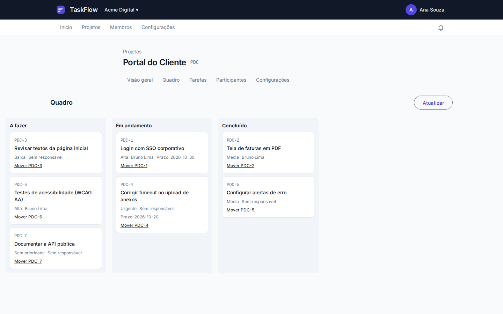

## O que o projeto demonstra

- **Multi-tenancy levado a sério.** As organizações compartilham o banco, e o `organizationId` do cliente é só intenção: o servidor resolve o tenant pela sessão e pela membership a cada requisição. Toda consulta filtra pela organização ativa, e recurso de outra organização responde `404`, nunca `403`.
- **Isolamento provado por harness.** Todas as rotas tenant-scoped são lidas da composição real e testadas contra a organização B: ids, cursores e menções de B nunca alcançam nada em A. O banco de B é comparado inteiro antes e depois. Quando a rota é pessoal, como as notificações, há também uma bateria entre usuários da mesma organização.
- **Autorização = RBAC + recurso.** Papéis da organização e do projeto, com teto (um viewer da organização nunca vira manager do projeto). Tudo é decidido no caso de uso, com o papel relido sob lock. A API devolve **capacidades** e a interface só esconde o que seria negado.
- **Concorrência sem surpresas.** Optimistic locking com `version` em tudo que é editável (`409` em conflito), ordem única de locks entre contextos e posição do Kanban por chave fracionária (sem reescrever a coluna a cada movimento).
- **Regras de negócio aplicadas pelo sistema.** São 34 regras numeradas (BR-001…BR-034), cada uma com teste que leva o ID no nome. Exemplos:
  - uma tarefa não conclui com subtarefa obrigatória pendente;
  - o último owner não sai da organização;
  - uma menção só vale para quem lê o projeto.
- **Eventos confiáveis.** Transactional Outbox gravada na mesma transação do fato, um único relay no worker, filas BullMQ com consumidores idempotentes e validados por Zod. É assim que saem os e-mails transacionais e as notificações de menção e atribuição.
- **Segurança em camadas:**
  - JWT curto e refresh token opaco e rotativo, com detecção de reuso;
  - cookies `HttpOnly` e CSRF por double-submit, sem tokens em `localStorage`;
  - Argon2id;
  - rate limiting por usuário e por IP;
  - logs com pseudonimização;
  - e-mails sem conteúdo de terceiros.
- **Limites de arquitetura verificados.** Contextos e camadas viram tags Nx, e o `@nx/enforce-module-boundaries` barra no lint qualquer import proibido. Lints próprios impedem um contexto de ler tabelas de outro.
- **Qualidade:**
  - 1.549 testes unitários (domínio, casos de uso com fakes, HTTP com Supertest, componentes Angular);
  - 272 testes de integração com PostgreSQL, Redis e Mailpit reais via Testcontainers;
  - 19 testes E2E Playwright contra o sistema real;
  - mutation testing manual em cada tarefa.

Desenvolvido com Claude Code e Context Engineering: veja [como](#context-engineering-e-desenvolvimento-assistido-por-ia).

## Arquitetura

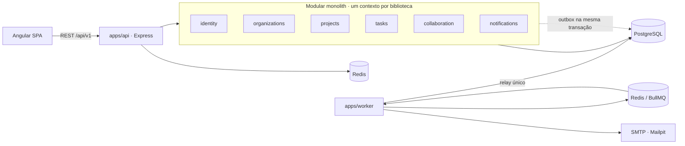

| Contexto        | Responsabilidade                                                                                                 |
| --------------- | ---------------------------------------------------------------------------------------------------------------- |
| `identity`      | Usuários, credenciais (Argon2id), login, refresh rotativo, sessões, verificação de e-mail e recuperação de senha |
| `organizations` | Organizações (tenant), memberships e papéis, convites por e-mail, organização ativa                              |
| `projects`      | Projetos com chave, participantes com teto de papel, workflow (status e transições), arquivamento                |
| `tasks`         | Tarefas e subtarefas, responsável, prioridade, prazo, dependências, cancelamento e o quadro Kanban               |
| `collaboration` | Comentários em texto simples, menções estruturadas, edição e moderação                                           |
| `notifications` | Notificações de menção e atribuição, contador do sino, resumo por e-mail e preferência                           |

| App           | Papel                                                                                                |
| ------------- | ---------------------------------------------------------------------------------------------------- |
| `apps/api`    | Composition root: monta os módulos, os adaptadores entre contextos e o Express (`:3333`)             |
| `apps/worker` | Relay da outbox, filas `emails` e `notifications`, resumo horário e limpeza diária (`:3334`, health) |
| `apps/web`    | SPA Angular standalone, zoneless e com Signals (`:4200`)                                             |

Cada contexto é dividido em bibliotecas por camada (`domain` → `application` → `infrastructure` / `http`), e um contexto nunca importa outro. Quando A precisa de B, A define uma porta e o composition root liga um adaptador. Detalhes em [visão geral](docs/architecture/overview.md), [bounded contexts](docs/architecture/bounded-contexts.md), [regras de dependência](docs/architecture/dependency-rules.md) e [fluxos de dados](docs/architecture/data-flow.md).

## Telas

| Projetos                                       | Tarefas com filtros                          |
| ---------------------------------------------- | -------------------------------------------- |
| 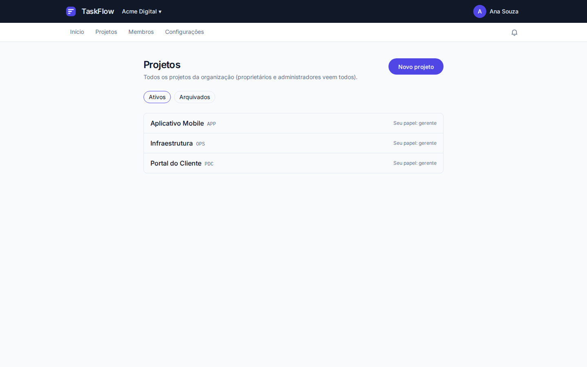 | 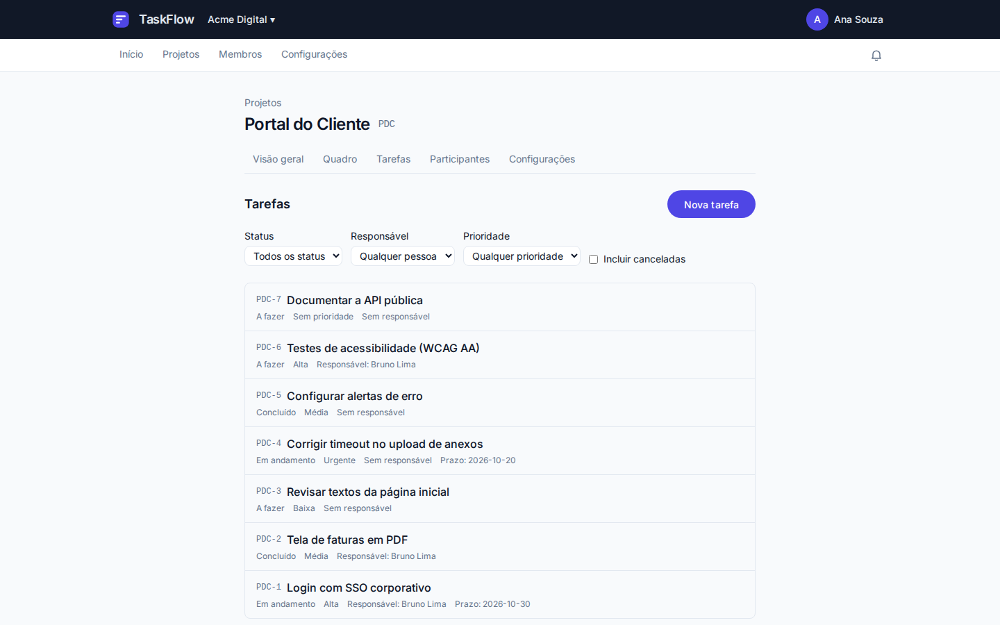 |

| Detalhe da tarefa                                 | Comentários com menção                           |
| ------------------------------------------------- | ------------------------------------------------ |
| 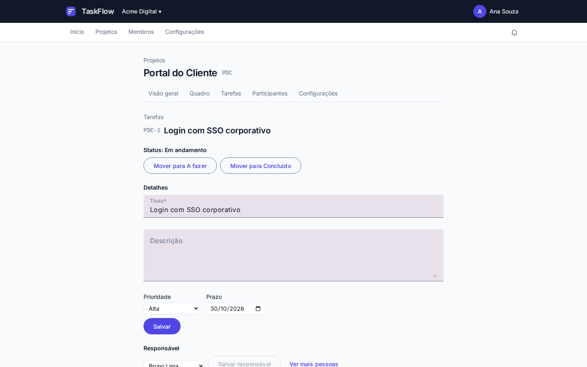 | 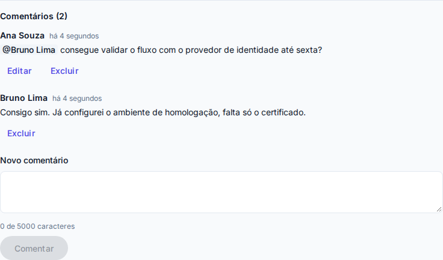 |

| Notificações e sino com contador               | Resumo por e-mail (sem conteúdo de terceiros)      |
| ---------------------------------------------- | -------------------------------------------------- |
| 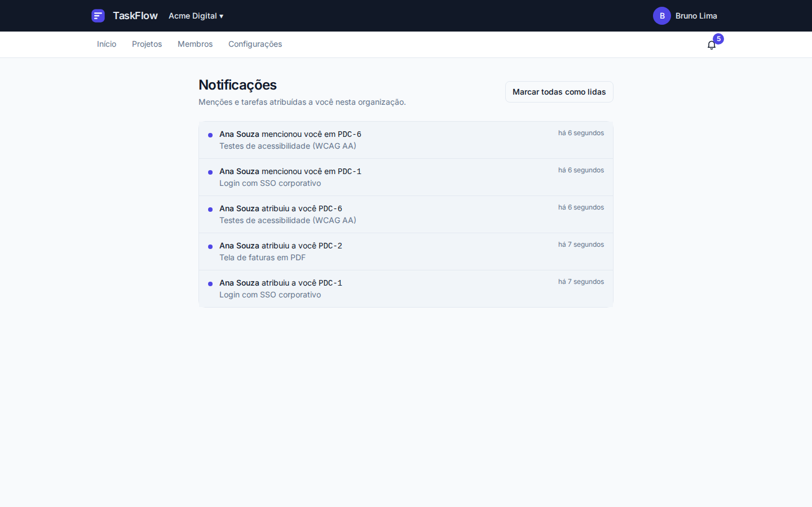 | 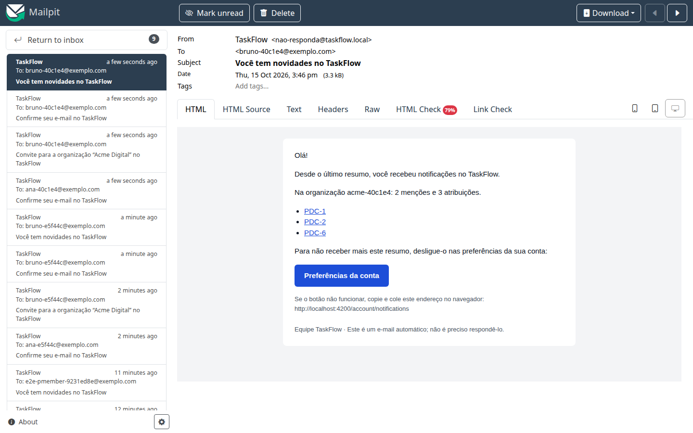 |

| Membros e convites                  | Preferência de notificações                                     |
| ----------------------------------- | --------------------------------------------------------------- |
| 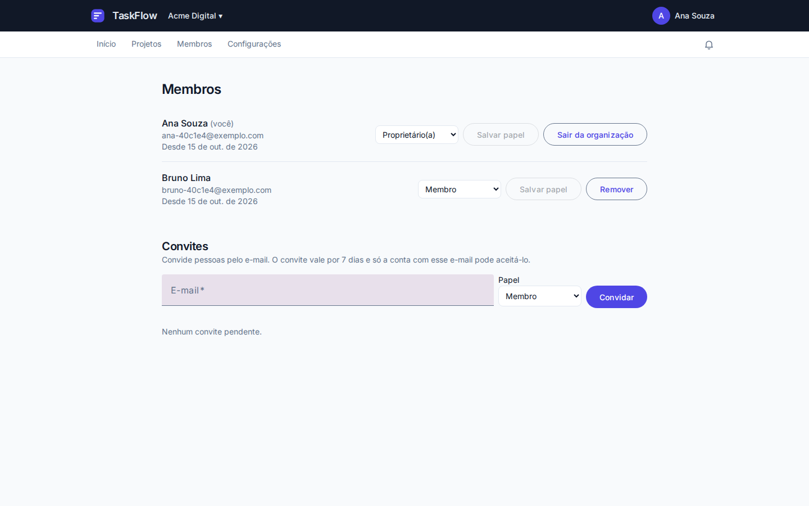 | 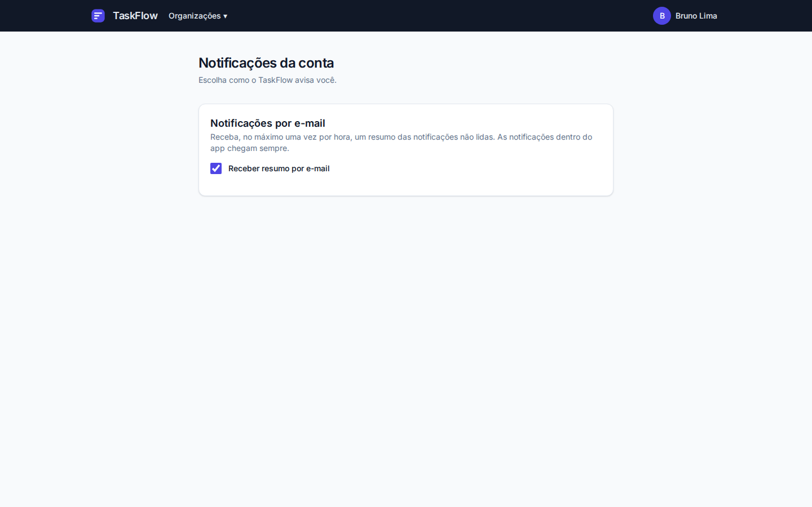 |

| Tema escuro                                          | Celular                                                          |
| ---------------------------------------------------- | ---------------------------------------------------------------- |
| 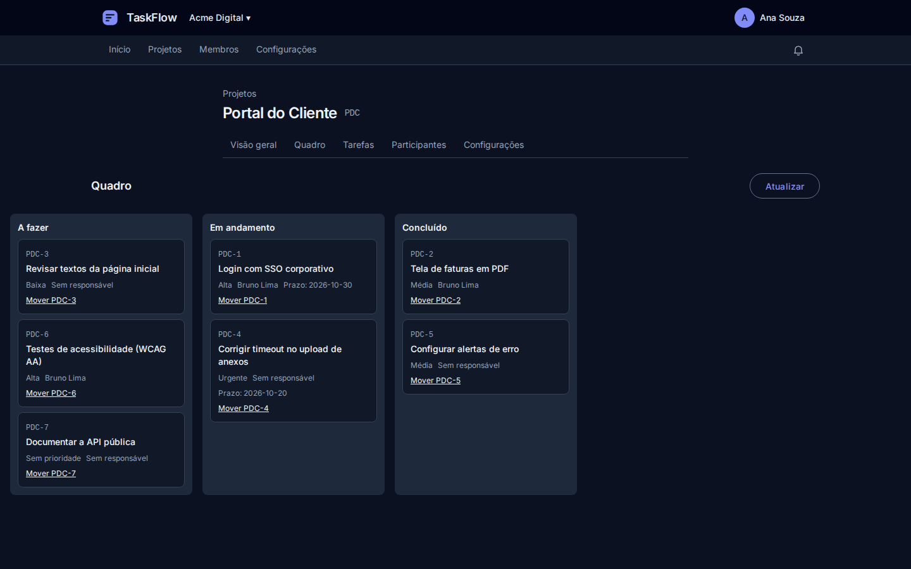 | 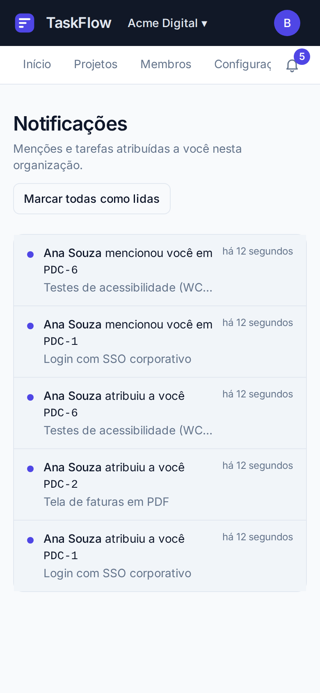 |

## Como executar

O guia completo, com todos os comandos, variáveis e problemas comuns, está em [docs/development/setup.md](docs/development/setup.md). Abaixo, o caminho mais curto do clone ao sistema funcionando.

### Pré-requisitos

| Ferramenta       | Versão           | Conferir                         |
| ---------------- | ---------------- | -------------------------------- |
| Node.js          | 24 LTS (≥ 24.15) | `node -v` (há `.nvmrc`)          |
| pnpm             | 11               | `pnpm -v` (ou `corepack enable`) |
| Docker + Compose | 24+ / v2         | `docker compose version`         |

Portas usadas: 55432 (PostgreSQL), 56379 (Redis), 51025 e 58025 (Mailpit SMTP e interface), 3333 (API), 3334 (health do worker), 4200 (web) e 8080 (stack completa em Docker). Todas só em `127.0.0.1`. Nenhum serviço pago é necessário.

### Opção A: tudo em Docker

```bash
git clone <url-do-repositório> taskflow && cd taskflow
cp .env.example .env
docker compose --profile app up --build -d
```

Sobem PostgreSQL, Redis, Mailpit, as migrations, a API, o worker e o web (Nginx com o build de produção). Abra <http://localhost:8080>. Os e-mails (confirmação, convites, resumo) chegam no Mailpit: <http://localhost:58025>.

### Opção B: desenvolvimento

#### 1. Dependências e variáveis locais

```bash
pnpm install
cp .env.example .env
```

Os valores `dev-only-…` do exemplo funcionam localmente e são recusados com `NODE_ENV=production`. Para gerar segredos próprios (mínimo de 32 bytes):

```bash
node -e "console.log(require('node:crypto').randomBytes(32).toString('base64url'))"
```

| Variável                                                 | Para quê                                                                               |
| -------------------------------------------------------- | -------------------------------------------------------------------------------------- |
| `AUTH_ACCESS_TOKEN_KEYS`, `AUTH_ACCESS_TOKEN_ACTIVE_KID` | Chaves de assinatura do access token (JSON `{"kid":"segredo"}`, com rotação por `kid`) |
| `CSRF_SECRET`                                            | Assinatura do token CSRF (double-submit)                                               |
| `LOG_PSEUDONYMIZATION_KEY`                               | Pseudonimização de e-mails e IPs nos logs                                              |
| `DATABASE_URL`, `REDIS_URL`, `SMTP_URL`                  | PostgreSQL, Redis e SMTP (Mailpit no desenvolvimento)                                  |
| `APP_URL`, `APP_ORIGIN`                                  | Links dos e-mails e origem aceita no CSRF                                              |

O `.env` nunca vai para o Git, e a API recusa o start listando as variáveis ausentes ou inválidas.

#### 2. Infraestrutura e banco

```bash
pnpm infra:up        # PostgreSQL 18, Redis 8 e Mailpit; espera todos ficarem healthy
pnpm db:generate     # Prisma Client
pnpm db:deploy       # aplica as migrations
```

#### 3. Subir API, worker e web

```bash
pnpm dev             # API :3333 · web :4200 · worker (health :3334)
```

#### 4. Testar pela interface

| Experimente             | Como                                                                                                               |
| ----------------------- | ------------------------------------------------------------------------------------------------------------------ |
| Criar conta             | <http://localhost:4200> → "Criar conta". Confirme pelo link que chega no Mailpit                                   |
| Criar a organização     | Depois de confirmar, crie a organização: você vira owner                                                           |
| Convidar alguém         | Membros → convide outro e-mail. O convite chega no Mailpit; cadastre a pessoa por ele em outra janela anônima      |
| Projeto e participantes | Projetos → Novo projeto (a chave é sugerida pelo nome) → Participantes                                             |
| Tarefas                 | Tarefas → Nova tarefa; no detalhe: responsável, prioridade, prazo, subtarefas obrigatórias e bloqueios             |
| Regra BR-001            | Tente concluir uma tarefa com subtarefa obrigatória pendente: a API recusa e cita a subtarefa                      |
| Kanban                  | Quadro → arraste os cards ou use "Mover PDC-1" pelo teclado. Em Configurações do projeto, crie status e transições |
| Menções e notificações  | Comente `@nome` numa tarefa. A pessoa mencionada vê o sino com o contador em até 60 s                              |
| Resumo por e-mail       | O worker envia de hora em hora um resumo das não lidas; desligue em "Notificações da conta"                        |
| Tema escuro e celular   | Siga o tema do sistema operacional; reduza a janela para ver o layout no celular                                   |

O access token vive em cookie `HttpOnly`, e a sessão sobrevive ao recarregar a página pelo refresh rotativo.

#### 5. Explorar a API

- Swagger UI (fora de produção): <http://localhost:3333/api/docs/>, com o documento em `/api/docs/openapi.json`. O OpenAPI 3.1 é gerado a partir dos schemas Zod dos contratos (`libs/contracts`), e testes validam o documento e conferem os endpoints de cada spec.
- Health: <http://localhost:3333/health/live> e <http://localhost:3333/health/ready> (PostgreSQL e Redis).
- Mailpit, com todos os e-mails enviados: <http://localhost:58025>.

#### 6. Parar

```bash
pnpm infra:down      # para os containers; os dados ficam nos volumes
```

### Testes automatizados

```bash
pnpm verify              # lint (inclui limites de arquitetura) + typecheck + testes + build
pnpm test:integration    # PostgreSQL, Redis e Mailpit reais via Testcontainers (Docker no ar)
pnpm e2e                 # Playwright contra API, worker e web reais
```

O E2E grava dados de verdade: rode contra um banco descartável. Veja [docs/development/testing.md](docs/development/testing.md).

### Problemas comuns

| Sintoma                          | Solução                                                                                             |
| -------------------------------- | --------------------------------------------------------------------------------------------------- |
| A API não sobe e lista variáveis | `.env` antigo: compare com o `.env.example` ou recrie com `cp .env.example .env`                    |
| Web sobe na porta 3333           | Há `PORT` no `.env`: remova a linha e use `API_PORT`                                                |
| Porta 55432/56379 ocupada        | Ajuste `POSTGRES_PORT`/`REDIS_PORT` no `.env` e as URLs correspondentes                             |
| `/health/ready` responde 503     | Confira `pnpm infra:ps`: os containers precisam estar `healthy`                                     |
| `ERR_PNPM_IGNORED_BUILDS`        | Dependência nova com script de instalação: avalie e libere em `allowBuilds` (`pnpm-workspace.yaml`) |
| `429` ao criar contas seguidas   | O cadastro tem limite de 5 por hora por IP                                                          |

## Stack

| Backend                                                                                                                                     | Frontend                                                                                                              | Infra e qualidade                                                                                                                            |
| ------------------------------------------------------------------------------------------------------------------------------------------- | --------------------------------------------------------------------------------------------------------------------- | -------------------------------------------------------------------------------------------------------------------------------------------- |
| Node.js 24, Express 5, TypeScript 6 (strict), Zod 4, Prisma 7, PostgreSQL 18, Redis 8, BullMQ, Pino, Argon2id, JWT, OpenAPI 3.1, Nodemailer | Angular 22 (standalone, zoneless, Signals), Angular Material/CDK, Tailwind CSS 4, design tokens com tema escuro, RxJS | Nx 23 + pnpm 11, Docker Compose, Vitest, Supertest, Testcontainers, Playwright, ESLint 10 com `enforce-module-boundaries`, Prettier, Mailpit |

Versões e justificativas: [ADR 0002](docs/architecture/adr/0002-stack-and-versions.md).

## Documentação

| Tema                | Documento                                                                                                                                                                                                                     |
| ------------------- | ----------------------------------------------------------------------------------------------------------------------------------------------------------------------------------------------------------------------------- |
| Produto             | [visão](docs/product/vision.md) · [roadmap](docs/product/roadmap.md) · [regras de negócio (BR-001…BR-034)](docs/product/business-rules.md)                                                                                    |
| Arquitetura         | [visão geral](docs/architecture/overview.md) · [bounded contexts](docs/architecture/bounded-contexts.md) · [regras de dependência](docs/architecture/dependency-rules.md) · [fluxos de dados](docs/architecture/data-flow.md) |
| Decisões (17 ADRs)  | [adr/](docs/architecture/adr/README.md)                                                                                                                                                                                       |
| Segurança           | [autenticação](docs/security/authentication.md) · [autorização](docs/security/authorization.md) · [multi-tenancy](docs/security/multi-tenancy.md)                                                                             |
| Desenvolvimento     | [setup](docs/development/setup.md) · [workflow](docs/development/workflow.md) · [testes](docs/development/testing.md) · [convenções](docs/development/conventions.md)                                                         |
| Interface           | [design system](docs/design-system.md)                                                                                                                                                                                        |
| Especificações      | [specs/](specs/README.md): requisitos, design, tarefas e aceitação de cada funcionalidade                                                                                                                                     |
| Context Engineering | [como agentes, skills e regras se organizam](docs/context-engineering.md)                                                                                                                                                     |

## Estrutura

```text
apps/api/        composition root do backend (Express): módulos, adaptadores entre contextos, OpenAPI
apps/worker/     relay da outbox, filas BullMQ (e-mails, notificações, resumo) e manutenção diária
apps/web/        SPA Angular: core (auth, organização ativa, layout) e features por domínio
apps/web-e2e/    jornadas Playwright contra o sistema real
libs/backend/    6 contextos × camadas (domain, application, infrastructure, http) + shared/*
libs/contracts/  contratos HTTP em Zod: fonte do OpenAPI e dos tipos do frontend
prisma/          schema multi-arquivo (um por contexto) e migrations
specs/           Spec-Driven Development: uma pasta por funcionalidade
docs/            produto, arquitetura, ADRs, segurança, desenvolvimento, design system
infra/           Dockerfiles da API, do worker e do web (Nginx)
.claude/         regras por caminho, skills e agentes especialistas (Context Engineering)
```

## Context Engineering e desenvolvimento assistido por IA

O projeto foi desenvolvido com **AI-assisted development** usando o [Claude Code](https://claude.com/claude-code) (Anthropic) como agente de programação, apoiado numa disciplina de **Context Engineering**. Em vez de pedidos soltos, o agente trabalha sobre um contexto projetado, versionado no repositório e carregado sob demanda: regras de arquitetura por caminho de arquivo, regras de negócio numeradas, decisões registradas em ADRs e um processo de especificação antes do código.

O modelo é **human-in-the-loop**. O autor definiu objetivo, escopo e restrições, respondeu a cada decisão de produto levantada nas specs, aprovou cada spec antes da implementação e fez os commits. O agente executou especificação, modelagem, código, testes, revisões e documentação dentro desses limites.

### Arquitetura de contexto

| Camada                                              | Artefato                                                     | Papel                                                                                                                                                                                                      |
| --------------------------------------------------- | ------------------------------------------------------------ | ---------------------------------------------------------------------------------------------------------------------------------------------------------------------------------------------------------- |
| Contexto persistente (_project memory_)             | [`CLAUDE.md`](CLAUDE.md)                                     | Regras sempre ativas: stack, arquitetura, convenção de idioma, segurança inegociável, Definição de Pronto e mapa de onde está cada coisa. Curto de propósito                                               |
| Regras por caminho                                  | 10 regras em [`.claude/rules/`](.claude/rules)               | `architecture`, `security`, `express`, `api-design`, `database`, `angular`, `typescript`, `testing`, `documentation` e `git-workflow`, carregadas quando o arquivo editado é daquela área                  |
| Conhecimento sob demanda (_progressive disclosure_) | 10 skills em [`.claude/skills/`](.claude/skills)             | Receitas: `create-feature`, `implement-spec`, `create-domain-module`, `create-api-endpoint`, `create-angular-feature`, `database-migration`, `write-tests`, `review-code`, `security-audit` e `create-adr` |
| Processo                                            | [Spec-Driven Development](specs/README.md)                   | `requirements` → `design` → `tasks` → `acceptance`. Funcionalidade relevante só começa com spec aprovada, e cada tarefa registra a evidência de execução no próprio `tasks.md`                             |
| Fonte de verdade do domínio                         | [regras de negócio](docs/product/business-rules.md) (BR-xxx) | Especificação rastreável: código, testes e revisões citam o ID da regra                                                                                                                                    |
| Registro de decisões                                | 17 [ADRs](docs/architecture/adr/README.md)                   | Decisões e alternativas descartadas, para que nenhuma sessão nova reabra o que já foi decidido. Uma decisão aprovada só muda por um ADR novo                                                               |

### Fluxo de trabalho (_agentic workflow_)

- **Spec antes de código.** Cada funcionalidade começa com perguntas de produto ao autor: para as notificações, foram 10 decisões, como canais, retenção e o que pode aparecer no e-mail. Depois vêm a revisão de arquitetura e de segurança do design e só então a aprovação.
- **Uma tarefa por vez**, cada uma com testes, mutation testing manual e o gate `nx affected -t lint typecheck test`. A evidência (comandos e contagens reais) fica registrada no `tasks.md`.
- **Guardrails:**
  - regras "nunca": sem `any`, sem casts inseguros, sem erro engolido, sem segredo versionado, sem decisão aprovada alterada em silêncio;
  - permissões da ferramenta: sem leitura do `.env`, sem comandos destrutivos, sem commit sem pedido.
- **Verification loop.** Nenhum teste é dado como aprovado sem ter sido executado. Cada spec fecha com `pnpm verify`, a suíte de integração completa e o E2E contra o sistema real. Cada mutante sobrevivente vira um teste novo.

### Multi-agent review

Mudanças passam por **agentes especialistas** ([`.claude/agents/`](.claude/agents)) com contexto isolado. Os revisores não editam: devolvem achados priorizados com arquivo e linha, que viram correção com teste ou risco aceito e documentado.

| Agent                                            | Escopo                                                                         |
| ------------------------------------------------ | ------------------------------------------------------------------------------ |
| `software-architect`                             | Fronteiras de contexto, regra de dependência, necessidade de ADR               |
| `security-reviewer`                              | Autenticação, autorização, isolamento entre tenants, exposição de dados, OWASP |
| `code-reviewer`                                  | Bugs, regressões, legibilidade, performance e cobertura                        |
| `qa-test-engineer`                               | Estratégia de testes orientada a risco, rastreabilidade BR ↔ teste             |
| `database-specialist`                            | Modelagem, migrations, índices, locks e multi-tenancy no PostgreSQL            |
| `node-express-specialist` / `angular-specialist` | Implementação e revisão por camada                                             |
| `ux-ui-specialist` / `devops-specialist`         | Design system e acessibilidade; Docker, Nx e pipeline                          |

Exemplos de defeitos encontrados por esse ciclo e corrigidos com teste:

- **Privacidade no e-mail:** o design do resumo previa o nome de quem mencionou no assunto, uma porta para phishing. A revisão de segurança barrou antes do código, e virou decisão de produto: assunto fixo, sem nomes, títulos nem texto.
- **Busca com curingas:** o `contains` do Prisma não escapa `%` e `_`, e a busca de pessoas para mencionar casaria nomes demais. O escape foi feito no repositório e um mutante prova que o teste pega a regressão.
- **Contador fora de ordem:** uma resposta atrasada do sino desfazia a baixa feita ao abrir uma notificação e anunciava ao leitor de tela um aumento que não existia.
- **Link quebrado:** o e-mail de resumo apontava para uma rota inexistente. A falha apareceu ao construir a tela da preferência.
- **Abuso:** as rotas de preferência não tinham limite de requisições. Isso foi apontado na auditoria de segurança.

O histórico por funcionalidade, com decisões, desvios e evidências, está em cada `specs/NNN-*/tasks.md`.

### Reprodutibilidade

O contexto é parte do repositório: abrir o projeto no Claude Code carrega automaticamente o `CLAUDE.md`, as regras, as skills e os agentes. Uma nova sessão parte das mesmas regras, decisões e estado, sem depender do histórico de conversas.
