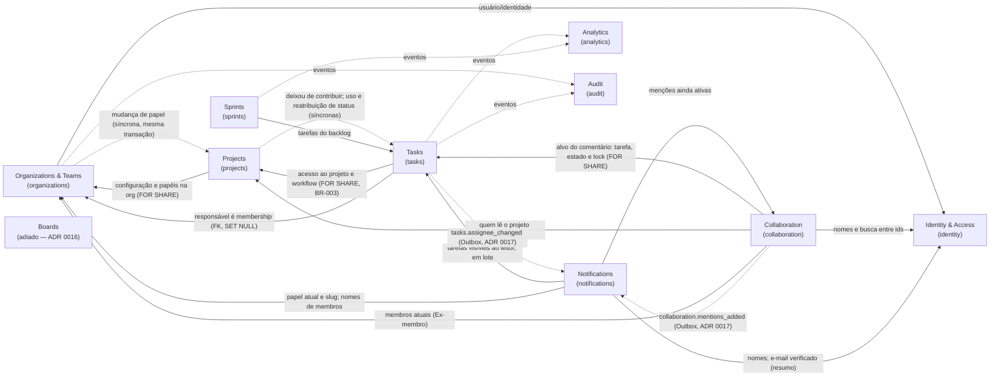

# Bounded contexts

Status: **Identity & Access** (spec 001), **Organizations** (spec 002), **Projects** (spec 003) e **Tasks** (specs 004 e 005, inclusive o quadro Kanban) e **Collaboration** (spec 010: comentários e menções) e **Notifications** (spec 008: notificações in-app e resumo por e-mail) **implementados**; **Boards adiado** ([ADR 0016](adr/0016-kanban-board-as-tasks-view.md)); os demais **planejados**. A coluna "Spec/Fase" indica quando cada um nasce.

## Mapa de contextos

Setas sólidas: dependência de consulta (via porta na `application` do consumidor, implementada no composition root). Setas tracejadas: reação a eventos publicados após commit. As setas `TSK/COL → NOT` existem (spec 008); as demais tracejadas (`ANA`, `AUD`) são planejadas.

## Contextos

| Contexto              | Nome técnico    | Responsabilidades                                                                                                                                                                                                                                                                                                                                                                        | Não é responsável por                            | Spec/Fase                 |
| --------------------- | --------------- | ---------------------------------------------------------------------------------------------------------------------------------------------------------------------------------------------------------------------------------------------------------------------------------------------------------------------------------------------------------------------------------------- | ------------------------------------------------ | ------------------------- |
| Identity & Access     | `identity`      | Usuários, credenciais (Argon2id), login/logout, refresh rotativo, recuperação de senha, sessões, resolução do contexto de autorização.                                                                                                                                                                                                                                                   | Papéis dentro de projetos; dados de organização. | 001 · F1                  |
| Organizations & Teams | `organizations` | Organizações (tenant), memberships e papéis organizacionais, convites, organização ativa (**implementado**, spec 002); equipes (planejado: spec que as usar).                                                                                                                                                                                                                            | Credenciais; projetos.                           | 002 · F1                  |
| Projects              | `projects`      | Projetos, chave (BR-025), workflow padrão (configuração na 005), participantes e papéis no projeto (BR-027), arquivamento (BR-026) (**implementado**, spec 003).                                                                                                                                                                                                                         | Tarefas e sua ordem.                             | 003 · F1                  |
| Tasks                 | `tasks`         | Tarefas e subtarefas (um nível), status pelo workflow (BR-004), prioridade, responsável, prazo, dependências, conclusão (BR-001, 003, 006, 008), número `CHAVE-N` (BR-028), cancelamento (BR-029) (**implementado**, spec 004); **quadro Kanban** como visão das tarefas — posição `board_rank`, leitura do quadro e movimento de cards (BR-009) (**implementado**, spec 005, ADR 0016). | Configuração do workflow; sprints.               | 004 · F1                  |
| Boards                | `boards`        | **Adiado** ([ADR 0016](adr/0016-kanban-board-as-tasks-view.md)): nasce quando o quadro tiver estado próprio (vários quadros por projeto, limites de WIP, raias, colunas que não são 1:1 com status). Hoje o quadro é uma visão de `tasks`.                                                                                                                                               | Regras de conclusão (de `tasks`).                | Adiado                    |
| Sprints               | `sprints`       | Backlog, planejamento, sprints, associação de tarefas, encerramento/reabertura (BR-005).                                                                                                                                                                                                                                                                                                 | Estado das tarefas.                              | 007 · F3                  |
| Collaboration         | `collaboration` | Comentários em tarefas e subtarefas (texto simples, BR-031), menções estruturadas (BR-032), edição e exclusão lógica com moderação (**implementado**, spec 010); histórico de discussão e reações: planejados.                                                                                                                                                                           | Entrega de notificações.                         | 010 · F2                  |
| Notifications         | `notifications` | Notificações pessoais de menção e atribuição (BR-033) registradas pelo worker a partir de eventos de integração; lista, contador e marcação de lidas; preferência e resumo por e-mail (BR-034); retenção de 90 dias (**implementado**, spec 008). Entrega em tempo real (Socket.IO): planejada.                                                                                          | Decidir _o que_ aconteceu (reage a eventos).     | 008 · F2                  |
| Analytics             | `analytics`     | Indicadores, produtividade, métricas de projetos e sprints (modelos de leitura).                                                                                                                                                                                                                                                                                                         | Escrever estado de outros contextos.             | 009 · F3                  |
| Audit                 | `audit`         | Registro imutável de alterações relevantes (BR-007), consulta administrativa.                                                                                                                                                                                                                                                                                                            | Regras de negócio dos contextos auditados.       | Transversal · consulta F3 |

## Decisões de fronteira

- **Membership vs. permissão** (ADR [0013](adr/0013-authorization-shared-kernel.md), spec 006): `organizations` guarda quem pertence a qual organização e com que papel; `projects` guarda as participações e seus papéis (spec 003). O **vocabulário** de autorização (catálogos, matrizes, papel efetivo com teto da organização — BR-023) é Shared Kernel em `libs/backend/shared/kernel`, sem estado; a **decisão** fica no caso de uso de cada contexto, que recebe os dados de outro contexto por portas (ex.: `projects` lê "membros podem criar projetos" e `tasks` lê o papel de projeto). `identity` não participa da autorização além de autenticar.
- **Quadro Kanban** (spec 005, [ADR 0016](adr/0016-kanban-board-as-tasks-view.md)): com um quadro por projeto e coluna = status, o quadro é uma **visão de `tasks`** — a posição do card é `tasks.board_rank` (chave fracionária, [ADR 0007](adr/0007-kanban-ordering.md)) e `MoveCard` muda status e posição numa transação de um só contexto (BR-010 sem exceção). O **workflow** (status e transições) continua em `projects`, que pede a `tasks` pela porta `WorkflowStatusUsage` (na sua `application`, ligada à fundação de `tasks`) para contar as tarefas de cada status e reatribuí-las ao remover um status. O contexto `boards` fica adiado até ter estado próprio.
- **Audit**: gravado na mesma transação da alteração (BR-007/010) por uma porta `AuditLog` implementada na infraestrutura de `audit`; a leitura pertence ao contexto `audit`.
- **Analytics**: lê de projeções próprias alimentadas por eventos; nunca consulta tabelas de outros contextos diretamente.
- **Tabelas**: cada contexto é dono das suas tabelas; outro contexto não lê nem escreve nelas via Prisma (apenas via portas).
- **`projects` × `organizations`** (spec 003): `projects` usa a porta `OrganizationAccess` (trava a organização `FOR SHARE` e relê configuração e papéis na mesma transação; lista membros para candidatos); `organizations` avisa toda mudança de papel pela porta `MembershipRoleChanges`, na sua linguagem, e `projects` decide (BR-027: rebaixado a viewer ⇒ participações viram viewer). Ordem única de locks: organização → projeto → participações. Seta pontilhada no mapa: reação **síncrona**, na transação de `organizations`, não evento pós-commit.

- **`tasks` × `projects`** (spec 004): `tasks` usa a porta `ProjectAccess` — `lockForContribution` trava o projeto `FOR SHARE` e as memberships das pessoas envolvidas `FOR SHARE` (por `organizations`) e devolve papéis efetivos e o workflow lido depois do lock; `resolveForRead` resolve a leitura numa consulta; `assignableUsers` lista quem pode ser responsável. **Quem deixou de contribuir** (papel efetivo fora de manager/member) é decidido **só em `projects`**, que avisa `tasks` pela porta `ProjectContributorChanges` (na linguagem de `projects`); `tasks` só executa a desatribuição (`RevokeAssignmentsOnAccessLoss`) na transação de quem originou. A cadeia é linear: `organizations → projects → tasks` (`MembershipRoleChanges` continua com um ouvinte só). A revogação **não tem evento próprio**: roda na transação de outro contexto, e o evento de quem originou é a evidência (ADR 0015, item 4).
- **Ordem única de locks das escritas de tarefa**: projeto (`projects`) `FOR SHARE` → memberships `FOR SHARE` → contador ou lock do projeto em `tasks` (`task_project_locks`) → **uma** linha de `tasks`; a linha da organização nunca é travada. **Invariante**: toda mudança de papel efetivo trava a membership (`organizations`) ou o projeto em `FOR NO KEY UPDATE` (`projects`), e nenhuma transação trava `projects` depois de travar uma membership — por isso as participações são lidas sem lock. O runner fixa READ COMMITTED e repete uma vez a transação em deadlock/serialização (`P2034`); persistindo, 409 `CONCURRENT_UPDATE`.
- **`collaboration` × `tasks`/`projects`/`organizations`/`identity`** (spec 010): uma porta só, `TaskDiscussionAccess`, na `application` de `collaboration`, que devolve **dados** (papéis efetivos, arquivado, cancelada ou `null`) — quem decide 404/403/estado é `collaboration`. O adaptador compõe `tasks` (`LockTaskForDiscussion`/`ResolveTaskForDiscussion`, no **módulo** de `tasks`), `projects` (`ListProjectReaderIds`) e `identity` (`SearchUsersAmong`, busca por nome/e-mail só entre os ids dados). Nomes exibidos só de membros atuais (`organizations` + `identity`; quem saiu é "Ex-membro"). Grafo sem ciclo: nenhum contexto anterior chama `collaboration`; ele é montado por último. Menções são tokens `<@id>` no texto e linhas em `comment_mentions` (sem FK para memberships: fato passado).
- **Comentários na ordem de locks** (spec 010): projeto `FOR SHARE` → memberships `FOR SHARE` (ator e menções **novas**) → [`task_project_locks` — nunca usado por comentários] → **uma** linha de `tasks` em `FOR SHARE` → **uma** linha de `comments`. **Invariante**: nenhuma transação trava `tasks` depois de travar `comments`, e comentários nunca escrevem em `tasks` (o `FOR SHARE` não é promovido); a exclusão da tarefa apaga a conversa por cascata.
- **`notifications` × produtores** (spec 008, [ADR 0017](adr/0017-outbox-for-cross-context-integration-events.md)): `tasks` e `collaboration` gravam **eventos de integração** (`tasks.assignee_changed`, `collaboration.mentions_added`, só ids, payload tipado na `application` do produtor) na Outbox, na mesma transação do fato. O worker valida o envelope com Zod (`satisfies` o tipo do produtor) e traduz para o fato de `notifications` numa camada anticorrupção no composition root; `notifications` nunca importa tipos dos produtores. Um único `OutboxRelay` roteia os tipos para as filas `emails` e `notifications`.
- **Leitura de `notifications`** (spec 008): a validade é decidida **na leitura**, nunca na gravação (D8). A porta `NotificationTargets` consulta `tasks` (`ResolveVisibleTasks`, que consulta `projects`) e `collaboration` (`ListActiveMentions`, amarrada à tarefa) em lote e **falha fechado**; `NotificationPeople` consulta `organizations` (papel atual, slug, membros) e `identity` (nomes, e-mail verificado). Grafo de consulta sem ciclo: `NOT → COL → TSK → PRJ → ORG → IAM`, mais `NOT → ORG` e `NOT → IAM`. Na API, `notifications` é o **último** módulo montado (nenhum depende dele); no worker, `notifications.module.ts` compõe os mesmos adaptadores **só de leitura**.
- **Remover ou sair da organização** desfaz as atribuições pelo banco (`ON DELETE SET NULL ("assignee_user_id")`), sem evento de `tasks` nem incremento de `version` (exceção a BR-008 registrada no design da spec 004).

## Exceções de integridade referencial entre contextos (ADR 0015)

FKs entre tabelas de contextos diferentes só sob os critérios do [ADR 0015](adr/0015-cross-context-referential-integrity.md). A back-relation exigida pelo Prisma no modelo fornecedor é inerte (barrada por lint em `organizations`).

| FK                                                                                                                               | Ação                                                                               | Spec | Motivo                                                                                                                                                                                                                                |
| -------------------------------------------------------------------------------------------------------------------------------- | ---------------------------------------------------------------------------------- | ---- | ------------------------------------------------------------------------------------------------------------------------------------------------------------------------------------------------------------------------------------- |
| `projects (organization_id) → organizations (id)`                                                                                | `CASCADE`, `ON UPDATE RESTRICT`                                                    | 003  | Toda tabela tenant-scoped tem FK para a organização (regra de banco)                                                                                                                                                                  |
| `project_members (organization_id, user_id) → memberships (organization_id, user_id)`                                            | `CASCADE`, `ON UPDATE RESTRICT`                                                    | 003  | Não existe participação sem membership (obrigação 2 da 006, BR-027)                                                                                                                                                                   |
| `tasks (organization_id, project_id) → projects (organization_id, id)`                                                           | `CASCADE`, `ON UPDATE RESTRICT`                                                    | 004  | Tarefa pertence a um projeto da mesma organização (critério a)                                                                                                                                                                        |
| `tasks (organization_id, project_id, status_id) → workflow_statuses (…)`                                                         | `RESTRICT`                                                                         | 004  | Status sempre do workflow do projeto; remover status em uso exige migrar (obrigação para a 005)                                                                                                                                       |
| `tasks (organization_id, assignee_user_id) → memberships (organization_id, user_id)`                                             | `SET NULL ("assignee_user_id")` (ajuste manual na migration), `ON UPDATE RESTRICT` | 004  | Responsável é membro da organização (critério b, seta `TSK → ORG`); sair da organização desatribui sem bloquear a remoção. Protegida por teste de catálogo (`confdelsetcols`) e teste de remoção                                      |
| `task_counters (organization_id, project_id) → projects (…)` e `task_project_locks (organization_id, project_id) → projects (…)` | `CASCADE`, `ON UPDATE RESTRICT`                                                    | 004  | Contador de números (BR-028) e lock de invariantes entre tarefas vivem e morrem com o projeto                                                                                                                                         |
| `comments (organization_id, project_id, task_id) → tasks (organization_id, project_id, id)`                                      | `CASCADE`, `ON UPDATE RESTRICT`                                                    | 010  | Comentário pertence a uma tarefa do mesmo projeto e organização (critério a); a conversa morre com a tarefa, as subtarefas e a organização. Back-relation `Task.comments` inerte, barrada por lint (`tasksMustNotReachOtherContexts`) |
| `notifications (organization_id, recipient_user_id) → memberships (organization_id, user_id)`                                    | `CASCADE`, `ON UPDATE RESTRICT`                                                    | 008  | Notificação é pessoal de um membro da organização (critério b); sair da organização apaga as notificações dela — voltar não as recupera (privacidade). Back-relation `Membership.notifications` inerte, barrada por lint              |
| `notifications (organization_id, project_id, task_id) → tasks (organization_id, project_id, id)`                                 | `CASCADE`, `ON UPDATE RESTRICT`                                                    | 008  | Notificação aponta para uma tarefa do mesmo projeto e organização (critério a); some com a tarefa. Back-relation `Task.notifications` inerte, barrada por lint                                                                        |
