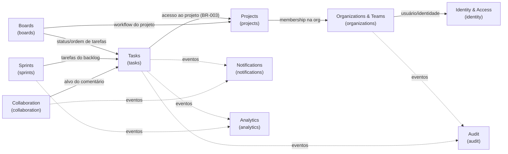

# Bounded contexts

Status: **Identity & Access implementado** (spec 001); os demais **planejados**. A coluna "Spec/Fase" indica quando cada um nasce.

## Mapa de contextos

Setas sólidas: dependência de consulta (via porta na `application` do consumidor, implementada no composition root). Setas tracejadas: reação a eventos publicados após commit.

## Contextos

| Contexto              | Nome técnico    | Responsabilidades                                                                                                                                             | Não é responsável por                            | Spec/Fase                 |
| --------------------- | --------------- | ------------------------------------------------------------------------------------------------------------------------------------------------------------- | ------------------------------------------------ | ------------------------- |
| Identity & Access     | `identity`      | Usuários, credenciais (Argon2id), login/logout, refresh rotativo, recuperação de senha, sessões, resolução do contexto de autorização.                        | Papéis dentro de projetos; dados de organização. | 001 · F1                  |
| Organizations & Teams | `organizations` | Organizações (tenant), memberships e papéis organizacionais, convites, organização ativa (**implementado**, spec 002); equipes (planejado: spec que as usar). | Credenciais; projetos.                           | 002 · F1                  |
| Projects              | `projects`      | Projetos, configurações, workflow (status/transições), membros e papéis no projeto, arquivamento.                                                             | Tarefas e sua ordem.                             | 003 · F1                  |
| Tasks                 | `tasks`         | Tarefas, status, prioridade, responsáveis, prazos, subtarefas, dependências, regras de conclusão (BR-001, 003, 006, 008).                                     | Layout do quadro; sprints.                       | 004 · F1                  |
| Boards                | `boards`        | Quadros Kanban, colunas mapeadas a status, posição/ordenação de cards, movimentação (BR-004, 009).                                                            | Regras de conclusão (delegadas a Tasks).         | 005 · F1                  |
| Sprints               | `sprints`       | Backlog, planejamento, sprints, associação de tarefas, encerramento/reabertura (BR-005).                                                                      | Estado das tarefas.                              | 007 · F3                  |
| Collaboration         | `collaboration` | Comentários, menções, histórico de discussão.                                                                                                                 | Entrega de notificações.                         | F2                        |
| Notifications         | `notifications` | Notificações in-app/e-mail, preferências, entrega assíncrona e em tempo real.                                                                                 | Decidir _o que_ aconteceu (reage a eventos).     | 008 · F2                  |
| Analytics             | `analytics`     | Indicadores, produtividade, métricas de projetos e sprints (modelos de leitura).                                                                              | Escrever estado de outros contextos.             | 009 · F3                  |
| Audit                 | `audit`         | Registro imutável de alterações relevantes (BR-007), consulta administrativa.                                                                                 | Regras de negócio dos contextos auditados.       | Transversal · consulta F3 |

## Decisões de fronteira

- **Membership vs. permissão** (ADR [0013](adr/0013-authorization-shared-kernel.md), spec 006): `organizations` guarda quem pertence a qual organização e com que papel; `projects` guardará os membros do projeto e seus papéis (spec 003). O **vocabulário** de autorização (catálogos, matrizes, papel efetivo com teto da organização — BR-023) é Shared Kernel em `libs/backend/shared/kernel`, sem estado; a **decisão** fica no caso de uso de cada contexto, que recebe os dados de outro contexto por portas (ex.: `projects` lê "membros podem criar projetos" e `tasks` lê o papel de projeto). `identity` não participa da autorização além de autenticar.
- **Tasks × Boards**: o status é da tarefa (`tasks`); a coluna e a posição são do quadro (`boards`). Mover um card chama o caso de uso de transição de status de `tasks` (via porta) e grava a posição em `boards` na mesma transação (BR-010). Por isso estes dois contextos compartilham fronteira transacional — exceção documentada no design da spec 005.
- **Audit**: gravado na mesma transação da alteração (BR-007/010) por uma porta `AuditLog` implementada na infraestrutura de `audit`; a leitura pertence ao contexto `audit`.
- **Analytics**: lê de projeções próprias alimentadas por eventos; nunca consulta tabelas de outros contextos diretamente.
- **Tabelas**: cada contexto é dono das suas tabelas; outro contexto não lê nem escreve nelas via Prisma (apenas via portas).
