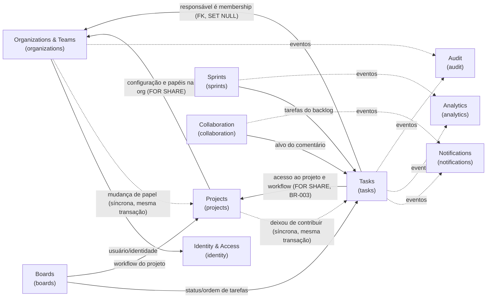

# Bounded contexts

Status: **Identity & Access** (spec 001), **Organizations** (spec 002), **Projects** (spec 003) e **Tasks** (spec 004) **implementados**; os demais **planejados**. A coluna "Spec/Fase" indica quando cada um nasce.

## Mapa de contextos

Setas sólidas: dependência de consulta (via porta na `application` do consumidor, implementada no composition root). Setas tracejadas: reação a eventos publicados após commit.

## Contextos

| Contexto              | Nome técnico    | Responsabilidades                                                                                                                                                                                                               | Não é responsável por                            | Spec/Fase                 |
| --------------------- | --------------- | ------------------------------------------------------------------------------------------------------------------------------------------------------------------------------------------------------------------------------- | ------------------------------------------------ | ------------------------- |
| Identity & Access     | `identity`      | Usuários, credenciais (Argon2id), login/logout, refresh rotativo, recuperação de senha, sessões, resolução do contexto de autorização.                                                                                          | Papéis dentro de projetos; dados de organização. | 001 · F1                  |
| Organizations & Teams | `organizations` | Organizações (tenant), memberships e papéis organizacionais, convites, organização ativa (**implementado**, spec 002); equipes (planejado: spec que as usar).                                                                   | Credenciais; projetos.                           | 002 · F1                  |
| Projects              | `projects`      | Projetos, chave (BR-025), workflow padrão (configuração na 005), participantes e papéis no projeto (BR-027), arquivamento (BR-026) (**implementado**, spec 003).                                                                | Tarefas e sua ordem.                             | 003 · F1                  |
| Tasks                 | `tasks`         | Tarefas e subtarefas (um nível), status pelo workflow (BR-004), prioridade, responsável, prazo, dependências, conclusão (BR-001, 003, 006, 008), número `CHAVE-N` (BR-028), cancelamento (BR-029) (**implementado**, spec 004). | Layout do quadro; sprints.                       | 004 · F1                  |
| Boards                | `boards`        | Quadros Kanban, colunas mapeadas a status, posição/ordenação de cards, movimentação (BR-004, 009).                                                                                                                              | Regras de conclusão (delegadas a Tasks).         | 005 · F1                  |
| Sprints               | `sprints`       | Backlog, planejamento, sprints, associação de tarefas, encerramento/reabertura (BR-005).                                                                                                                                        | Estado das tarefas.                              | 007 · F3                  |
| Collaboration         | `collaboration` | Comentários, menções, histórico de discussão.                                                                                                                                                                                   | Entrega de notificações.                         | F2                        |
| Notifications         | `notifications` | Notificações in-app/e-mail, preferências, entrega assíncrona e em tempo real.                                                                                                                                                   | Decidir _o que_ aconteceu (reage a eventos).     | 008 · F2                  |
| Analytics             | `analytics`     | Indicadores, produtividade, métricas de projetos e sprints (modelos de leitura).                                                                                                                                                | Escrever estado de outros contextos.             | 009 · F3                  |
| Audit                 | `audit`         | Registro imutável de alterações relevantes (BR-007), consulta administrativa.                                                                                                                                                   | Regras de negócio dos contextos auditados.       | Transversal · consulta F3 |

## Decisões de fronteira

- **Membership vs. permissão** (ADR [0013](adr/0013-authorization-shared-kernel.md), spec 006): `organizations` guarda quem pertence a qual organização e com que papel; `projects` guarda as participações e seus papéis (spec 003). O **vocabulário** de autorização (catálogos, matrizes, papel efetivo com teto da organização — BR-023) é Shared Kernel em `libs/backend/shared/kernel`, sem estado; a **decisão** fica no caso de uso de cada contexto, que recebe os dados de outro contexto por portas (ex.: `projects` lê "membros podem criar projetos" e `tasks` lê o papel de projeto). `identity` não participa da autorização além de autenticar.
- **Tasks × Boards**: o status é da tarefa (`tasks`); a coluna e a posição são do quadro (`boards`). Mover um card chama o caso de uso de transição de status de `tasks` (via porta) e grava a posição em `boards` na mesma transação (BR-010). Por isso estes dois contextos compartilham fronteira transacional — exceção documentada no design da spec 005.
- **Audit**: gravado na mesma transação da alteração (BR-007/010) por uma porta `AuditLog` implementada na infraestrutura de `audit`; a leitura pertence ao contexto `audit`.
- **Analytics**: lê de projeções próprias alimentadas por eventos; nunca consulta tabelas de outros contextos diretamente.
- **Tabelas**: cada contexto é dono das suas tabelas; outro contexto não lê nem escreve nelas via Prisma (apenas via portas).
- **`projects` × `organizations`** (spec 003): `projects` usa a porta `OrganizationAccess` (trava a organização `FOR SHARE` e relê configuração e papéis na mesma transação; lista membros para candidatos); `organizations` avisa toda mudança de papel pela porta `MembershipRoleChanges`, na sua linguagem, e `projects` decide (BR-027: rebaixado a viewer ⇒ participações viram viewer). Ordem única de locks: organização → projeto → participações. Seta pontilhada no mapa: reação **síncrona**, na transação de `organizations`, não evento pós-commit.

- **`tasks` × `projects`** (spec 004): `tasks` usa a porta `ProjectAccess` — `lockForContribution` trava o projeto `FOR SHARE` e as memberships das pessoas envolvidas `FOR SHARE` (por `organizations`) e devolve papéis efetivos e o workflow lido depois do lock; `resolveForRead` resolve a leitura numa consulta; `assignableUsers` lista quem pode ser responsável. **Quem deixou de contribuir** (papel efetivo fora de manager/member) é decidido **só em `projects`**, que avisa `tasks` pela porta `ProjectContributorChanges` (na linguagem de `projects`); `tasks` só executa a desatribuição (`RevokeAssignmentsOnAccessLoss`) na transação de quem originou. A cadeia é linear: `organizations → projects → tasks` (`MembershipRoleChanges` continua com um ouvinte só). A revogação **não tem evento próprio**: roda na transação de outro contexto, e o evento de quem originou é a evidência (ADR 0015, item 4).
- **Ordem única de locks das escritas de tarefa**: projeto (`projects`) `FOR SHARE` → memberships `FOR SHARE` → contador ou lock do projeto em `tasks` (`task_project_locks`) → **uma** linha de `tasks`; a linha da organização nunca é travada. **Invariante**: toda mudança de papel efetivo trava a membership (`organizations`) ou o projeto em `FOR NO KEY UPDATE` (`projects`), e nenhuma transação trava `projects` depois de travar uma membership — por isso as participações são lidas sem lock. O runner fixa READ COMMITTED e repete uma vez a transação em deadlock/serialização (`P2034`); persistindo, 409 `CONCURRENT_UPDATE`.
- **Remover ou sair da organização** desfaz as atribuições pelo banco (`ON DELETE SET NULL ("assignee_user_id")`), sem evento de `tasks` nem incremento de `version` (exceção a BR-008 registrada no design da spec 004).

## Exceções de integridade referencial entre contextos (ADR 0015)

FKs entre tabelas de contextos diferentes só sob os critérios do [ADR 0015](adr/0015-cross-context-referential-integrity.md). A back-relation exigida pelo Prisma no modelo fornecedor é inerte (barrada por lint em `organizations`).

| FK                                                                                                                               | Ação                                                                               | Spec | Motivo                                                                                                                                                                                           |
| -------------------------------------------------------------------------------------------------------------------------------- | ---------------------------------------------------------------------------------- | ---- | ------------------------------------------------------------------------------------------------------------------------------------------------------------------------------------------------ |
| `projects (organization_id) → organizations (id)`                                                                                | `CASCADE`, `ON UPDATE RESTRICT`                                                    | 003  | Toda tabela tenant-scoped tem FK para a organização (regra de banco)                                                                                                                             |
| `project_members (organization_id, user_id) → memberships (organization_id, user_id)`                                            | `CASCADE`, `ON UPDATE RESTRICT`                                                    | 003  | Não existe participação sem membership (obrigação 2 da 006, BR-027)                                                                                                                              |
| `tasks (organization_id, project_id) → projects (organization_id, id)`                                                           | `CASCADE`, `ON UPDATE RESTRICT`                                                    | 004  | Tarefa pertence a um projeto da mesma organização (critério a)                                                                                                                                   |
| `tasks (organization_id, project_id, status_id) → workflow_statuses (…)`                                                         | `RESTRICT`                                                                         | 004  | Status sempre do workflow do projeto; remover status em uso exige migrar (obrigação para a 005)                                                                                                  |
| `tasks (organization_id, assignee_user_id) → memberships (organization_id, user_id)`                                             | `SET NULL ("assignee_user_id")` (ajuste manual na migration), `ON UPDATE RESTRICT` | 004  | Responsável é membro da organização (critério b, seta `TSK → ORG`); sair da organização desatribui sem bloquear a remoção. Protegida por teste de catálogo (`confdelsetcols`) e teste de remoção |
| `task_counters (organization_id, project_id) → projects (…)` e `task_project_locks (organization_id, project_id) → projects (…)` | `CASCADE`, `ON UPDATE RESTRICT`                                                    | 004  | Contador de números (BR-028) e lock de invariantes entre tarefas vivem e morrem com o projeto                                                                                                    |
