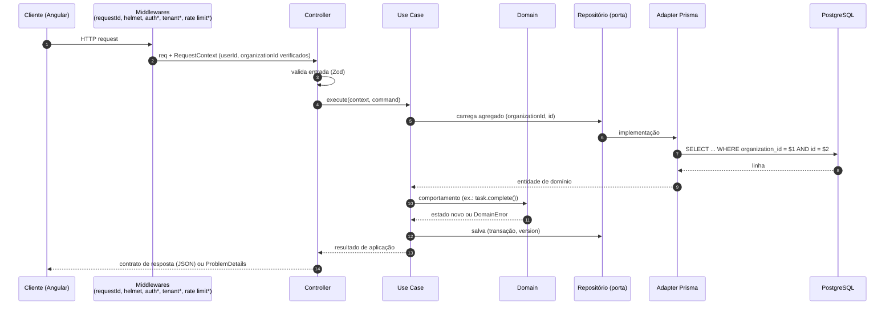
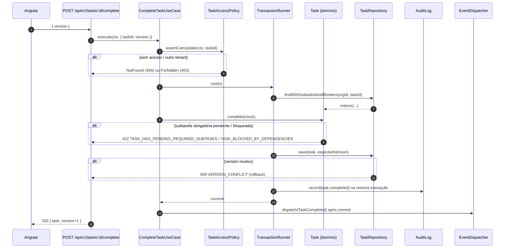
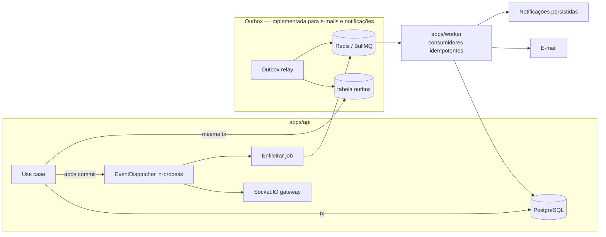
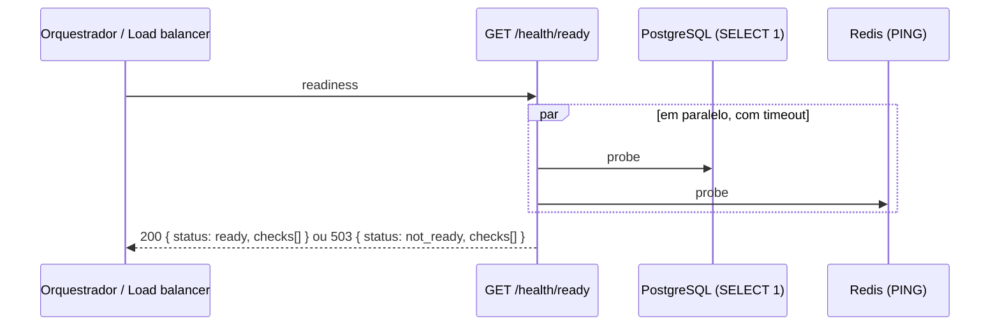

# Fluxos de dados

Estado: o fluxo de requisição e o health check estão **implementados** (Fase 0). Os demais fluxos são **planejados** e servem de referência para as specs.

## 1. Requisição HTTP padrão



`*` planejado na spec 001/006. Entidades de persistência nunca saem do adapter; o controller mapeia o resultado para o contrato de `@taskflow/contracts`.

## 2. Conclusão de tarefa (BR-001, BR-006, BR-007, BR-008, BR-010)



## 3. Movimento de card no quadro (BR-004, BR-009, BR-010)

**Implementado** (spec 005; o quadro é uma visão de `tasks`, [ADR 0016](adr/0016-kanban-board-as-tasks-view.md)). Sem tempo real nesta fase: o cliente recarrega depois de conflitos e em "Atualizar".

```mermaid
sequenceDiagram
    autonumber
    participant A as Usuário (Angular)
    participant API as POST /api/v1/organizations/{org}/tasks/{taskId}/move
    participant UC as MoveCardUseCase (tasks)
    participant PA as ProjectAccess (projects)
    participant DB as PostgreSQL

    A->>A: move otimista (guarda o estado anterior)
    A->>API: { toStatusId, afterTaskId | beforeTaskId, version }
    API->>UC: execute (limite de escritas, lock_timeout 2 s)
    UC->>PA: projeto FOR SHARE, memberships FOR SHARE, workflow relido
    UC->>DB: lock do projeto em tasks → tarefa FOR NO KEY UPDATE
    UC->>UC: posição (vizinho na coluna destino; empate ⇒ rebalanceia)
    UC->>UC: coluna nova ⇒ applyTransition (BR-004, BR-001, BR-006)
    UC->>DB: status + board_rank (uma linha), na mesma transação
    alt recusado (409/422)
        API-->>A: Problem Details (com taskIds em BR-001/BR-006)
        A->>A: reverte o card; recarrega o quadro se os dados estavam velhos
    else sucesso
        API-->>A: 200 { card, statusId }
        UC-->>UC: eventos tasks.card_moved / tasks.status_changed no log, após o commit
    end
```

**Planejado (Fase 2)**: publicar `card.moved` por Socket.IO (room `project:{id}`) depois do commit, para os outros usuários reconciliarem pela versão.

## 3a. Comentário com menção (BR-031, BR-032, BR-010) — implementado (spec 010)

```mermaid
sequenceDiagram
    participant UI as Detalhe da tarefa
    participant API as collaboration/http
    participant UC as CreateComment
    participant TDA as TaskDiscussionAccess
    participant DB as PostgreSQL
    UI->>API: POST /tasks/{taskId}/comments { body com <@id> }
    API->>UC: execute (limite contado; texto e menções validados antes do lock)
    UC->>TDA: lockForComment(tarefa, [ator, mencionados])
    TDA->>DB: projeto e memberships FOR SHARE; tarefa FOR SHARE
    UC->>UC: 404 → 403 → arquivado → cancelada → INVALID_MENTION → teto
    UC->>DB: INSERT comment + comment_mentions (mesma transação)
    UC-->>API: comentário; evento collaboration.comment_created após o commit
    API-->>UI: 201 Comment (Location)
```

Sem tempo real: a conversa recarrega ao abrir e depois de conflitos. As menções **novas** viram o evento de integração `collaboration.mentions_added`, gravado na Outbox na mesma transação (spec 008, §4a).

## 4. Comunicação assíncrona

**Implementado (spec 001, ADR [0011](adr/0011-early-worker-and-outbox-for-email.md))**: Transactional Outbox para e-mails transacionais, do caso de uso na API até o SMTP.

```mermaid
sequenceDiagram
    participant UC as Caso de uso (apps/api)
    participant DB as PostgreSQL
    participant R as OutboxRelay (apps/worker)
    participant Q as BullMQ (fila emails)
    participant C as Consumidor (apps/worker)
    participant M as SMTP

    UC->>DB: alteração + INSERT outbox_events (mesma transação)
    loop a cada 1 s; lotes cheios em sequência
        R->>DB: BEGIN · SELECT … tipos roteados … LIMIT 50 FOR UPDATE SKIP LOCKED
        R->>Q: addBulk (jobId = id do evento)
        R->>DB: UPDATE published_at · COMMIT
    end
    Q->>C: job (até 5 tentativas, backoff exponencial de 5 s)
    C->>DB: upsert do token por evento (hash; novo a cada tentativa)
    C->>M: e-mail pt-BR com link APP_URL/…#token=…
```

- Relays concorrentes recebem lotes disjuntos (`SKIP LOCKED`). Se o commit falhar depois da publicação, o lote é republicado e o BullMQ ignora o `jobId` repetido, que fica retido por 24 h após a conclusão.
- O relay só lê os tipos que sabe rotear. Um evento de um produtor mais novo fica pendente até um worker que o conheça, sem bloquear os demais.
- Com o Redis indisponível, o lote falha, a transação é desfeita e o relay tenta de novo no ciclo seguinte.
- O consumidor valida cada job com Zod. Job inválido falha sem retry (`UnrecoverableError`); falha de SMTP volta para a fila. Como o token é regravado a cada tentativa, só o link do último envio funciona, e um evento reprocessado nunca gera um segundo token. Se o link do evento já foi usado, o reenvio é descartado (não se envia link morto).
- Avisos sem token (cadastro com e-mail existente, senha alterada) podem, raramente, chegar duplicados: entrega pelo menos uma vez.

### 4a. Notificações (BR-033, BR-034) — implementado (spec 008, ADR [0017](adr/0017-outbox-for-cross-context-integration-events.md))

```mermaid
sequenceDiagram
    participant P as tasks / collaboration (apps/api)
    participant DB as PostgreSQL
    participant R as OutboxRelay único (apps/worker)
    participant Q as BullMQ (fila notifications)
    participant C as Consumidor (apps/worker)
    participant D as Fila notification-digests
    participant M as SMTP

    P->>DB: fato + INSERT outbox_events (tasks.assignee_changed / collaboration.mentions_added)
    R->>DB: lote FOR UPDATE SKIP LOCKED (tipos de emails e notifications)
    R->>Q: addBulk (jobId = id do evento)
    Q->>C: job validado (Zod satisfies o payload do produtor) → anticorrupção → RecordNotifications
    C->>DB: INSERT … ON CONFLICT DO NOTHING por destinatário (sem o ator; teto de menções; P2003 ⇒ descartada)
    loop de hora em hora (job scheduler)
        D->>DB: quem tem candidatas (não lidas, não enviadas, 24 h) e preferência ligada
        D->>D: um job por pessoa (jobId digest-{userId}-{AAAAMMDDHH})
        D->>DB: até 50 candidatas; visibilidade pelo papel atual (falha fechado)
        D->>M: resumo sem nomes nem conteúdo (se sobrar algo e o e-mail for verificado)
        D->>DB: emailed_at em todas as candidatas lidas (… AND emailed_at IS NULL)
    end
```

- A validade é decidida **na leitura** (lista, contador e resumo): tarefa legível pelo papel atual e menção ainda ativa; o que deixou de valer some sem apagar a linha.
- Um único relay roteia `emails` e `notifications`; tipo roteado duas vezes é erro de composição. Um tipo sem rota fica pendente sem bloquear os demais.
- O sino consulta `GET …/notifications/unread-count` a cada 60 s com a aba visível e ao voltar para ela (sem tempo real).
- A retenção de 90 dias roda na limpeza diária (`maintenance`), em lotes de 1 000.

**Planejado (Fase 2–4)**: eventos em processo para Socket.IO e as demais filas.



Garantias: entrega **pelo menos uma vez**; consumidores idempotentes (chave de idempotência por evento); retry com backoff exponencial e limite de tentativas; falhas permanentes vão para fila de falhas com alerta. Ver ADR [0008](adr/0008-domain-events-and-outbox.md).

## 5. Health check (implementado)



`/health/live` responde 200 sem consultar dependências (o processo está vivo). Respostas expõem apenas nome, estado e latência de cada dependência — nunca mensagens de erro internas.
