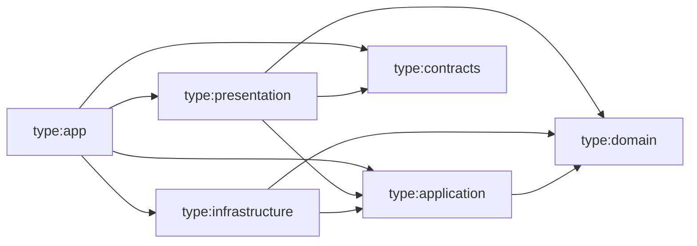

# Regras de dependência

As regras abaixo são **verificadas automaticamente** por `@nx/enforce-module-boundaries` em `eslint.config.mjs` — rodam em `pnpm lint` e no CI. Documentação e lint devem sempre coincidir; ao mudar um, mude o outro.

## Dimensões de tags

Todo projeto Nx recebe três dimensões de tags:

| Dimensão   | Valores                                                                                                                                 | Significado                             |
| ---------- | --------------------------------------------------------------------------------------------------------------------------------------- | --------------------------------------- |
| `scope:*`  | `frontend`, `backend`, `shared`                                                                                                         | Em que runtime o código roda.           |
| `domain:*` | `shared`, `identity`, `organizations`, `projects`, `tasks`, `boards`, `sprints`, `collaboration`, `notifications`, `analytics`, `audit` | Bounded context. Apps não têm `domain`. |
| `type:*`   | `app`, `contracts`, `domain`, `application`, `infrastructure`, `presentation`, `feature`, `ui`, `data-access`, `util`, `model`, `e2e`   | Camada/papel.                           |

## Restrições por escopo

| Origem           | Pode depender de                 |
| ---------------- | -------------------------------- |
| `scope:frontend` | `scope:frontend`, `scope:shared` |
| `scope:backend`  | `scope:backend`, `scope:shared`  |
| `scope:shared`   | `scope:shared`                   |

## Restrições por contexto

| Origem          | Pode depender de              |
| --------------- | ----------------------------- |
| `domain:<x>`    | `domain:<x>`, `domain:shared` |
| `domain:shared` | `domain:shared`               |

Consequência: **nenhum contexto importa outro**. Integração entre contextos acontece por portas definidas na `application` do consumidor e adaptadores ligados no composition root (`apps/api`), que não possui tag `domain`.

## Restrições por tipo (backend)



| Origem                | Pode depender de                                                         | Importações externas proibidas                                                  |
| --------------------- | ------------------------------------------------------------------------ | ------------------------------------------------------------------------------- |
| `type:domain`         | `type:domain`                                                            | `express`, `@prisma/*`, `ioredis`, `bullmq`, `socket.io`, `pino*`, `@angular/*` |
| `type:application`    | `type:domain`, `type:application`                                        | as mesmas de `type:domain`                                                      |
| `type:infrastructure` | `type:domain`, `type:application`, `type:infrastructure`                 | `express`, `@angular/*`                                                         |
| `type:presentation`   | `type:application`, `type:domain`, `type:contracts`, `type:presentation` | `@prisma/*`, `@angular/*`                                                       |
| `type:contracts`      | `type:contracts`                                                         | tudo exceto `zod`                                                               |

`presentation → domain` é permitido apenas para mapear erros e tipos de valor na resposta; controllers não chamam métodos de entidades.

## Restrições por tipo (frontend)

| Origem             | Pode depender de                                                                            |
| ------------------ | ------------------------------------------------------------------------------------------- |
| `type:app` (web)   | qualquer biblioteca `scope:frontend`/`scope:shared`                                         |
| `type:feature`     | `type:feature`*, `type:ui`, `type:data-access`, `type:util`, `type:model`, `type:contracts` |
| `type:ui`          | `type:ui`, `type:util`, `type:model`                                                        |
| `type:data-access` | `type:data-access`, `type:util`, `type:model`, `type:contracts`                             |
| `type:util`        | `type:util`                                                                                 |
| `type:model`       | `type:model`, `type:contracts`                                                              |

\* Somente via rotas lazy (`loadChildren`), nunca importação direta de componentes de outra feature.

## Regras adicionais (lint e revisão)

- Importar apenas o `index.ts` público de outro projeto (`@nx/enforce-module-boundaries` rejeita deep imports).
- Sem dependências circulares entre projetos (verificado pelo mesmo rule).
- Regras de camada **dentro** de um projeto (ex.: `apps/api/src`) são garantidas por revisão (`/review-code`) — por isso o código de negócio vive em bibliotecas, não nos apps.

## Como verificar

```bash
pnpm lint                 # inclui enforce-module-boundaries
pnpm nx graph             # visualiza o grafo de projetos
```
