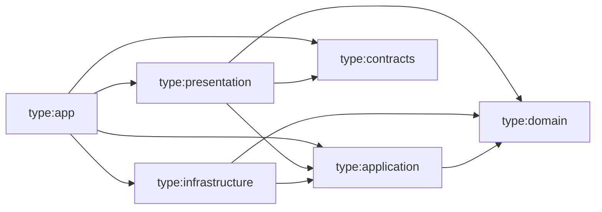

# Regras de dependência

As regras abaixo são **verificadas automaticamente** por `@nx/enforce-module-boundaries` em `eslint.config.mjs` — rodam em `pnpm lint` e no CI. Documentação e lint devem sempre coincidir; ao mudar um, mude o outro.

## Dimensões de tags

Todo projeto Nx recebe três dimensões de tags:

| Dimensão   | Valores                                                                                                                                 | Significado                             |
| ---------- | --------------------------------------------------------------------------------------------------------------------------------------- | --------------------------------------- |
| `scope:*`  | `frontend`, `backend`, `shared`                                                                                                         | Em que runtime o código roda.           |
| `domain:*` | `shared`, `identity`, `organizations`, `projects`, `tasks`, `boards`, `sprints`, `collaboration`, `notifications`, `analytics`, `audit` | Bounded context. Apps não têm `domain`. |
| `type:*`   | `app`, `contracts`, `domain`, `application`, `infrastructure`, `presentation`, `feature`, `ui`, `data-access`, `util`, `model`, `e2e`   | Camada/papel.                           |

## Restrições por escopo

| Origem           | Pode depender de                 |
| ---------------- | -------------------------------- |
| `scope:frontend` | `scope:frontend`, `scope:shared` |
| `scope:backend`  | `scope:backend`, `scope:shared`  |
| `scope:shared`   | `scope:shared`                   |

## Restrições por contexto

| Origem          | Pode depender de              |
| --------------- | ----------------------------- |
| `domain:<x>`    | `domain:<x>`, `domain:shared` |
| `domain:shared` | `domain:shared`               |

Consequência: **nenhum contexto importa outro**. Integração entre contextos acontece por portas definidas na `application` do consumidor e adaptadores ligados no composition root (`apps/api`), que não possui tag `domain`.

## Restrições por tipo (backend)



| Origem                | Pode depender de                                                         | Importações externas proibidas                                                                                              |
| --------------------- | ------------------------------------------------------------------------ | --------------------------------------------------------------------------------------------------------------------------- |
| `type:domain`         | `type:domain`                                                            | **todos** os pacotes npm (`allowedExternalImports: []`) — domínio é TypeScript puro; capacidades externas entram por portas |
| `type:application`    | `type:domain`, `type:application`                                        | `express`, `@prisma/*`, `prisma`, `ioredis`, `bullmq`, `socket.io`, `pino`, `pino-http`, `@angular/*`                       |
| `type:infrastructure` | `type:domain`, `type:application`, `type:infrastructure`                 | `express`, `@angular/*`                                                                                                     |
| `type:presentation`   | `type:application`, `type:domain`, `type:contracts`, `type:presentation` | `@prisma/*`, `prisma`, `ioredis`, `bullmq`, `@angular/*` — middlewares recebem portas, nunca falam com Redis/filas          |
| `type:contracts`      | `type:contracts`                                                         | tudo exceto `zod` (`allowedExternalImports`)                                                                                |

O Nx verifica apenas pacotes presentes no grafo (instalados); módulos nativos do Node (`node:*`) não são verificados — seu uso em `domain` é barrado na revisão de código.

`presentation → domain` é permitido apenas para mapear erros e tipos de valor na resposta; controllers não chamam métodos de entidades.

## Bibliotecas compartilhadas do backend (implementadas)

Todas com `scope:backend` e `domain:shared` — qualquer contexto pode usá-las, respeitando a camada.

| Projeto                              | `type:*`         | Import                                            | Conteúdo                                                                                                                                                                                                                                                                                                                                                                                                                                                                              |
| ------------------------------------ | ---------------- | ------------------------------------------------- | ------------------------------------------------------------------------------------------------------------------------------------------------------------------------------------------------------------------------------------------------------------------------------------------------------------------------------------------------------------------------------------------------------------------------------------------------------------------------------------- |
| `libs/backend/shared/kernel`         | `domain`         | `@taskflow/backend/shared/kernel`                 | `DomainError`, `Clock`, `IdGenerator`, `EmailAddress`, `normalizeDisplayText`, `OrganizationRole`                                                                                                                                                                                                                                                                                                                                                                                     |
| `libs/backend/shared/application`    | `application`    | `@taskflow/backend/shared/application`            | `RequestContext`, `TenantRequestContext`, `TransactionRunner`, `IntegrationEvent`/`createIntegrationEvent`, `OutboxWriter`, `EmailSender`, `RateLimiter`, `SecurityEventRecorder` genérico; subcaminho `/testing` com fakes genéricos                                                                                                                                                                                                                                                 |
| `libs/backend/shared/http`           | `presentation`   | `@taskflow/backend/shared/http`                   | `HttpError`, error handler (`DomainError` → Problem Details), `parseBody`, `createAuthenticate`, `createCsrfProtection`, `createRateLimit`, `clientIpKey`, `createTenantContext`/`tenantRequestContextFrom`, `createTenantScope` (ADR 0012), serializers de log                                                                                                                                                                                                                       |
| `libs/backend/shared/infrastructure` | `infrastructure` | `@taskflow/backend/shared/infrastructure`         | Prisma (cliente, `PrismaTransactionRunner`, `PrismaOutboxWriter`, `PrismaOutboxRetention`, `isUniqueConstraintViolation`, tipos `*Row`), Redis (cliente, `RedisRateLimiter`), BullMQ (`createEventQueue`, `createEventWorker`, `BullMqEventPublisher`, `OutboxRelay`), `SmtpEmailSender`, layout de e-mail (`renderEmail`, `escapeHtml`), `createLogger`, base de configuração (`parseEnvironment`), `checkReadiness` e probes, `UuidV7Generator`, `SystemClock`, `HmacPseudonymizer` |
| ↳ subcaminho de testes               | —                | `@taskflow/backend/shared/infrastructure/testing` | `startPostgresTestDatabase()` (PostgreSQL efêmero + migrations reais). **Somente em testes**; excluído do `tsconfig.lib.json`                                                                                                                                                                                                                                                                                                                                                         |

Regra de inclusão: algo só entra em `shared/*` quando dois ou mais contextos já precisam dele (ou a spec que o cria demonstra o segundo uso, como `RequestContext` para a spec 002). Na spec 002 entraram por esse critério o layout de e-mail (`renderEmail`), os fakes genéricos de teste e o `SecurityEventRecorder` genérico.

## Bibliotecas do contexto Identity & Access (implementadas, spec 001)

Todas com `scope:backend` e `domain:identity`. Nenhum outro contexto as importa; outros contextos consultam a identidade por portas próprias ligadas no composition root (ex.: a porta `UserDirectory` de `organizations`, ligada em `apps/api` e `apps/worker` a `GetUserAccountsUseCase` e `FindUserIdByEmailUseCase`).

| Projeto                                | Tipo             | Alias                                       | Conteúdo                                                                                                                                      |
| -------------------------------------- | ---------------- | ------------------------------------------- | --------------------------------------------------------------------------------------------------------------------------------------------- |
| `libs/backend/identity/domain`         | `domain`         | `@taskflow/backend/identity/domain`         | `User`, `Session`, `UserToken`, `Password` (BR-011), `PersonName`, contratos de repositório, `SecretTokenGenerator`, `PasswordHasher`         |
| `libs/backend/identity/application`    | `application`    | `@taskflow/backend/identity/application`    | Casos de uso (cadastro, login, refresh, logout, sessões, verificação, recuperação, envios do worker, retenção), portas, políticas de limite   |
| `libs/backend/identity/infrastructure` | `infrastructure` | `@taskflow/backend/identity/infrastructure` | Repositórios Prisma, Argon2id, `JoseAccessTokens`, lista de revogação e rastreador de login no Redis, lista de senhas comuns, templates pt-BR |
| `libs/backend/identity/http`           | `presentation`   | `@taskflow/backend/identity/http`           | `createIdentityRouter`, cookies de sessão, mapeamento de erros, limites por endpoint, OpenAPI                                                 |

Subcaminhos de teste (fora do build): `@taskflow/backend/identity/application/testing` (fakes em memória) e `@taskflow/backend/shared/infrastructure/testing` (PostgreSQL efêmero).

## Bibliotecas do contexto Organizations (implementadas, spec 002)

Todas com `scope:backend` e `domain:organizations`. Não importam `identity` (verificado pelo lint de boundaries); contas de usuário chegam pela porta `UserDirectory`.

| Projeto                                     | Tipo             | Alias                                            | Conteúdo                                                                                                                                                               |
| ------------------------------------------- | ---------------- | ------------------------------------------------ | ---------------------------------------------------------------------------------------------------------------------------------------------------------------------- |
| `libs/backend/organizations/domain`         | `domain`         | `@taskflow/backend/organizations/domain`         | `Organization`, `OrganizationName`, `OrganizationSlug` (BR-022), `Membership`, `Invitation` (BR-020), política de papéis (BR-021), contratos de repositório            |
| `libs/backend/organizations/application`    | `application`    | `@taskflow/backend/organizations/application`    | Casos de uso (organização, membros com lock e releitura, convites, aceite, envio pelo worker, retenção), portas `UserDirectory`, `InvitationTokenGenerator`, templates |
| `libs/backend/organizations/infrastructure` | `infrastructure` | `@taskflow/backend/organizations/infrastructure` | Repositórios Prisma (lock `FOR NO KEY UPDATE`, filtro por organização em leitura e escrita, cursor keyset), retenção em lotes, template pt-BR do convite               |
| `libs/backend/organizations/http`           | `presentation`   | `@taskflow/backend/organizations/http`           | `createOrganizationsRouters` (router fora do tenant + router tenant-scoped relativo), mapeamento de erros, limites, OpenAPI                                            |

Subcaminho de teste: `@taskflow/backend/organizations/application/testing` (fakes em memória e testbed).

## Restrições por tipo (frontend)

| Origem             | Pode depender de                                                                            |
| ------------------ | ------------------------------------------------------------------------------------------- |
| `type:app` (web)   | qualquer biblioteca `scope:frontend`/`scope:shared`                                         |
| `type:feature`     | `type:feature`*, `type:ui`, `type:data-access`, `type:util`, `type:model`, `type:contracts` |
| `type:ui`          | `type:ui`, `type:util`, `type:model`                                                        |
| `type:data-access` | `type:data-access`, `type:util`, `type:model`, `type:contracts`                             |
| `type:util`        | `type:util`                                                                                 |
| `type:model`       | `type:model`, `type:contracts`                                                              |

\* Somente via rotas lazy (`loadChildren`), nunca importação direta de componentes de outra feature.

## Regras adicionais (lint e revisão)

- Importar apenas o `index.ts` público de outro projeto (`@nx/enforce-module-boundaries` rejeita deep imports).
- Sem dependências circulares entre projetos (verificado pelo mesmo rule).
- Regras de camada **dentro** de um projeto (ex.: `apps/api/src`) são garantidas por revisão (`/review-code`) — por isso o código de negócio vive em bibliotecas, não nos apps.

## Como verificar

```bash
pnpm lint                 # inclui enforce-module-boundaries
pnpm nx graph             # visualiza o grafo de projetos
```
