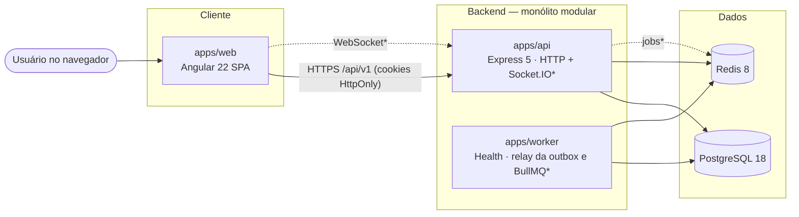
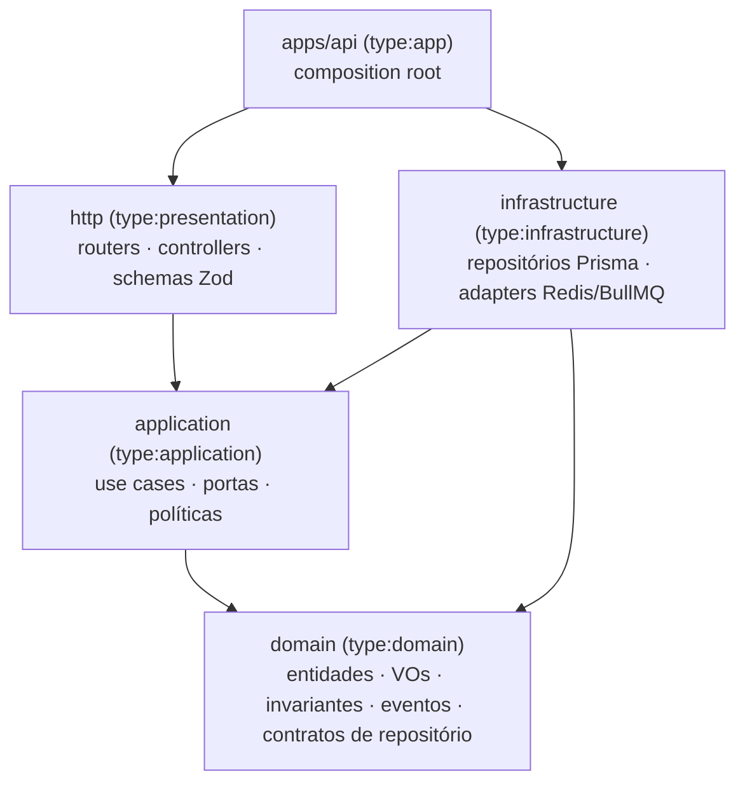

# Visão geral da arquitetura

Estado: **Fase 0** — estrutura e fundação implementadas; módulos de negócio planejados. Cada seção indica o que existe hoje.

## Estilo

**Modular Monolith** organizado por bounded contexts, com Clean Architecture e DDD pragmático (ADR [0003](adr/0003-modular-monolith-clean-architecture.md)).

- Um processo de API (Express) concentra os módulos de negócio, com limites explícitos verificados pelo Nx.
- Um processo de worker (`apps/worker`) com composition root próprio, para processamento assíncrono (relay da outbox e filas BullMQ a partir da spec 001).
- Um frontend Angular consome a API por contratos compartilhados (`libs/contracts`).
- Um banco PostgreSQL compartilhado com isolamento lógico por `organizationId` (ADR [0004](adr/0004-multi-tenancy-shared-database.md)).

## Visão de contêineres



`*` = planejado. Implementado: `apps/web`, `apps/api` (health checks; módulos de negócio a partir da spec 001), `apps/worker` (composition root, health e desligamento limpo; relay da outbox e filas em implementação na spec 001, ADR [0011](adr/0011-early-worker-and-outbox-for-email.md)), PostgreSQL, Redis e Mailpit via Docker Compose.

## Organização do monorepo

```text
apps/
  api/            composition root HTTP (Express)       — implementado (fundação)
  web/            SPA Angular                            — implementado (shell + status)
  web-e2e/        testes Playwright                      — implementado
  worker/         composition root de filas              — implementado (health); filas na spec 001 (T20–T22)
libs/
  contracts/                      contratos HTTP compartilhados (Zod)        — implementado
  backend/shared/kernel/          DomainError, Clock, IdGenerator, EmailAddress — implementado
  backend/shared/application/     portas: RequestContext, TransactionRunner,
                                  OutboxWriter, EmailSender, RateLimiter      — implementado
  backend/shared/http/            erros, autenticação, CSRF, rate limit, logs — implementado
  backend/shared/infrastructure/  Prisma, transações, outbox, Redis, SMTP,
                                  rate limiter, probes; /testing para testes  — implementado
  backend/<context>/{domain,application,infrastructure,http}                 — planejado por spec
  frontend/<domain>/{feature,ui,data-access,util,model}                      — planejado quando extraído
prisma/           schema.prisma (generator/datasource) + models/<contexto>.prisma + migrations
infra/docker/     Dockerfiles de produção
docs/  specs/  .claude/
```

Bibliotecas são criadas **somente** quando há código real (sem pastas vazias para o roadmap).

## Camadas de um bounded context



Detalhes e restrições verificáveis em [dependency-rules.md](dependency-rules.md).

## Backend

- **Composition root** (`apps/api/src/main.ts`): carrega config validada (Zod), cria clientes (Prisma, Redis), instancia módulos com constructor injection, monta o app (`createApp`) e controla o graceful shutdown.
- **`createApp(deps)`**: sem efeitos colaterais; recebe dependências prontas — testável com Supertest.
- **Erros**: `application/problem+json` (RFC 9457) com `code` estável e `requestId`; `DomainError` mapeado por `code` no error handler de `libs/backend/shared/http`.
- **Transações**: casos de uso delimitam a transação via `TransactionRunner`; a implementação Prisma guarda o cliente da transação em `AsyncLocalStorage` (restrito à infraestrutura) e chamadas aninhadas reutilizam a transação externa.
- **Outbox**: eventos de integração gravados em `outbox_events` na mesma transação (ADR 0011); o `OutboxRelay` do worker publica-os no BullMQ (`FOR UPDATE SKIP LOCKED`, `jobId` = id do evento). Fluxo em [data-flow.md](data-flow.md#4-comunicação-assíncrona).
- **Retenção**: job diário do worker (03:00 UTC, job scheduler do BullMQ: uma execução por ocorrência mesmo com vários workers) remove, em lotes, contas não verificadas há mais de 7 dias sem login (RF-15), sessões encerradas há mais de 30 dias, tokens de e-mail encerrados há mais de 7 dias e eventos da outbox publicados há mais de 7 dias.
- **Logs**: Pino com `requestId` (aceita `x-request-id` válido do proxy ou gera UUID), redação de credenciais e serializers mínimos (sem headers completos nem query string).
- **Health**: `/health/live` (processo vivo) e `/health/ready` (PostgreSQL + Redis com timeout).

## Frontend

- Angular 22 standalone, **zoneless**, Signals; rotas lazy; `httpResource` para leitura reativa e `HttpClient` para mutações.
- Organização por feature (`app/features/*`) e `app/core` para infraestrutura transversal; extração para `libs/frontend` quando houver reuso (ADR [0009](adr/0009-frontend-state-with-signals.md)).
- Design System com tokens CSS consumidos por Tailwind e Angular Material ([design-system.md](../design-system.md), ADR [0010](adr/0010-tailwind-and-angular-material.md)).
- Em desenvolvimento, o dev server faz proxy de `/api` e `/health` para a API: mesma origem, sem CORS, cookies `SameSite` funcionam como em produção atrás de um reverse proxy.
- **Segurança do documento** (Nginx em produção, dev server em desenvolvimento — mesma política): CSP sem origens de terceiros com nonce por resposta (`$request_id` no Nginx, aplicado pelo Angular via `ngCspNonce`), `Referrer-Policy: no-referrer`, `X-Frame-Options: DENY`, `nosniff`; `index.html` com `no-store`. Configuração em `infra/docker/spa-document.conf` e `apps/web/project.json` (`serve.options.headers`).
- **Sessão** (`app/core/auth`, spec 001 T24): `AuthStore` (Signals) resolvido antes da primeira navegação por `provideAppInitializer` (`GET /auth/csrf` → `GET /me`, timeout de 5 s; falha ⇒ anônimo). CSRF via `withXsrfConfiguration` (`__Host-tf_csrf` → `X-CSRF-Token`). Interceptor: 401 ⇒ refresh em voo único na aba e serializado entre abas por Web Lock (`taskflow:session-refresh`), repetindo a requisição original uma vez; 409 `REFRESH_IN_PROGRESS` ⇒ repete; 401 do refresh ⇒ anônimo e, se havia usuário, `/login?returnUrl=…`; falha de rede não encerra a sessão. `returnUrl` só aceita caminhos internos e descarta o fragmento (tokens de e-mail). Guards `authGuard`/`guestGuard` são UX — o controle de acesso é da API.
- **Contratos no frontend**: `@taskflow/contracts` entra no `apps/web` **só como tipos** (`import type`, imposto por `no-restricted-imports`); respostas são verificadas por guards em `app/core/http/contract-guards.ts`. Importar os schemas Zod custava ~500 kB no bundle inicial (medido na T25: 753 kB → 323 kB). Erros da API são lidos por `toApiProblem` (`code`, `violations`, `Retry-After`) e as mensagens são escolhidas sempre pelo `code`.
- **Telas de visitante** (`features/auth`): login e cadastro com Reactive Forms tipados, Material, foco no primeiro erro e no alerta, requisitos de senha em tempo real (BR-011 espelhada em `password-policy.ts`; anúncio para leitor de tela com debounce) e a mesma confirmação de cadastro para e-mail novo ou existente (BR-014).
- **Links de e-mail** (`/verify-email`, `/reset-password`): o token vem no fragmento, é lido uma vez por `LinkToken` (formato do contrato) e **removido da URL** com `history.replaceState`; na verificação ele fica só em memória (`PendingEmailVerification`) para sobreviver à ida ao login. A confirmação nunca é automática: sem sessão a página pede login; com sessão, exige o clique (CA-03, CA-16/BR-017). A redefinição encerra o estado local da sessão (a API revoga todas, BR-016).

## Padrões de projeto

Aplicados somente diante de problema concreto. Estado atual: nenhum padrão de domínio implementado ainda (Fase 0).

| Padrão                            | Onde e por quê                                                                                                                               | Quando **não** usar                                         |
| --------------------------------- | -------------------------------------------------------------------------------------------------------------------------------------------- | ----------------------------------------------------------- |
| Repository                        | Porta no domínio/aplicação, `Prisma*Repository` na infraestrutura: testar casos de uso sem banco e manter Prisma fora do domínio.            | Repositório genérico `Repository<T>` que esconde consultas. |
| Factory (método estático)         | `Task.create()` valida invariantes de criação; `Task.restore()` reidrata do banco.                                                           | Fábricas para objetos triviais.                             |
| Strategy                          | Políticas intercambiáveis reais (ex.: algoritmo de cálculo de prioridade, política de atribuição) quando houver ≥ 2 variantes especificadas. | Substituir um `if` estável.                                 |
| Domain Events + Publish/Subscribe | Desacoplar efeitos secundários (notificação, auditoria assíncrona, socket) de casos de uso. Despachados após commit.                         | Comunicação síncrona necessária para a regra.               |
| Unit of Work                      | Via porta `TransactionRunner` sobre `prisma.$transaction` — sem framework próprio.                                                           | Abstração extra sobre o que o Prisma já resolve.            |
| Transactional Outbox              | Quando eventos precisarem sobreviver a falhas entre commit e publicação (Fase 4, ADR [0008](adr/0008-domain-events-and-outbox.md)).          | Antes de existir consumidor externo/fila.                   |

Event Sourcing e CQRS completo estão **fora** do escopo.

## Multi-tenancy, segurança e concorrência

- Tenancy: [multi-tenancy.md](../security/multi-tenancy.md) · Auth: [authentication.md](../security/authentication.md) · Permissões: [authorization.md](../security/authorization.md).
- Concorrência: optimistic locking por `version` (ADR [0006](adr/0006-optimistic-locking.md)); ordenação Kanban por chaves fracionárias (ADR [0007](adr/0007-kanban-ordering.md)).

## Observabilidade e desempenho

| Item        | Fase 0 (implementado)                              | Planejado                                                                                                          |
| ----------- | -------------------------------------------------- | ------------------------------------------------------------------------------------------------------------------ |
| Logs        | Pino estruturado, `requestId`, redação de segredos | `correlationId` propagado para jobs, `organizationId`/`userId` em logs autenticados                                |
| Health      | `/health/live`, `/health/ready` (API e worker)     | Atraso da outbox e profundidade das filas no readiness do worker                                                   |
| Métricas    | —                                                  | Latência p50/p95/p99, taxa de erro, throughput, filas, conexões WebSocket (OpenTelemetry, Fase 4)                  |
| Tracing     | —                                                  | OpenTelemetry SDK com exportação OTLP opcional (Fase 4)                                                            |
| Performance | Limite de payload JSON, timeouts de probe          | Paginação por cursor, índices por `organization_id`, prevenção de N+1, debounce de busca, cache apenas com medição |

Fluxos detalhados: [data-flow.md](data-flow.md). Contextos: [bounded-contexts.md](bounded-contexts.md).
