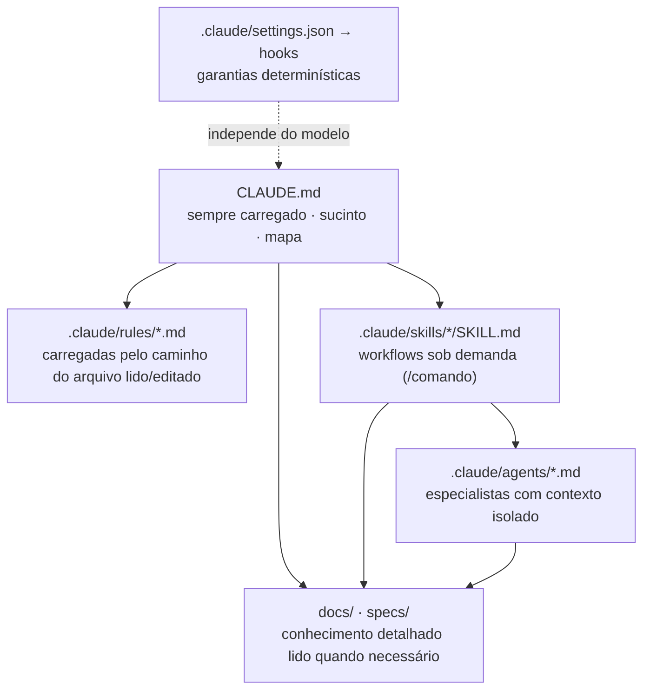

# Context Engineering para Claude Code

Como o TaskFlow organiza o contexto entregue ao Claude Code para que o desenvolvimento assistido por IA seja previsível, verificável e alinhado à arquitetura.

## Camadas de contexto

| Camada            | Quando carrega                                                      | Papel                                                                                |
| ----------------- | ------------------------------------------------------------------- | ------------------------------------------------------------------------------------ |
| `CLAUDE.md`       | Toda sessão                                                         | Visão, stack, princípios inegociáveis, processo, comandos, mapa de documentos.       |
| `.claude/rules/`  | Ao ler/editar arquivos que casam com `paths` (sem `paths` = sempre) | Regras específicas de cada área, sem poluir tarefas não relacionadas.                |
| `.claude/skills/` | Quando invocadas (`/nome`) ou quando o modelo identifica a tarefa   | Procedimentos passo a passo reutilizáveis.                                           |
| `.claude/agents/` | Quando delegado                                                     | Especialistas com instruções e ferramentas próprias, em janela de contexto separada. |
| Hooks             | Em eventos de ferramenta                                            | Garantias que não dependem do modelo "lembrar".                                      |
| `docs/`, `specs/` | Lidos sob demanda                                                   | Fonte de verdade de arquitetura, produto e requisitos.                               |

## Regras (`.claude/rules/`)

| Arquivo            | Escopo (`paths`)                                                     | Conteúdo                                                               |
| ------------------ | -------------------------------------------------------------------- | ---------------------------------------------------------------------- |
| `architecture.md`  | `apps/**`, `libs/**`, `prisma/**`                                    | Modular monolith, camadas, regra de dependência, anti-overengineering. |
| `typescript.md`    | `**/*.ts`, `**/*.mts`                                                | Strict, proibição de `any`, erros, nomes, imports.                     |
| `angular.md`       | `apps/web/**`, `apps/web-e2e/**`, `libs/frontend/**`                 | Standalone, Signals, RxJS, estado, acessibilidade, estilo, testes.     |
| `express.md`       | `apps/api/**`, `apps/worker/**`, `libs/backend/**`                   | Controller → use case → domain, erros, config, logging, assíncrono.    |
| `api-design.md`    | API, `libs/contracts/**`, `docs/api/**`                              | REST, versionamento, paginação, erros, concorrência, OpenAPI.          |
| `database.md`      | `prisma/**`, `prisma.config.ts`, `libs/backend/**/infrastructure/**` | Modelagem multi-tenant, transações, locking, migrations.               |
| `security.md`      | backend, auth do frontend, infra, CI                                 | Tenant isolation, autenticação, autorização, segredos, OWASP.          |
| `testing.md`       | `*.spec.ts`, configs de teste, e2e                                   | Estratégia por camada, BR no nome do teste, proibições.                |
| `documentation.md` | `docs/**`, `specs/**`, `**/*.md`                                     | Idioma, estados (implementado/planejado), ADRs, links.                 |
| `git-workflow.md`  | sempre                                                               | Branches, commits, o que nunca commitar, quando commitar.              |

## Skills (`.claude/skills/`)

| Skill                    | Invocação                                                               | Uso                                                               |
| ------------------------ | ----------------------------------------------------------------------- | ----------------------------------------------------------------- |
| `create-feature`         | Só manual                                                               | Fluxo SDD completo: spec → aprovação → implementação → validação. |
| `implement-spec`         | Só manual                                                               | Implementa uma tarefa de spec aprovada com testes e verificação.  |
| `create-domain-module`   | Manual ou automática                                                    | Novo bounded context / entidades com bibliotecas por camada.      |
| `create-api-endpoint`    | Manual ou automática                                                    | Endpoint REST padronizado (ficha + contrato + testes).            |
| `create-angular-feature` | Manual ou automática                                                    | Feature Angular com rotas lazy, estado, estados de UI e testes.   |
| `database-migration`     | Manual ou automática                                                    | Mudança de schema segura com revisão do SQL.                      |
| `write-tests`            | Manual ou automática                                                    | Testes a partir de BRs e critérios de aceitação.                  |
| `review-code`            | Manual ou automática; roda no agente `code-reviewer` (contexto isolado) | Revisão por gravidade.                                            |
| `security-audit`         | Manual ou automática; roda no agente `security-reviewer`                | Auditoria de auth/tenancy/exposição.                              |
| `create-adr`             | Manual ou automática                                                    | Registro de decisão arquitetural.                                 |

`create-feature` e `implement-spec` têm `disable-model-invocation: true`: escrever código de feature só começa por decisão explícita do usuário.

## Agentes (`.claude/agents/`)

| Agente                    | Ferramentas     | Quando usar                                                      |
| ------------------------- | --------------- | ---------------------------------------------------------------- |
| `software-architect`      | Somente leitura | Revisar `design.md`, novas libs, padrões, ADRs.                  |
| `security-reviewer`       | Somente leitura | Após mudanças em auth, permissões, queries tenant-scoped, infra. |
| `code-reviewer`           | Somente leitura | Antes de commit/PR.                                              |
| `node-express-specialist` | Todas           | Implementar backend de uma spec.                                 |
| `angular-specialist`      | Todas           | Implementar frontend de uma spec.                                |
| `database-specialist`     | Todas           | Modelagem e migrations não triviais.                             |
| `qa-test-engineer`        | Todas           | Planejar/escrever testes, auditar cobertura de BRs.              |
| `ux-ui-specialist`        | Todas           | Especificar telas, revisar acessibilidade e consistência visual. |
| `devops-specialist`       | Todas           | Nx, Docker, CI/CD, observabilidade.                              |

Regras de operação:

- O fluxo principal mantém a responsabilidade de integrar e validar o que um agente produz.
- Delegar apenas quando a especialidade ou o isolamento de contexto melhorar o resultado; tarefas triviais são feitas diretamente.
- Revisões independentes (arquitetura + segurança) podem rodar em paralelo; evite revisões redundantes do mesmo diff.
- Revisores não editam arquivos (`disallowedTools: Edit, Write`) — devolvem achados para o fluxo principal decidir.

## Hooks

| Evento                                     | Script                                    | Garantia                                                                                                                   |
| ------------------------------------------ | ----------------------------------------- | -------------------------------------------------------------------------------------------------------------------------- |
| `PreToolUse` (`Edit\|Write\|NotebookEdit`) | `.claude/hooks/guard-protected-files.mjs` | Bloqueia edição de `.env*` (exceto `.env.example`), `pnpm-lock.yaml`, Prisma Client gerado, `node_modules`, `dist`, `.nx`. |
| `PostToolUse` (`Edit\|Write`)              | `.claude/hooks/format-edited-file.mjs`    | Formata o arquivo editado com o Prettier local; silencioso e não bloqueante.                                               |

Ambos são scripts Node sem dependências externas, determinísticos e rápidos. Hooks que rodam testes ou lint a cada edição foram descartados: lentos, ruidosos durante edições em múltiplos passos e redundantes com o `pnpm verify` exigido na definição de pronto.

## Permissões (`.claude/settings.json`)

- **Permitidos sem prompt**: tarefas Nx, scripts de qualidade, `git status/diff/log/show/branch`, inspeção do Docker Compose.
- **Negados**: leitura de `.env`, `git push --force`, `prisma migrate reset`, remoção de volumes Docker.
- Preferências pessoais ficam em `.claude/settings.local.json` (ignorado pelo Git).

## Manutenção

- Ao mudar uma convenção: atualize a regra correspondente e, se necessário, o `CLAUDE.md` (nunca duplique conteúdo).
- Ao adicionar diretórios relevantes (ex.: `apps/worker`), revise os `paths` das regras.
- Verifique periodicamente com `/memory` quais arquivos de instrução estão carregados e se o `CLAUDE.md` continua abaixo de 200 linhas.
