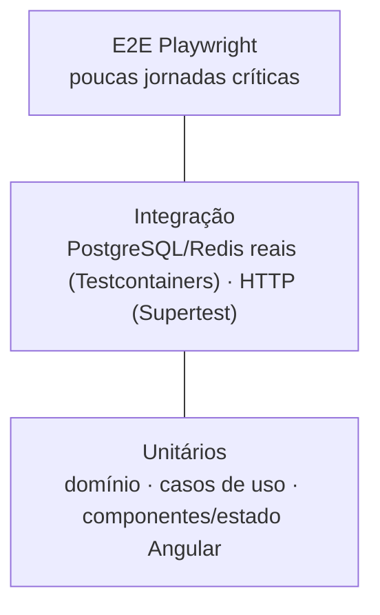

# Estratégia de testes

Regras operacionais para agentes: [.claude/rules/testing.md](../../.claude/rules/testing.md). Este documento explica a estratégia.

## Pirâmide orientada a risco



A maior parte do valor está em **testes de domínio e de caso de uso** (rápidos, determinísticos) e em **testes de integração** dos riscos que só aparecem com banco real (isolamento entre tenants, constraints, concorrência, transações).

## Riscos prioritários e como são cobertos

| Risco                            | Teste                                                                                 |
| -------------------------------- | ------------------------------------------------------------------------------------- |
| Vazamento entre organizações     | Integração por endpoint/repositório com duas organizações semeadas.                   |
| RBAC incorreto                   | Tabela-driven a partir da matriz em [authorization.md](../security/authorization.md). |
| Rotação/reuso de refresh token   | Integração: rotação, reuso → revogação da família, expiração, logout.                 |
| Conclusão de tarefa (BR-001/006) | Domínio (regra) + integração (mesma transação).                                       |
| Movimentação Kanban (BR-004/009) | Domínio (transições, ranking) + integração (movimentos concorrentes).                 |
| Conflitos concorrentes (BR-008)  | Integração: duas escritas na mesma versão → uma 409.                                  |
| Atomicidade (BR-010)             | Integração: falha forçada após primeira escrita não deixa estado parcial.             |
| Idempotência de jobs             | Consumidor processando o mesmo evento duas vezes produz um único efeito.              |

## Organização

- Unitários: `*.spec.ts` ao lado do código, target `test` de cada projeto (Vitest; Angular via `@angular/build:unit-test`).
- Integração: `*.integration.spec.ts`, target `integration-test` com `vitest.integration.config.mts`; containers sobem uma vez por arquivo de teste.
- E2E: `apps/web-e2e`, target `e2e` (Playwright sobe API e web).

## Metas de cobertura

- **90%** de linhas em `domain` e `application` de contextos críticos (identity, organizations, projects, tasks, boards).
- **80%** global de lógica testável como objetivo evolutivo.
- Cobertura é indicador, não objetivo: revisões rejeitam testes sem asserções significativas.

```bash
pnpm nx run <projeto>:test --coverage
```

Os limites (`thresholds`) serão ativados por biblioteca quando cada contexto crítico for criado, para não bloquear a fundação com metas sem código.

## Fase 0 (estado atual)

Implementado e executado: unitários de contratos, configuração e health da API (Supertest), componente de status do web, integração das probes de PostgreSQL/Redis com Testcontainers e um E2E de fumaça. Resultados na seção de validação de `specs/000-foundation/tasks.md`.
