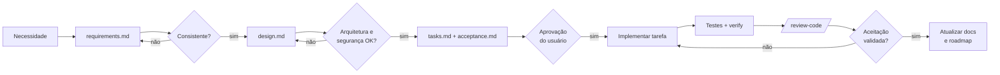

# Fluxo de desenvolvimento

## Visão geral (SDD)

Detalhes do processo: [specs/README.md](../../specs/README.md).

## Proporcionalidade

| Tipo de mudança                                                              | Exigência                                                             |
| ---------------------------------------------------------------------------- | --------------------------------------------------------------------- |
| Funcionalidade nova, regra de negócio, mudança de contrato/schema, segurança | Spec completa (4 documentos) aprovada.                                |
| Melhoria pequena dentro de spec existente                                    | Nova tarefa no `tasks.md` da spec + critério em `acceptance.md`.      |
| Bug                                                                          | Teste que reproduz + correção; referenciar BR/spec afetada no commit. |
| Typo, docs, configuração sem efeito funcional                                | Sem spec; descrever no commit.                                        |

## Ciclo de uma tarefa

1. `git switch -c feat/<spec>-<resumo>`.
2. `/implement-spec specs/NNN-nome Tn` (ou manualmente seguindo a skill).
3. `pnpm verify` (e `pnpm test:integration` se tocar persistência).
4. `/review-code`; `/security-audit` quando tocar auth, permissões ou queries tenant-scoped.
5. Atualizar `tasks.md` com evidência; commit em Conventional Commits; PR com descrição e evidências.

## Uso de IA

- O agente principal (Claude Code) lê `CLAUDE.md` e as regras de caminho automaticamente. Agentes especialistas e skills estão descritos em [context-engineering.md](../context-engineering.md).
- O agente nunca: inventa requisitos, declara testes não executados, altera decisões aceitas sem ADR, edita `.env` (bloqueado por hook) ou executa operações destrutivas sem autorização.
- Relatórios de entrega separam **implementado, testado, documentado, planejado e pendente**.
