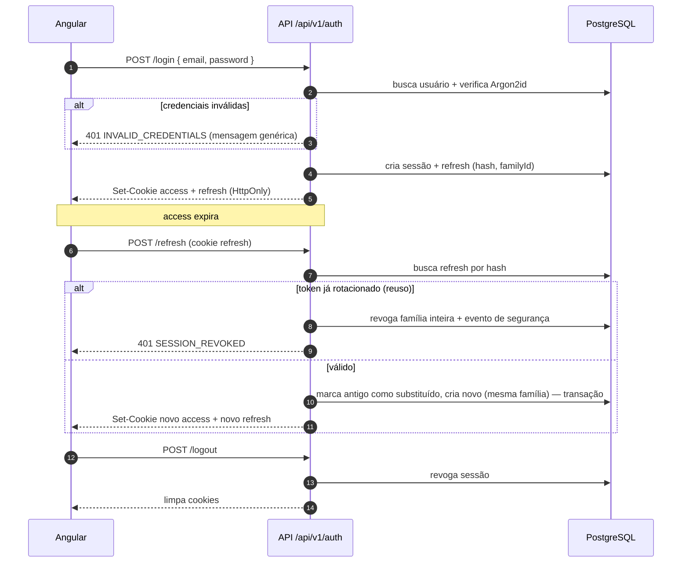

# Autenticação

Status: **Planejado** — arquitetura proposta no ADR [0005](../architecture/adr/0005-authentication-tokens-and-cookies.md); requisitos e design detalhados serão definidos na spec `001-authentication`.

## Componentes

| Elemento      | Proposta                                                                                                                                 |
| ------------- | ---------------------------------------------------------------------------------------------------------------------------------------- |
| Senha         | Argon2id (parâmetros mínimos OWASP: m=19 MiB, t=2, p=1), comparação em tempo constante pela biblioteca.                                  |
| Access token  | JWT, 10–15 min, claims `sub`, `sid`, `iat`, `exp`; cookie `HttpOnly`, `Secure`, `SameSite=Lax`.                                          |
| Refresh token | 256 bits aleatórios, armazenado como hash SHA-256, família por login, validade 7–30 dias (decidir), cookie `HttpOnly` com path restrito. |
| Sessão        | Registro por login (`sessionId`, dispositivo/user agent, IP truncado, `createdAt`, `lastUsedAt`, `revokedAt`).                           |
| CSRF          | Mesma origem + `SameSite` + verificação de `Origin`/`Sec-Fetch-Site` + token double-submit para mutações.                                |
| Rate limit    | Login, registro, refresh, recuperação de senha (Redis como store).                                                                       |

## Fluxo de login e refresh rotativo

## Regras

- Mensagens de login e de recuperação de senha não revelam se o e-mail existe.
- Recuperação de senha: token de uso único, aleatório, armazenado como hash, validade curta (≤ 30 min); redefinir senha revoga todas as sessões.
- Concorrência no refresh: duas abas renovando ao mesmo tempo não devem disparar falso positivo de reuso — a spec 001 define janela de tolerância curta ou serialização no frontend (um refresh em voo por vez).
- O interceptor Angular faz no máximo um refresh concorrente e repete a requisição original uma vez.
- Nenhum token é acessível por JavaScript nem armazenado em `localStorage`/`sessionStorage`.
- Logs registram eventos de autenticação (sucesso, falha, reuso) sem credenciais.
