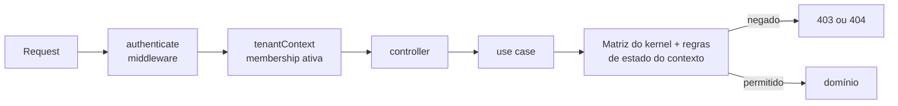

# Autorização

Status: vocabulário e matrizes **implementados** na spec 006 como Shared Kernel (`libs/backend/shared/kernel`, [ADR 0013](../architecture/adr/0013-authorization-shared-kernel.md)), com testes tabela-driven que transcrevem as tabelas abaixo. Permissões **de organização** com comportamento: **implementadas e testadas** (specs 002 e 006). Permissões **de projeto**: matriz e papel efetivo (BR-023) **implementados e aplicados** pelos casos de uso de `projects` (spec 003: `project:read`, `project:update`, `project:archive`, `project-member:manage`); as permissões de tarefas (`task:create`, `task:update`, `task:assign`, `task:delete`) **implementadas e aplicadas** pelos casos de uso de `tasks` (spec 004); `board:configure` **aplicada** à configuração do workflow (spec 005); as de comentários e sprints serão aplicadas nas specs seguintes. Itens marcados como planejados não estão no catálogo e, portanto, são negados.

## Modelo

Autorização = **RBAC** (papel efetivo) **+** **checagem no recurso** (o usuário tem relação com _este_ projeto/tarefa?) **+** **negação por padrão**.

- **Papéis organizacionais** (`Membership.role`): `owner`, `admin`, `member`, `viewer`.
- **Papéis de projeto** (`ProjectMember.role`): `manager`, `member`, `viewer`.
- **Papel efetivo em um projeto** (BR-023, `effectiveProjectRole`): `owner`/`admin` da organização atuam como `manager` em todos os projetos; `member` usa o papel do projeto; `viewer` da organização tem no máximo `viewer` (o papel da organização é teto); sem `ProjectMember` → sem acesso ao projeto (404, fora das listas).

| Papel do brief     | Representação                                                                                   |
| ------------------ | ----------------------------------------------------------------------------------------------- |
| Organization Owner | `Membership.role = owner` (exatamente ≥ 1 por organização)                                      |
| Organization Admin | `Membership.role = admin`                                                                       |
| Project Manager    | `ProjectMember.role = manager` (ou owner/admin da org, sem participação gravada — spec 003, D1) |
| Project Member     | `ProjectMember.role = member`                                                                   |
| Viewer             | `ProjectMember.role = viewer` ou `Membership.role = viewer`                                     |

## Matriz de permissões

Legenda: ✅ permitido · ⚪ apenas sobre o próprio recurso (`own`) · ⚙️ depende de configuração da organização (`setting`) · ❌ negado · _planejado_: fora do catálogo (negado até a spec que o implementar).

### Organização

| Permissão                                   | Owner | Admin | Member | Viewer |
| ------------------------------------------- | :---: | :---: | :----: | :----: |
| `organization:read`                         |  ✅   |  ✅   |   ✅   |   ✅   |
| `organization:update` (nome, configurações) |  ✅   |  ✅   |   ❌   |   ❌   |
| `member:invite`                             |  ✅   |  ✅   |   ❌   |   ❌   |
| `member:change-role`                        |  ✅   | ✅ ¹  |   ❌   |   ❌   |
| `member:remove` (remover **outros**)        |  ✅   | ✅ ¹  |   ❌   |   ❌   |
| `project:create`                            |  ✅   |  ✅   |  ⚙️ ²  |   ❌   |
| `organization:delete` — _planejado_         |  ✅   |  ❌   |   ❌   |   ❌   |
| `organization:transfer-ownership` — _plan._ |  ✅   |  ❌   |   ❌   |   ❌   |
| `team:manage` — _planejado_                 |  ✅   |  ✅   |   ❌   |   ❌   |
| `audit:read` — _planejado_                  |  ✅   |  ✅   |   ❌   |   ❌   |

¹ Admin não altera nem remove owner, nem promove alguém a owner (BR-021, regra de estado no domínio de `organizations`). ² "Membros podem criar projetos" (BR-024; padrão: permitido), alterada por quem tem `organization:update`; o criador vira `manager` do projeto (spec 003).

**Comentários** (spec 010): `comment:create`, `comment:update` (só o autor) e `comment:delete` (autor; o manager modera) **aplicadas**, decididas no caso de uso com o papel efetivo relido sob o lock da tarefa — inclusive para o autor rebaixado a viewer. A conversa (`GET /tasks/{id}/comments`) devolve `actions.comment`, e cada comentário `actions.edit`/`actions.delete`, já descontados projeto arquivado e tarefa cancelada (que permitem só excluir). Ordem de decisão: entrada (400/422) → 404 (`TASK_NOT_FOUND` ou, nas rotas por comentário, só `COMMENT_NOT_FOUND`) → 403 → arquivado → cancelada → removido → versão → menções → limites; excluir pula os estados e é idempotente depois do 403. A busca de candidatos a menção exige `comment:create`.

**Sair da organização** não é permissão: qualquer membro pode sair, respeitando a regra do último owner (BR-019).

**Estado**: implementados `organization:read`, `organization:update` (nome e "membros podem criar projetos"; o slug é imutável — BR-022), `member:invite` (convites nunca concedem owner), `member:change-role` e `member:remove`, com a regra do último owner (BR-019). `project:create` está no catálogo e nas capacidades; o endpoint que o usa nasce na spec 003. `organization:delete`, `team:manage` e `audit:read` são **planejados** (backlog, spec que usar equipes, Fase 3); `organization:transfer-ownership` não é um fluxo dedicado — é coberto por vários owners (promover outro e então sair). A decisão final de toda mutação de organização, membership e convite usa o papel **relido sob o lock da organização**, não o do middleware.

**Visibilidade de dados de membros**: todos os membros veem nome, e-mail e papel dos demais membros da própria organização (decisão do usuário na spec 002; a revisão de segurança recomendava restringir o e-mail a owner/admin). Quem não é membro não vê nada (404). A lista de convites é só de owner/admin.

### Projeto (papel efetivo no projeto)

| Permissão                                         |     Manager     |       Member        | Viewer |
| ------------------------------------------------- | :-------------: | :-----------------: | :----: |
| `project:read`                                    |       ✅        |         ✅          |   ✅   |
| `project:update` / configurar workflow            |       ✅        |         ❌          |   ❌   |
| `project:archive`                                 |       ✅        |         ❌          |   ❌   |
| `project-member:manage`                           |       ✅        |         ❌          |   ❌   |
| `task:create`                                     |       ✅        |         ✅          |   ❌   |
| `task:update` (campos, status, mover card)        |       ✅        |         ✅          |   ❌   |
| `task:assign`                                     |       ✅        |        ✅ ³         |   ❌   |
| `task:delete`                                     |       ✅        | ⚪ criadas por si ⁴ |   ❌   |
| `comment:create`                                  |       ✅        |         ✅          |   ❌   |
| `comment:update` / `comment:delete`               | ⚪ / ✅ moderar |       ⚪ / ⚪       |   ❌   |
| `sprint:manage` (criar, iniciar, fechar, reabrir) |       ✅        |         ❌          |   ❌   |
| `board:configure` (colunas)                       |       ✅        |         ❌          |   ❌   |

³ O **responsável** precisa ter papel efetivo manager/member (BR-003) — regra de estado verificada em `tasks` (spec 004), não na matriz.

⁴ D5 da spec 004: o member só exclui quando a tarefa **e todas as subtarefas** foram criadas por ele (a exclusão é em cascata e não apaga trabalho alheio), decidido sob o lock do projeto em `tasks`.

## Capacidades na API

O frontend **não tem matriz própria**. A API devolve:

- `capabilities` em `GET /organizations/{id}` e em `GET /me/organizations`: as permissões de organização efetivas do usuário (`organizationPermissions(role, settings)`), já considerando BR-024;
- `actions` em cada item de `GET /organizations/{id}/members` e na resposta de alteração de papel: `changeRoleTo` (papéis para os quais o usuário atual pode alterar aquele membro) e `remove`, calculadas pela política de BR-021.

Capacidades são **dica de interface**: a interface só esconde ou desabilita ações; o caso de uso sempre decide de novo, com o estado relido.

Nos projetos (spec 003), o mesmo padrão: `GET …/projects/{id}` e `…/by-key/{key}` devolvem `myRole` (papel efetivo) e `capabilities` (permissões `allow`, descontado o arquivamento: arquivado ⇒ só ler e restaurar); cada participante traz `actions` (`changeRoleTo`, `remove`, `leave`) e cada candidato `allowedRoles` (teto). Quem não participa recebe 404 com o mesmo corpo de um projeto inexistente; participante sem permissão recebe 403 antes de qualquer erro de estado.

Nas tarefas (spec 004), o detalhe traz `actions` (`update`, `assign`, `cancel`, `reopen`, `delete` — com a regra de D5 — e `transitionTo`, os destinos permitidos pelo workflow), descontados o arquivamento e o cancelamento. Rotas endereçadas por tarefa respondem o **mesmo** 404 `TASK_NOT_FOUND` para tarefa inexistente, de projeto inexistente ou sem acesso (achado M3); rotas com `projectId` na query ou no corpo respondem `PROJECT_NOT_FOUND`. Ordem de decisão: 404 → 403 → projeto arquivado → tarefa cancelada → versão → referências → regras → limites.

No quadro (spec 005), `GET /board` devolve `actions.move` (`task:update`) e `actions.configure` (`board:configure`), descontado o arquivamento; mover card segue 404 → 403 → arquivado → cancelada → versão → `TASK_NOT_A_CARD` → `STATUS_NOT_FOUND` → `INVALID_POSITION` → regras. As edições do workflow seguem 404 `PROJECT_NOT_FOUND` → 403 → arquivado → versão → referências (`STATUS_NOT_FOUND`) → regras BR-030 → limites.

## Onde a autorização acontece

- Middlewares garantem **identidade** e **tenant**; a decisão de permissão sobre o recurso é do **caso de uso**, porque depende do recurso carregado: o grant vem da matriz do kernel (`hasOrganizationPermission`, `canOnProject`) e as regras de estado (BR-019, BR-021, BR-003) vêm do domínio do contexto. Um grant `allow` nunca é autorização completa.
- 404 quando o usuário não deve saber que o recurso existe (outro tenant, projeto sem acesso); 403 quando o recurso é visível mas a ação não é permitida (ex.: viewer tentando editar).
- Guards do Angular apenas melhoram a UX (esconder ações); nunca substituem a verificação do backend.

## Testes

Para cada permissão: teste positivo por papel permitido e negativo por papel negado, mais isolamento cross-tenant. A matriz acima é a fonte dos casos (tabela-driven em `authorization.spec.ts` do kernel, incluindo chaves hostis como `__proto__`); um teste em `organizations/http` garante que o catálogo do kernel e o de `libs/contracts` são iguais. Mudar a matriz exige atualizar este documento, os testes e a spec 006 (ou a spec que a altera).
