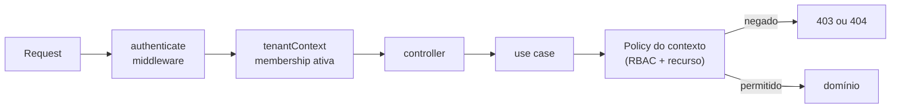

# Autorização

Status: papéis e permissões **da organização** **implementados** na spec 002 (BR-019, BR-021; marcados abaixo); papéis e permissões **de projeto** **planejados** — matriz inicial confirmada na spec `006-permissions`.

## Modelo

Autorização = **RBAC** (papel efetivo) **+** **checagem no recurso** (o usuário tem relação com _este_ projeto/tarefa?) **+** **negação por padrão**.

- **Papéis organizacionais** (`Membership.role`): `owner`, `admin`, `member`, `viewer`.
- **Papéis de projeto** (`ProjectMember.role`): `manager`, `member`, `viewer`.
- **Papel efetivo em um projeto**: `owner`/`admin` da organização atuam como `manager` em todos os projetos; demais usam o papel do projeto; sem `ProjectMember` → sem acesso ao projeto (404).

| Papel do brief     | Representação                                               |
| ------------------ | ----------------------------------------------------------- |
| Organization Owner | `Membership.role = owner` (exatamente ≥ 1 por organização)  |
| Organization Admin | `Membership.role = admin`                                   |
| Project Manager    | `ProjectMember.role = manager` (ou owner/admin da org)      |
| Project Member     | `ProjectMember.role = member`                               |
| Viewer             | `ProjectMember.role = viewer` ou `Membership.role = viewer` |

## Matriz de permissões (inicial)

Legenda: ✅ permitido · ⚪ apenas sobre o próprio recurso/próprio usuário · ❌ negado.

### Organização

| Permissão                                   | Owner | Admin | Member  | Viewer  |
| ------------------------------------------- | :---: | :---: | :-----: | :-----: |
| `organization:read`                         |  ✅   |  ✅   |   ✅    |   ✅    |
| `organization:update` (nome, configurações) |  ✅   |  ✅   |   ❌    |   ❌    |
| `organization:delete`                       |  ✅   |  ❌   |   ❌    |   ❌    |
| `organization:transfer-ownership`           |  ✅   |  ❌   |   ❌    |   ❌    |
| `member:invite`                             |  ✅   |  ✅   |   ❌    |   ❌    |
| `member:change-role`                        |  ✅   | ✅ ¹  |   ❌    |   ❌    |
| `member:remove`                             |  ✅   | ✅ ¹  | ⚪ sair | ⚪ sair |
| `team:manage`                               |  ✅   |  ✅   |   ❌    |   ❌    |
| `project:create`                            |  ✅   |  ✅   |  ✅ ²   |   ❌    |
| `audit:read`                                |  ✅   |  ✅   |   ❌    |   ❌    |

¹ Admin não altera nem remove owner, nem promove alguém a owner. ² Configurável pela organização (padrão: permitido); o criador vira `manager` do projeto.

**Estado na spec 002**: implementados `organization:read`, `organization:update` (nome; o slug é imutável — BR-022), `member:invite` (convites nunca concedem owner), `member:change-role` e `member:remove`/sair, com a regra do último owner (BR-019). `organization:delete` e `team:manage` estão **fora do escopo** (backlog e spec que usar equipes); `organization:transfer-ownership` não é um fluxo dedicado — é coberto por vários owners (promover outro e então sair). A decisão final de toda mutação de membership e convite usa o papel **relido sob o lock da organização**, não o do middleware.

**Visibilidade de dados de membros**: todos os membros veem nome, e-mail e papel dos demais membros da própria organização (decisão do usuário na spec 002; a revisão de segurança recomendava restringir o e-mail a owner/admin). Quem não é membro não vê nada (404). A lista de convites é só de owner/admin.

### Projeto (papel efetivo no projeto)

| Permissão                                         |     Manager     |      Member       | Viewer |
| ------------------------------------------------- | :-------------: | :---------------: | :----: |
| `project:read`                                    |       ✅        |        ✅         |   ✅   |
| `project:update` / configurar workflow            |       ✅        |        ❌         |   ❌   |
| `project:archive`                                 |       ✅        |        ❌         |   ❌   |
| `project-member:manage`                           |       ✅        |        ❌         |   ❌   |
| `task:create`                                     |       ✅        |        ✅         |   ❌   |
| `task:update` (campos, status, mover card)        |       ✅        |        ✅         |   ❌   |
| `task:assign`                                     |       ✅        |       ✅ ³        |   ❌   |
| `task:delete`                                     |       ✅        | ⚪ criadas por si |   ❌   |
| `comment:create`                                  |       ✅        |        ✅         |   ❌   |
| `comment:update` / `comment:delete`               | ⚪ / ✅ moderar |        ⚪         |   ❌   |
| `sprint:manage` (criar, iniciar, fechar, reabrir) |       ✅        |        ❌         |   ❌   |
| `board:configure` (colunas)                       |       ✅        |        ❌         |   ❌   |

³ Apenas para membros do projeto (BR-003).

## Onde a autorização acontece

- Middlewares garantem **identidade** e **tenant**; a decisão de permissão sobre o recurso é do **caso de uso** (via policy do contexto), porque depende do recurso carregado.
- 404 quando o usuário não deve saber que o recurso existe (outro tenant, projeto sem acesso); 403 quando o recurso é visível mas a ação não é permitida (ex.: viewer tentando editar).
- Guards do Angular apenas melhoram a UX (esconder ações); nunca substituem a verificação do backend.

## Testes

Para cada permissão: teste positivo por papel permitido e negativo por papel negado, mais isolamento cross-tenant. A matriz acima é a fonte dos casos (tabela-driven tests).
