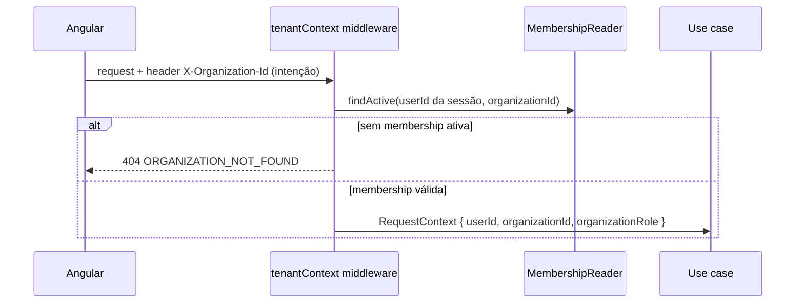

# Multi-tenancy

Status: **Planejado** (decisão base aceita no ADR [0004](../architecture/adr/0004-multi-tenancy-shared-database.md); implementação nas specs 002 e 006).

## Modelo

- **Tenant** = `Organization`. Um usuário (`User`, global) pode pertencer a várias organizações via `Membership (organizationId, userId, role, status)`.
- Todas as tabelas de negócio (projetos, tarefas, quadros, sprints, comentários, notificações, auditoria) possuem `organization_id NOT NULL`.
- Tabelas globais (sem tenant): usuários, credenciais, sessões/refresh tokens, organizações.

## Organização ativa

- O cliente informa a organização desejada (header `X-Organization-Id`, a confirmar na spec 002); o servidor **valida** contra memberships a cada request. Sem membership → 404.
- **Troca de organização**: apenas muda o header enviado pelo frontend; o frontend descarta estado em memória da organização anterior, fecha rooms de socket antigas e recarrega dados. Nenhum token precisa ser reemitido.
- Membership removida/suspensa tem efeito na próxima request (sem cache além da duração da request).

## Garantias na aplicação

1. `RequestContext` com `organizationId` verificado é parâmetro obrigatório de casos de uso tenant-scoped.
2. Repositórios exigem `organizationId` em todos os métodos e o aplicam em `where` de leitura **e** escrita.
3. Recurso de outra organização → **404** (`RESOURCE_NOT_FOUND`), sem distinguir de inexistente.
4. Relações cruzadas (tarefa ↔ projeto, dependência ↔ tarefa, responsável ↔ membro) só aceitam entidades da mesma organização — validadas no caso de uso e, quando possível, por FK composta `(organization_id, id)`.
5. Rooms de Socket.IO: `org:{organizationId}` e `project:{projectId}`; ingresso autorizado no servidor, revalidado em reconexão.
6. Jobs carregam `organizationId` e revalidam o estado ao executar.

## Defesa em profundidade (proposta)

RLS no PostgreSQL com `set_config('app.organization_id', $1, true)` por transação — avaliação na spec 006 (benefícios: banco bloqueia vazamentos por filtro esquecido; limitações: toda query precisa de transação com contexto, pool de conexões, migrations com papel distinto, custo de depuração).

## Testes obrigatórios

Para cada recurso tenant-scoped: usuário da organização A **não** consegue listar, ler, alterar, excluir, referenciar (ex.: atribuir, criar dependência) nem se inscrever em eventos de recursos da organização B. Implementados como testes de integração com duas organizações semeadas.
