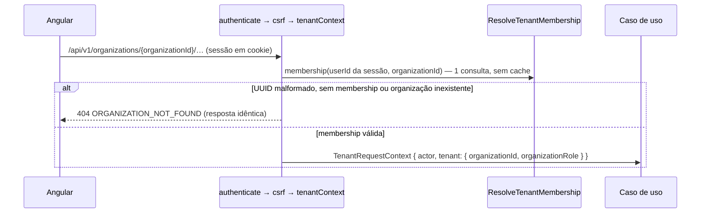

# Multi-tenancy

Status: **Implementado** na spec 002 (organização ativa, memberships, isolamento por `organizationId`; ADRs [0004](../architecture/adr/0004-multi-tenancy-shared-database.md) e [0012](../architecture/adr/0012-tenant-in-api-path.md)). RLS **adiada para a Fase 4** ([ADR 0014](../architecture/adr/0014-rls-deferred.md)); harness de isolamento obrigatório **implementado** (spec 006).

## Modelo

- **Tenant** = `Organization`. Um usuário (`User`, global, contexto `identity`) pertence a várias organizações via `Membership (organizationId, userId, role, version)`. Não há `status`: remover ou sair **apaga** a membership (histórico no log de segurança; BR-007 com desvio registrado).
- Todas as tabelas de negócio (projetos, tarefas, quadros, sprints, comentários, notificações, auditoria) possuem `organization_id NOT NULL`.
- Tabelas globais (sem tenant): usuários, credenciais, sessões/refresh tokens, organizações.

## Organização ativa (ADR 0012)

Todo recurso tenant-scoped vive sob **`/api/v1/organizations/{organizationId}/…`**. O id do caminho é **intenção**, nunca prova.

- `createTenantScope` (`libs/backend/shared/http`) monta `authenticate → csrf → tenantContext` **uma vez** sobre o prefixo, e os routers dos contextos são montados abaixo dele (`mergeParams`): protegidos por construção. Controllers obtêm o contexto só por `tenantRequestContextFrom(request)`, que falha fechado.
- Rotas sem organização ativa ficam fora do prefixo: `POST /organizations`, `GET /me/organizations`, `POST /invitations/lookup|accept`, identidade.
- O papel do middleware serve só para **negação rápida**; mutações de membership e convites travam a organização e **relêem** ator e alvo antes de decidir (BR-019/BR-021).
- **Troca de organização** no frontend: é navegação para `/o/:slug`. O slug é resolvido pelo `GET /me/organizations`; o data-access monta cada URL com o id resolvido — **não há interceptor que injete o tenant**. A área `/o/:slug` (e seus stores) é recriada quando o slug muda. Nenhum token precisa ser reemitido; abas diferentes podem estar em organizações diferentes.
- Membership removida tem efeito na próxima request (sem cache além da duração da request); no frontend, um 404 `ORGANIZATION_NOT_FOUND` invalida "minhas organizações" e leva a `/organizations`.

## Garantias na aplicação

1. `RequestContext` com `organizationId` verificado é parâmetro obrigatório de casos de uso tenant-scoped.
2. Repositórios exigem `organizationId` em todos os métodos e o aplicam em `where` de leitura **e** escrita.
3. Recurso de outra organização → **404**, sem distinguir de inexistente (ex.: `ORGANIZATION_NOT_FOUND`, `MEMBER_NOT_FOUND`, `INVITATION_NOT_FOUND`). Parâmetros malformados também respondem 404, sem chegar ao banco.
4. Relações cruzadas (tarefa ↔ projeto, dependência ↔ tarefa, responsável ↔ membro) só aceitam entidades da mesma organização — validadas no caso de uso e, quando possível, por FK composta `(organization_id, id)`.
5. Rooms de Socket.IO: `org:{organizationId}` e `project:{projectId}`; ingresso autorizado no servidor, revalidado em reconexão.
6. Jobs carregam `organizationId` e revalidam o estado ao executar.

## Defesa em profundidade (RLS adiado — ADR 0014)

RLS no PostgreSQL com `set_config('app.organization_id', $1, true)` por transação foi avaliado na spec 006 e **adiado para a Fase 4** ([ADR 0014](../architecture/adr/0014-rls-deferred.md)), com gatilhos de reavaliação antecipada (primeiro SQL raw tenant-scoped, busca/relatórios/exportação, worker com dados de tenant, Socket.IO, integrações externas, qualquer incidente de isolamento) e preparação barata já exigida das próximas specs (`organization_id NOT NULL` em toda tabela filha, FKs compostas `(organization_id, id)`, `PrismaTransactionRunner` como ponto único de acesso). Até lá, o risco residual (filtro esquecido) é coberto pelas garantias acima, pelo harness abaixo, pelo lint de `params.organizationId` e por `/security-audit` em cada spec.

## Testes obrigatórios

Para cada recurso tenant-scoped: usuário da organização A **não** consegue listar, ler, alterar, excluir, referenciar (ex.: atribuir, criar dependência) nem se inscrever em eventos de recursos da organização B. Implementados pelo **harness de isolamento** (spec 006, `apps/api/src/testing`):

- as rotas são lidas da composição real (`composeApiRouters`) por introspecção do router do Express 5, falhando fechado se a estrutura mudar;
- cada rota do escopo do tenant precisa de um caso em `isolation-cases.ts` e cada rota global de uma justificativa em `GLOBAL_ROUTES` — o teste unitário `route-coverage.spec.ts` falha se faltar um deles ou se uma rota com `:organizationId` ficar fora do escopo;
- a integração (`organizations-isolation.integration.spec.ts`) executa para cada rota: 401 sem sessão, 404 sem membership e as variantes por referência com ids **reais** de B sob o prefixo de A;
- um snapshot genérico de todas as tabelas com `organization_id` (via `information_schema`) prova que B fica inalterado, e ids canário de B (inclusive contas que só existem em B) não podem aparecer em nenhuma resposta.

Desde a spec 003 (obrigação 6 da 006 e revisão de segurança), o harness também:

- exige que cada caso declare os schemas de corpo e query (de `libs/contracts`, ou `null` explícito); `coverageGaps` deriva deles as referências `…Id` e `cursor` e exige variante para cada uma;
- confere o **código** do Problem Details esperado em cada variante (não só o 404);
- semeia projetos, participantes, workflow e cursores reais nos dois lados e troca **uma** referência por vez;
- roda as variantes também com um usuário **membro de A e de B**, participante de projetos dos dois lados — o ator que revela consultas de participação sem `organizationId`;
- reconhece o middleware `noStore` por identidade, não por nome.

A autorização **dentro** da organização tem bateria própria (`projects-authorization.integration.spec.ts`), gerada das rotas de projeto: quem não participa recebe 404 idêntico a "não existe"; participante sem permissão recebe 403 antes de erros de estado; IDOR entre projetos ⇒ 404.

Desde a spec 004, o harness cobre as 13 rotas de `/tasks` (caminho `taskId`/`key`/`blockingTaskId`; corpo e query `projectId`, `parentTaskId`, `assigneeUserId`, `statusId`, `blockingTaskId`, `cursor`), com o filtro "eu/sem responsável" fora das referências (`assigned`, achado M6.1) e uma expectativa nova, `refused` (422 com código), para referências a pessoas de B que a regra recusa (`ASSIGNEE_NOT_PROJECT_MEMBER`). Filtros por status usam o status em que estão as tarefas de B: um filtro sem tenant as vazaria. A bateria `tasks-authorization.integration.spec.ts` prova, para as rotas de tarefa, o 404 idêntico, o 403 antes de erros de estado e a recusa de referências de **outro projeto** da mesma organização (pai, bloqueadora, status, responsável e filtros) — inclusive para o owner, que enxerga os dois projetos. FKs compostas `(organization_id, project_id, …)` barram no banco o que a aplicação deixasse passar (verificado por mutation testing).

Desde a spec 005, `inputReferences` percorre **listas e objetos aninhados** (`statusIds`, `transitions[].fromStatusId`) e o destino da remoção chama-se `moveTasksToStatusId`; `refused` aceita o status esperado (400 `INVALID_CURSOR` para cursor de coluna de outra organização, amarrado à coluna). As 8 rotas do quadro e do workflow têm casos e entram nas baterias de `projects` e `tasks`, com IDOR entre projetos também para o owner. A reordenação de status — sem FK que a proteja — confere o conjunto pedido com o workflow relido e filtra `(organization_id, project_id, id)` em cada escrita. O rebalanceamento de coluna é a primeira escrita SQL raw tenant-scoped (avaliado no ADR 0007; RLS continua adiado).

Uma spec que cria rota tenant-scoped só acrescenta os casos dela; tabelas novas entram no snapshot automaticamente.
