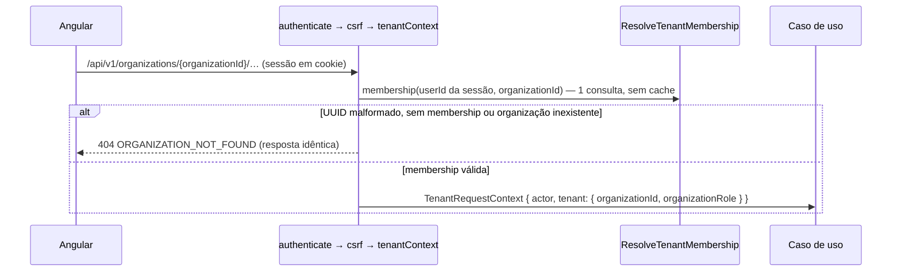

# Multi-tenancy

Status: **Implementado** na spec 002 (organização ativa, memberships, isolamento por `organizationId`; ADRs [0004](../architecture/adr/0004-multi-tenancy-shared-database.md) e [0012](../architecture/adr/0012-tenant-in-api-path.md)). RLS continua **planejada** (spec 006).

## Modelo

- **Tenant** = `Organization`. Um usuário (`User`, global, contexto `identity`) pertence a várias organizações via `Membership (organizationId, userId, role, version)`. Não há `status`: remover ou sair **apaga** a membership (histórico no log de segurança; BR-007 com desvio registrado).
- Todas as tabelas de negócio (projetos, tarefas, quadros, sprints, comentários, notificações, auditoria) possuem `organization_id NOT NULL`.
- Tabelas globais (sem tenant): usuários, credenciais, sessões/refresh tokens, organizações.

## Organização ativa (ADR 0012)

Todo recurso tenant-scoped vive sob **`/api/v1/organizations/{organizationId}/…`**. O id do caminho é **intenção**, nunca prova.

- `createTenantScope` (`libs/backend/shared/http`) monta `authenticate → csrf → tenantContext` **uma vez** sobre o prefixo, e os routers dos contextos são montados abaixo dele (`mergeParams`): protegidos por construção. Controllers obtêm o contexto só por `tenantRequestContextFrom(request)`, que falha fechado.
- Rotas sem organização ativa ficam fora do prefixo: `POST /organizations`, `GET /me/organizations`, `POST /invitations/lookup|accept`, identidade.
- O papel do middleware serve só para **negação rápida**; mutações de membership e convites travam a organização e **relêem** ator e alvo antes de decidir (BR-019/BR-021).
- **Troca de organização** no frontend: é navegação para `/o/:slug`. O slug é resolvido pelo `GET /me/organizations`; o data-access monta cada URL com o id resolvido — **não há interceptor que injete o tenant**. A área `/o/:slug` (e seus stores) é recriada quando o slug muda. Nenhum token precisa ser reemitido; abas diferentes podem estar em organizações diferentes.
- Membership removida tem efeito na próxima request (sem cache além da duração da request); no frontend, um 404 `ORGANIZATION_NOT_FOUND` invalida "minhas organizações" e leva a `/organizations`.

## Garantias na aplicação

1. `RequestContext` com `organizationId` verificado é parâmetro obrigatório de casos de uso tenant-scoped.
2. Repositórios exigem `organizationId` em todos os métodos e o aplicam em `where` de leitura **e** escrita.
3. Recurso de outra organização → **404**, sem distinguir de inexistente (ex.: `ORGANIZATION_NOT_FOUND`, `MEMBER_NOT_FOUND`, `INVITATION_NOT_FOUND`). Parâmetros malformados também respondem 404, sem chegar ao banco.
4. Relações cruzadas (tarefa ↔ projeto, dependência ↔ tarefa, responsável ↔ membro) só aceitam entidades da mesma organização — validadas no caso de uso e, quando possível, por FK composta `(organization_id, id)`.
5. Rooms de Socket.IO: `org:{organizationId}` e `project:{projectId}`; ingresso autorizado no servidor, revalidado em reconexão.
6. Jobs carregam `organizationId` e revalidam o estado ao executar.

## Defesa em profundidade (proposta)

RLS no PostgreSQL com `set_config('app.organization_id', $1, true)` por transação — avaliação na spec 006 (benefícios: banco bloqueia vazamentos por filtro esquecido; limitações: toda query precisa de transação com contexto, pool de conexões, migrations com papel distinto, custo de depuração).

## Testes obrigatórios

Para cada recurso tenant-scoped: usuário da organização A **não** consegue listar, ler, alterar, excluir, referenciar (ex.: atribuir, criar dependência) nem se inscrever em eventos de recursos da organização B. Implementados como testes de integração com duas organizações semeadas, usando ids **reais** de B sob o prefixo de A e verificando que o banco de B fica inalterado (referência: `apps/api/src/modules/organizations-isolation.integration.spec.ts`, spec 002/T14). Cada novo router tenant-scoped também entra no teste de tabela de rotas do contexto (rotas fora do prefixo enumeradas; todas as do tenant com 401 sem sessão e 404 sem membership).
