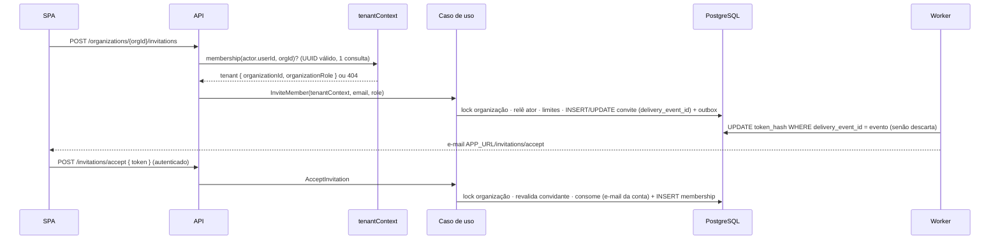

# 002 — Organizações e multi-tenancy · Design técnico

- **Status**: Aprovado (revisão 3 — decisões do usuário de 2026-10-09 sobre visibilidade de e-mails e reconvite)
- **Requisitos**: [requirements.md](requirements.md)
- **Revisão de arquitetura**: 1 bloqueante, 8 importantes, 9 sugestões → incorporados (ver [Histórico de revisões](#histórico-de-revisões))
- **Revisão de segurança**: sem críticos; 1 alto, 4 médios, 8 baixos → incorporados

## Solução proposta

Novo bounded context **`organizations`** em quatro camadas (padrão da spec 001). A organização é o tenant; `Membership` liga um usuário global (contexto `identity`) a uma organização com um papel. O contexto não lê tabelas de `identity`: consulta contas por uma porta (`UserDirectory`) que os composition roots (`apps/api` e `apps/worker`) ligam a casos de uso de `identity`.

**Transporte do tenant (ADR 0012, proposto com esta spec)**: todo recurso tenant-scoped vive sob `/api/v1/organizations/{organizationId}/…`. O composition root monta uma única vez `authenticate → csrf → tenantContext` sobre esse prefixo; os routers de cada contexto (organizations agora, projects e tasks depois) são montados ali com `mergeParams`, protegidos por construção. O `organizationId` da rota é intenção; o servidor valida a membership a cada requisição e entrega um `TenantRequestContext` tipado. Sem membership ⇒ 404.

Convites seguem o desenho de e-mails da spec 001 (ADR 0011): a API grava o convite e um evento na outbox na mesma transação; o **worker emite o token** e envia o e-mail com o token no **fragmento** da URL. Cada convite tem **um único token vigente**, ligado ao último evento de envio (`delivery_event_id`): eventos antigos fora de ordem são descartados. O aceite exige sessão da conta com o e-mail convidado, verificado (BR-013, BR-020).

As invariantes de papéis (BR-019 "sempre um owner" e BR-021 "hierarquia") são garantidas por **serialização por organização**: toda mutação de membership e toda ação de convite trava a linha da organização (`FOR NO KEY UPDATE`), **relê** as memberships do ator e do alvo e só então aplica a política e grava.

## Componentes envolvidos

| Projeto Nx                                    | Tags                                     | Mudança                                                                                                                                                                  |
| --------------------------------------------- | ---------------------------------------- | ------------------------------------------------------------------------------------------------------------------------------------------------------------------------ |
| ★ `libs/backend/organizations/domain`         | backend · organizations · domain         | `Organization`, `OrganizationName`, `OrganizationSlug` (BR-022), `Membership`, `Invitation`, política de papéis (BR-021), repositórios                                   |
| ★ `libs/backend/organizations/application`    | backend · organizations · application    | Casos de uso (inclui `ResolveTenantMembership` para o middleware e `SendInvitation` para o worker); portas `UserDirectory`, `InvitationTokenGenerator`; eventos; limites |
| ★ `libs/backend/organizations/infrastructure` | backend · organizations · infrastructure | Repositórios Prisma (lock da organização, escrita sempre filtrada por `organizationId`), templates pt-BR do convite                                                      |
| ★ `libs/backend/organizations/http`           | backend · organizations · presentation   | Router (montado sob o prefixo do tenant e rotas fora dele), mapeamento de erros, limites, OpenAPI                                                                        |
| `libs/backend/identity/application`           | backend · identity · application         | + `GetUserAccountsUseCase` (por ids: nome, e-mail, verificado) e `FindUserIdByEmailUseCase`, expostos por `createIdentityModule`                                         |
| `libs/backend/shared/application`             | backend · shared · application           | + `OrganizationRole` (linguagem publicada), `TenantRequestContext`; `SecurityEventRecorder` movido de `identity` (dois contextos o usam)                                 |
| `libs/backend/shared/http`                    | backend · shared · presentation          | + `createTenantContext({ resolve })` (UUID inválido ⇒ 404, exige `actor`, papel validado por enum) e `tenantRequestContextFrom(request)` (falha fechado)                 |
| `libs/backend/shared/kernel`                  | backend · shared · domain                | + validação de texto exibível (sem controles, CR/LF, bidi, zero-width), usada por `OrganizationName` e `PersonName`                                                      |
| `libs/contracts`                              | shared · contracts                       | Contratos de organizações, membros (paginados) e convites                                                                                                                |
| `prisma/models/organizations.prisma`          | —                                        | `Organization`, `Membership`, `Invitation` (+ migration)                                                                                                                 |
| `apps/api`                                    | backend · app                            | `createOrganizationsModule`; router do tenant único; adaptador `UserDirectory` → `identity`                                                                              |
| `apps/worker`                                 | backend · app                            | `SendInvitation` na fila `emails` (adaptador `UserDirectory` também aqui); retenção de convites encerrados                                                               |
| `apps/web`                                    | frontend · app                           | Onboarding, seletor, `/o/:slug`, membros e convites, aceite; data-access monta URLs pelo id resolvido da rota                                                            |

## Fluxo de dados

## Modelo de domínio

- **Organization**: `id`, `name` (`OrganizationName`: 2–80 caracteres após trim, texto exibível), `slug` (`OrganizationSlug`, BR-022, imutável), `version`, `createdAt`.
- **OrganizationRole** (shared): `owner` | `admin` | `member` | `viewer`.
- **Membership**: `organizationId`, `userId`, `role`, `version`, `createdAt`. Remoção apaga a linha (histórico em log de segurança; ver BR-007 em Observabilidade).
- **Invitation**: `organizationId`, `email` (`EmailAddress` do kernel), `role` (nunca `owner`), `invitedByUserId`, `deliveryEventId`, `expiresAt` (7 dias, renovado no reenvio), estado `pending | accepted | revoked`; expirado = pendente com `expiresAt` passado (listado como "expirado").
- **Política de papéis** (função pura, BR-021): `canInvite`, `canChangeRole(actor, target, newRole, isSelf)`, `canRemove(actor, target, isSelf)`, avaliada sempre sobre o estado relido sob lock. A contagem de owners (BR-019) também é feita sob o lock.

## Modelagem de dados

Novo `prisma/models/organizations.prisma` (aditivo). `user_id`, `invited_by_user_id` e `accepted_by_user_id` são UUIDs **sem FK** para `users` (regra entre contextos, ADR 0003). Remoção de usuários pela RF-15 só atinge contas não verificadas, que não podem ser membros (BR-013).

| Tabela          | Colunas principais                                                                                                                                                                                                                       | Restrições e índices                                                                                                                                                                                                                                                            |
| --------------- | ---------------------------------------------------------------------------------------------------------------------------------------------------------------------------------------------------------------------------------------- | ------------------------------------------------------------------------------------------------------------------------------------------------------------------------------------------------------------------------------------------------------------------------------- |
| `organizations` | `id`, `name`, `slug`, `version`, `created_at`, `updated_at`                                                                                                                                                                              | `slug` único; `CHECK` de formato do slug                                                                                                                                                                                                                                        |
| `memberships`   | `id`, `organization_id` (FK, cascade), `user_id`, `role`, `version`, `created_at`, `updated_at`                                                                                                                                          | único `(organization_id, user_id)` (usado pelo middleware); `(organization_id, role)`; **exceção documentada** à regra "índices começam por `organization_id`": `(user_id)` para "minhas organizações" (consulta global do próprio usuário)                                     |
| `invitations`   | `id`, `organization_id` (FK, cascade), `email`, `role`, `invited_by_user_id`, `token_hash` (nulo até o worker emitir), `delivery_event_id`, `expires_at`, `accepted_at`, `accepted_by_user_id`, `revoked_at`, `created_at`, `updated_at` | `token_hash` único (vários NULL permitidos); **único parcial** `(organization_id, email) WHERE accepted_at IS NULL AND revoked_at IS NULL` (um convite aberto por e-mail, inclusive expirado); `CHECK` papel ≠ owner; `CHECK` aceite e revogação exclusivos; e-mail normalizado |

## Contratos

### Endpoints

Fora do prefixo do tenant (sem organização ativa):

| Método | URI                          | Permissão                      | Request          | Response                                                                                            | Erros                                                                                                                         |
| ------ | ---------------------------- | ------------------------------ | ---------------- | --------------------------------------------------------------------------------------------------- | ----------------------------------------------------------------------------------------------------------------------------- |
| POST   | `/api/v1/organizations`      | e-mail verificado (BR-013)     | `{ name, slug }` | 201 `Organization` + `Location`                                                                     | 400, 403 `EMAIL_NOT_VERIFIED`, 409 `SLUG_TAKEN`, 422 `ORGANIZATION_LIMIT_REACHED`, 429                                        |
| GET    | `/api/v1/me/organizations`   | autenticado                    | —                | `{ items: MyOrganization[] }` (teto de 100 memberships por usuário, imposto na criação e no aceite) | —                                                                                                                             |
| POST   | `/api/v1/invitations/lookup` | autenticado                    | `{ token }`      | `InvitationPreview` (organização, papel, convidante, e-mail mascarado, `isForCurrentUser`)          | 400 `INVALID_OR_EXPIRED_INVITATION`, 429                                                                                      |
| POST   | `/api/v1/invitations/accept` | autenticado, e-mail verificado | `{ token }`      | 200 `MyOrganization`                                                                                | 400, 403 `EMAIL_NOT_VERIFIED`/`INVITATION_FOR_ANOTHER_ACCOUNT`, 409 `ALREADY_A_MEMBER`, 422 `ORGANIZATION_LIMIT_REACHED`, 429 |

Sob o prefixo do tenant `/api/v1/organizations/{organizationId}` (membership validada; sem membership ⇒ 404):

| Método | Sufixo                      | Permissão (BR-021)                        | Request             | Response                                                                               | Erros                                                                   |
| ------ | --------------------------- | ----------------------------------------- | ------------------- | -------------------------------------------------------------------------------------- | ----------------------------------------------------------------------- |
| GET    | ``                          | membro                                    | —                   | `Organization` (+ meu papel)                                                           | 404                                                                     |
| PATCH  | ``                          | owner, admin                              | `{ name, version }` | `Organization`                                                                         | 403, 404, 409 `VERSION_CONFLICT`                                        |
| GET    | `/members?limit&cursor`     | membro                                    | —                   | `{ items: Member[], nextCursor }` (nome, e-mail, papel)                                | 404                                                                     |
| PATCH  | `/members/{userId}`         | owner; admin sem owners                   | `{ role, version }` | `Member`                                                                               | 403 `ROLE_CHANGE_NOT_ALLOWED`, 404, 409 `LAST_OWNER`/`VERSION_CONFLICT` |
| DELETE | `/members/{userId}?version` | owner; admin sem owners; o próprio = sair | —                   | 204                                                                                    | 403, 404, 409 `LAST_OWNER`/`VERSION_CONFLICT`                           |
| GET    | `/invitations?limit&cursor` | owner, admin                              | —                   | `{ items: Invitation[], nextCursor }` (pendentes e expirados, com convidante)          | 403, 404                                                                |
| POST   | `/invitations`              | owner, admin                              | `{ email, role }`   | 201 `Invitation` (convite novo) ou 200 (já havia aberto: papel atualizado e reenviado) | 400, 403, 404, 409 `ALREADY_A_MEMBER`, 429                              |
| POST   | `/invitations/{id}/resend`  | owner, admin                              | —                   | 202                                                                                    | 403, 404, 429                                                           |
| DELETE | `/invitations/{id}`         | owner, admin                              | —                   | 204                                                                                    | 403, 404                                                                |

Listas paginadas por cursor (`limit` padrão 25, máximo 100). Respostas a convites para e-mail com e sem conta são idênticas (nenhum `hasAccount`, nome ou status de conta).

### Eventos

| Evento                               | Payload            | Consumidor no worker                                                                                                                                          |
| ------------------------------------ | ------------------ | ------------------------------------------------------------------------------------------------------------------------------------------------------------- |
| `organizations.invitation_requested` | `{ invitationId }` | `SendInvitation`: `UPDATE invitations SET token_hash … WHERE id AND delivery_event_id = evento AND aberto AND não expirado`; 0 linhas ⇒ descarta; senão envia |

Criar e reenviar (e reconvidar) atualizam `delivery_event_id` na transação da API; cada envio emite um token novo e invalida o anterior. Diferença em relação a `user_tokens` (spec 001): atualização condicional da linha já existente, não upsert por evento — o ADR 0011 continua válido (token nasce no worker).

## Segurança

- **Tenant** (ADR 0012): `createTenantContext` valida o UUID de `:organizationId` (inválido ⇒ 404 idêntico), exige `request.actor`, chama `ResolveTenantMembership` (uma consulta pelo único `(organization_id, user_id)`, sem cache) e valida o papel por enum (desconhecido ⇒ nega). Controllers obtêm o contexto **só** por `tenantRequestContextFrom(request)`, que falha fechado; nenhum caso de uso recebe `organizationId` solto da camada HTTP. Ordem: `authenticate → csrf → tenantContext`.
- **Decisão final sob lock** (BR-019/BR-021): `tenant.organizationRole` do middleware serve só para negação rápida (403). Toda mutação de membership e toda ação de convite trava a organização, **relê ator e alvo** e aplica a política nesse estado — um ator rebaixado ou removido no meio não conclui ação privilegiada.
- **Isolamento**: repositórios aplicam `organizationId` também em `updateMany`/`deleteMany`. Testes A/B para todo endpoint sob o prefixo usam ids **reais** da organização B (PATCH/DELETE de membro, resend/revoke de convite ⇒ 404 e banco inalterado). Teste que percorre a tabela de rotas e garante que todas as rotas tenant-scoped estão sob o prefixo.
- **Convites** (BR-020): token de 256 bits só como SHA-256, no fragmento, um vigente por convite. Aceite: `EMAIL_NOT_VERIFIED` → conta errada (403 sem consumir) → consumo `UPDATE … WHERE token_hash AND email = e-mail da conta AND aberto AND não expirado RETURNING`. No aceite, revalida que o convidante ainda é membro com papel que permite conceder o papel do convite; remover ou rebaixar um membro **revoga na mesma transação** os convites abertos criados por ele.
- **Abuso de e-mail** (alto da revisão): limite **por destinatário** (pseudonimizado, somando organizações: 3/dia e 10/semana, aplicado em silêncio); teto de convites **por conta** (30/dia somando organizações); limite de reenvio por **(organização, e-mail)** (1/10 min, vale para reenviar, revogar+recriar e reconvidar); convites 50/dia por organização; criação de organização 5/dia por usuário (contando tentativas) e no máximo 20 organizações das quais o usuário é owner.
- **Conteúdo do e-mail**: nome da organização e do convidante validados como texto exibível (sem controles, CR/LF, bidi, zero-width) e exibidos entre aspas em frase fixa ("Ana convidou você para a organização “Acme” no TaskFlow"), com aviso fixo "Se você não esperava este convite, ignore este e-mail"; nenhum texto livre vira link nem entra no assunto além do nome entre aspas numa linha.
- **Enumeração**: `SLUG_TAKEN` revela slugs em uso (inerente ao slug global; aceito) — sem endpoint de disponibilidade; tentativas contam no limite. `lookup` exige autenticação e mascara o e-mail.
- **Dados pessoais**: e-mail dos membros visível a todos os membros da organização (decisão do usuário, divergindo da recomendação de restringir a owner/admin); nunca a quem não é membro; convites encerrados apagados pela retenção após 30 dias.
- **Logs**: eventos `organizations.*` com ids; e-mail só pseudonimizado.

## Concorrência e consistência

- **Lock**: `SELECT 1 FROM organizations WHERE id = $1 FOR NO KEY UPDATE` (não conflita com o `FOR KEY SHARE` das FKs, então aceites e convites não ficam bloqueados por FK); ordem fixa organização → memberships; o lock não altera `version`. Compatível com o ADR 0006, que admite lock pessimista curto para invariantes de várias linhas documentadas no design.
- **BR-008**: `PATCH` de organização e de membro e `DELETE` de membro levam `version` (`WHERE version = $v`; 0 linhas ⇒ `VERSION_CONFLICT`).
- **Aceite**: lock da organização + consumo condicional + `INSERT` da membership na mesma transação; corrida com revogação ou outro aceite: só um vence; membership duplicada ⇒ `ALREADY_A_MEMBER` (único `(organization_id, user_id)`).
- **Convite duplicado**: dois `POST /invitations` simultâneos para o mesmo e-mail batem no único parcial ⇒ tratados como reconvite (`isUniqueConstraintViolation`), nunca 500.
- **Efeitos externos**: e-mail só pelo worker (outbox).

## Frontend

- **Rotas** (lazy): `/organizations/new` (onboarding), `/organizations` (minhas organizações), `/o/:slug` (início), `/o/:slug/settings` (geral), `/o/:slug/members` (membros e convites), `/invitations/accept` (token no fragmento, como `/verify-email`).
- **`ActiveOrganizationStore`** (Signals): resolve o slug da rota pelo `/me/organizations` (recarrega uma vez antes de "não encontrada", para quem acabou de aceitar); qualquer 404 tenant-scoped invalida o store e leva a `/organizations`. O data-access monta as URLs com o `organizationId` resolvido — **sem interceptor injetando o tenant** (sem corrida na troca).
- **Troca de organização**: stores da organização providos na rota `/o/:slug` e recriados quando o slug muda.
- **Última organização**: `localStorage` com `{ userId, slug }`, ignorado para outro usuário e limpo no logout (o `Clear-Site-Data` não apaga storage).
- **Aceite**: token lido do fragmento e mantido só em memória (nunca em Web Storage, query ou `returnUrl`); sem sessão ⇒ entrar/cadastrar; se a aba recarregar no caminho (ex.: verificação de e-mail em outra aba), a tela orienta a abrir o link do convite de novo (vale 7 dias). Aceite só por clique.
- **Texto do usuário** (nomes): apenas interpolação do Angular; nada de `innerHTML`/`bypassSecurityTrust*`.

## Observabilidade

Eventos de segurança em log (RF-13): `organizations.created`, `organizations.invitation_created|resent|revoked|accepted`, `organizations.member_role_changed`, `organizations.member_removed|left` — com `organizationId`, ids de ator e alvo e `requestId`.

**BR-007 (desvio registrado)**: a regra pede trilha transacional e imutável de mudanças de membership/papel e convites. Nesta spec o registro é o log de segurança (não transacional); a trilha em banco nasce com o contexto `audit` na Fase 3. Aceitável enquanto não há dados de produção; registrado em `business-rules.md`.

## Impacto em specs futuras

- **003+** montam seus routers sob o prefixo do tenant e usam `TenantRequestContext`.
- **003 (projetos)**: remover/sair passam por um único caso de uso (`RemoveMember`); a 003 limpa o acesso a projetos nesse ponto (porta síncrona ou evento `organizations.member_removed` com consumidor — não emitido agora, porque o relay só publica tipos roteados).
- **Exclusão de conta verificada** (futura, LGPD): `identity` precisará consultar `organizations` e bloquear quem é o último owner (BR-019).
- **Socket.IO** (Fase 2): expulsar das rooms da organização ao remover.

## Decisões arquiteturais

| Decisão                               | Alternativas                                                          | Escolha e motivo                                                                                                                                                     | ADR             |
| ------------------------------------- | --------------------------------------------------------------------- | -------------------------------------------------------------------------------------------------------------------------------------------------------------------- | --------------- |
| Como a API recebe a organização ativa | header `X-Organization-Id`; organização na sessão; prefixo de caminho | **Prefixo `/api/v1/organizations/{id}/…`** para todo recurso tenant-scoped: um mecanismo, protegido por construção, sem estado oculto no cliente, abas independentes | 0012 (proposto) |
| Garantir BR-019 e BR-021              | contador; trigger; `UPDATE … WHERE (count) > 1`; SERIALIZABLE         | **Lock `FOR NO KEY UPDATE` da organização** + releitura de ator/alvo + contagem: cobre todas as operações sem write skew nem retries                                 | (ADR 0006)      |
| Dados de usuários nos membros         | ler `users`; replicar nome/e-mail                                     | **Porta `UserDirectory`** → casos de uso de `identity` (ligada na API e no worker)                                                                                   | —               |
| Token do convite                      | na API; upsert por evento no worker                                   | **No worker, condicionado a `delivery_event_id`**: um token vigente; eventos antigos descartados                                                                     | (ADR 0011)      |
| Tipo do tenant                        | `string` estreitada por contexto; tipo por contexto                   | **`TenantRequestContext` com `OrganizationRole` em `shared/application`**: segundo uso (spec 003) já previsto                                                        | 0012            |
| Remoção de membro                     | `status = removed`; apagar a linha                                    | **Apagar**; histórico em log (BR-007 desviada até a Fase 3)                                                                                                          | —               |

## Riscos

| Risco                                              | Probabilidade | Impacto | Mitigação                                                                                               |
| -------------------------------------------------- | ------------- | ------- | ------------------------------------------------------------------------------------------------------- |
| Filtro de `organizationId` esquecido               | Média         | Alto    | Prefixo único; `tenantRequestContextFrom` falha fechado; filtros em escrita; testes A/B; teste de rotas |
| Escalada de privilégio por corrida                 | Baixa         | Alto    | Lock + releitura de ator e alvo; testes de integração concorrentes                                      |
| Convites como spam/phishing com a marca TaskFlow   | Média         | Alto    | Limites por destinatário, conta e organização; nome validado e entre aspas; aviso fixo                  |
| Convite aceito pela conta errada                   | Baixa         | Alto    | E-mail verificado da conta no `UPDATE` de consumo; 403 sem consumir                                     |
| Acesso persistente via convites de membro removido | Baixa         | Médio   | Revogação dos convites do removido/rebaixado; revalidação do convidante no aceite                       |
| Reacesso a projetos após remoção (specs futuras)   | Média         | Alto    | Ponto único `RemoveMember`; obrigação registrada para a 003                                             |

## Histórico de revisões

| Revisão | Origem      | Mudanças principais                                                                                                                                                                                                                                                                                                                                                         |
| ------- | ----------- | --------------------------------------------------------------------------------------------------------------------------------------------------------------------------------------------------------------------------------------------------------------------------------------------------------------------------------------------------------------------------- |
| 1       | Autor       | Versão inicial                                                                                                                                                                                                                                                                                                                                                              |
| 2       | Arquitetura | Transporte do tenant decidido (prefixo de caminho, ADR 0012); `TenantRequestContext` tipado em shared; releitura do ator sob lock; `FOR NO KEY UPDATE`; `delivery_event_id`; porta `UserDirectory` completa (API e worker); paginação; BR-007 desviada e registrada; impacto em specs futuras                                                                               |
| 2       | Segurança   | Limites por destinatário/conta e reenvio por (organização, e-mail); nome exibível validado e e-mail com frase fixa; releitura de ator e alvo em toda mutação; revogação de convites do removido; `tenantRequestContextFrom` falha fechado, UUID e enum; consumo condicionado ao e-mail; e-mail de membros só para owner/admin; `localStorage` por usuário e limpo no logout |
| 3       | Usuário     | E-mail dos membros visível a todos os membros (recomendação de restringir a owner/admin não adotada); reconvite atualiza o papel e reenvia; spec e ADR 0012 aprovados                                                                                                                                                                                                       |
