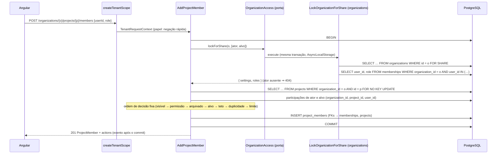

# 003 — Projetos · Design técnico

- **Status**: Rascunho (revisão 2)
- **Requisitos**: [requirements.md](requirements.md)
- **Revisão de arquitetura**: feita (revisão 2 incorpora os achados)
- **Revisão de segurança**: feita (revisão 2 incorpora os achados)

## Solução proposta

Novo bounded context **`projects`** em `libs/backend/projects/{domain,application,infrastructure,http}` (tags `scope:backend`, `domain:projects`), com o mesmo desenho de `organizations`: entidades com invariantes no domínio, casos de uso que decidem com o estado relido na transação, repositórios Prisma que sempre recebem `organizationId`, router tenant-scoped montado em `createTenantScope` (ADR 0012).

**Autorização** usa o kernel da spec 006 (ADR 0013): `organizationPermissions(role, settings)` para `project:create`, `effectiveProjectRole(orgRole, participação)` e `canOnProject` para o resto. Regras de estado ficam no domínio de `projects`: arquivado (BR-026), teto, duplicidade e participação só de membros (BR-027), chave (BR-025). Capacidades têm dono único: `projectCapabilities(effectiveRole, { archived })` em `projects/domain`.

**Integração com `organizations`, nos dois sentidos, só por portas** ligadas em `apps/api/src/modules/adapters/` (ADR 0003):

- `projects` → `organizations`: porta **`OrganizationAccess`** em `projects/application` (substitui o nome `ProjectCreationSettings` da obrigação 1 da 006, ampliada com papéis e listagem):
  - `lockForShare(organizationId, userIds)` → `{ membersCanCreateProjects, roles: ReadonlyMap<userId, OrganizationRole> } | null`, implementada pelo caso de uso `LockOrganizationForShare` de `organizations` (`SELECT … FOR SHARE` + papéis em lote). `null` (organização sumiu) ⇒ 404 `ORGANIZATION_NOT_FOUND`; ator ausente dos papéis relidos ⇒ 404 `ORGANIZATION_NOT_FOUND`, como `lockOrganizationAndRereadActor`.
  - `rolesOf(organizationId, userIds)` (leitura sem lock, para listas) e `listMembersPage({ organizationId, excludeUserIds, cursor, limit })` (candidatos; keyset com `user_id <> ALL($ids)` em `organizations`, sem anti-join entre tabelas de contextos).
- `organizations` → `projects`: porta **`MembershipRoleChanges`** em `organizations/application`, na linguagem de `organizations`: `roleChanged({ organizationId, userId, fromRole, toRole }) → { affectedProjectParticipations }`. `ChangeMemberRole` a chama **sempre** que o papel muda, depois de `memberships.save`, na mesma transação. O adaptador liga a `ApplyOrganizationRoleChange` de `projects`, que decide (BR-027: `toRole === 'viewer'` ⇒ rebaixa as participações a `viewer` e incrementa a `version` delas). `organizations` não conhece a regra.
- Remover ou sair da organização apaga as participações pela **FK composta `project_members (organization_id, user_id) → memberships ON DELETE CASCADE`** (ADR 0013 item 4; política em **ADR 0015**, proposto com esta spec).

**Contrato transacional das portas** (invariantes, com teste): (1) as duas portas só são chamadas dentro de `TransactionRunner.run` do chamador; (2) há **uma única instância** de `PrismaTransactionRunner` compartilhada por todos os módulos (o `AsyncLocalStorage` é por instância; outra instância cairia silenciosamente fora da transação); (3) os métodos de repositório envolvidos (`lockForShare`, o `UPDATE` do rebaixamento) usam `transactionalClient(...)` e falham fora de transação; (4) toda mutação de `memberships` trava a organização com `FOR NO KEY UPDATE` (hoje `ChangeMemberRole`, `RemoveMember`, `AcceptInvitation`); uma futura que trave várias organizações (ex.: exclusão de conta) trava em ordem de id.

**Workflow padrão** (BR-004, parte): tabelas `workflow_statuses` e `workflow_transitions` de `projects`, preenchidas na criação e só lidas nesta spec.

**Capacidades e ações** (padrão da 006): o projeto devolve `myRole` (efetivo) e `capabilities`; cada participante traz `actions`; candidatos trazem `allowedRoles`. A interface não tem regra própria.

## Componentes envolvidos

| Projeto Nx                                    | Camada         | Mudança                                                                                                                                                                                                                                  |
| --------------------------------------------- | -------------- | ---------------------------------------------------------------------------------------------------------------------------------------------------------------------------------------------------------------------------------------- |
| `libs/backend/projects/domain` (novo)         | domain         | `Project`, `ProjectKey`, `ProjectName`, `ProjectDescription`, `ProjectMember` (teto), `defaultWorkflow()`, `projectCapabilities`, `participantActions`, erros, contratos de repositório                                                  |
| `libs/backend/projects/application` (novo)    | application    | Portas `OrganizationAccess`, `UserDirectory` (só `getAccounts`); casos de uso (tabela abaixo); `ApplyOrganizationRoleChange`; views; limites; eventos `projects.*`; fakes em `/testing`                                                  |
| `libs/backend/projects/infrastructure` (novo) | infrastructure | Repositórios Prisma, keyset `(name, id)` e `(created_at, user_id)`, mapeamento de `P2002`/`P2003`                                                                                                                                        |
| `libs/backend/projects/http` (novo)           | presentation   | `createProjectsRouters` (só `tenantRouter`), mapeamento de erros, limites, OpenAPI                                                                                                                                                       |
| `libs/backend/organizations/application`      | application    | Porta `MembershipRoleChanges` chamada por `ChangeMemberRole` (contagem no evento `member_role_changed`); casos de uso `LockOrganizationForShare`, `GetMemberRoles`, `ListMembersExcluding`                                               |
| `libs/backend/organizations/infrastructure`   | infrastructure | `lockForShare` (`transactionalClient`), papéis em lote, página de membros excluindo ids                                                                                                                                                  |
| `libs/backend/shared/http`                    | presentation   | Exporta `noStore` (o harness compara a camada por identidade)                                                                                                                                                                            |
| `libs/contracts`                              | contracts      | `projects.contract.ts` (schemas de entrada `strictObject`, respostas, páginas, workflow)                                                                                                                                                 |
| `prisma`                                      | —              | `models/projects.prisma`; back-relation inerte em `Membership` (comentário → ADR 0015, `onUpdate: Restrict`); cabeçalhos de `schema.prisma`/`organizations.prisma` atualizados; migration com CHECK da chave e FKs compostas             |
| `apps/api`                                    | app            | Ordem de montagem (abaixo); adaptadores; casos de isolamento com schemas de entrada; harness ampliado (mundo A/B, ator duplo, `code` esperado); bateria de autorização intra-tenant; teste de colisão de códigos de erro entre contextos |
| `eslint.config.mjs`                           | —              | Em `libs/backend/organizations/**`: barrar `projectParticipations` e os delegates `.project`, `.projectMember`, `.workflowStatus`, `.workflowTransition`                                                                                 |
| `apps/web`                                    | app            | `features/projects`: lista, criação, área `/o/:slug/projects/:key` (visão geral, configurações, participantes); link "Projetos"                                                                                                          |
| `apps/web-e2e`                                | e2e            | Jornada real: criar projeto, adicionar participante, arquivar, restaurar                                                                                                                                                                 |

**Ordem de montagem em `apps/api`** (evita o ciclo de construção): (1) repositórios Prisma de `projects` e `ApplyOrganizationRoleChange` (depende só deles); (2) `createOrganizationsModule({ …, membershipRoleChanges: adapter })`, que passa a expor `lockForShare`, `rolesOf` e `listMembersExcluding` como já expõe `resolveTenant`; (3) `createProjectsModule({ …, organizationAccess: adapter(organizations…) , users: createUserDirectory(...) })`; (4) `composeApiRouters` com o router de projetos no escopo do tenant. Mapas de erro mesclados com teste que falha se dois contextos mapearem o mesmo `code` com status ou título diferentes (`MEMBER_NOT_FOUND` é reutilizado de propósito, igual nos dois).

## Casos de uso e permissões

**Ordem de decisão em toda escrita** (fixa, testada; sem oráculo por ordem de erro): (1) organização travada e ator relido (404 `ORGANIZATION_NOT_FOUND`); (2) projeto visível ao ator (404 `PROJECT_NOT_FOUND`); (3) permissão (403); (4) arquivado (409 `PROJECT_ARCHIVED`); (5) versão (409 `VERSION_CONFLICT`); (6) alvo membro da organização (404 `MEMBER_NOT_FOUND`) / participante (404 `PROJECT_MEMBER_NOT_FOUND`); (7) teto (422); (8) duplicidade (409); (9) limites (422). Em `CreateProject`: permissão (403) antes de chave em uso (409). Negação rápida antes da transação usa `organizationGrant(role, 'project:create') === 'deny'` (nunca decisão final).

| Caso de uso                          | Permissão                                 | Lock e releitura                                                          | Regras de estado                                                                                           |
| ------------------------------------ | ----------------------------------------- | ------------------------------------------------------------------------- | ---------------------------------------------------------------------------------------------------------- |
| `CreateProject`                      | `project:create` (configuração resolvida) | organização `FOR SHARE` (**exigido**: obrigação 1)                        | BR-025, limite por organização, criador participante `manager`\*, workflow                                 |
| `ListProjects`                       | — (visibilidade BR-023)                   | não (papel do contexto da requisição)                                     | owner/admin: todos; demais: só participações, numa única consulta                                          |
| `GetProject` (`by: id \| key`)       | `project:read`                            | não                                                                       | uma consulta com o filtro de visibilidade (`EXISTS` participação ou ator owner/admin); sem acesso ⇒ 404    |
| `GetWorkflow`                        | `project:read`                            | não                                                                       | —                                                                                                          |
| `UpdateProject`                      | `project:update`                          | organização `FOR SHARE` → projeto `FOR NO KEY UPDATE`                     | BR-026, BR-008                                                                                             |
| `ArchiveProject` / `RestoreProject`  | `project:archive`                         | idem                                                                      | já no estado-alvo ⇒ 200 com a versão atual, **sem** checar versão; senão BR-008                            |
| `ListProjectMembers`                 | `project:read`                            | não                                                                       | `actions` por participante; papéis da organização por `rolesOf`                                            |
| `ListMemberCandidates`               | `project-member:manage`                   | não                                                                       | arquivado ⇒ 409; `listMembersPage` excluindo participantes; contas por `UserDirectory` (3 consultas fixas) |
| `AddProjectMember`                   | `project-member:manage`                   | organização `FOR SHARE` (**exigido**: teto) → projeto `FOR NO KEY UPDATE` | BR-026, BR-027 (membro, teto, duplicidade), limite por projeto; `P2003` ⇒ `MEMBER_NOT_FOUND`               |
| `ChangeProjectMemberRole`            | `project-member:manage`                   | idem (**exigido**: teto)                                                  | BR-026, BR-027 (teto), BR-008; participação localizada por `(organizationId, projectId, userId)`           |
| `RemoveProjectMember` (outro / sair) | `project-member:manage` / próprio         | idem (uniforme; não exigido)                                              | BR-008; permitido em arquivado                                                                             |
| `ApplyOrganizationRoleChange`        | — (só pela porta)                         | dentro da transação de `ChangeMemberRole` (organização já travada)        | BR-027; incrementa `version`; devolve a contagem                                                           |

\* Ver ponto de decisão D1 (participações de owner/admin).

Leituras usam o papel do `TenantRequestContext` (uma consulta por requisição, ADR 0012) sem passar pela porta; a janela de milissegundos com papel antigo é aceita para leituras. Escritas sempre decidem com o papel relido sob lock. O lock da organização é **exigido** em `CreateProject`, `AddProjectMember` e `ChangeProjectMemberRole` (invariantes que cruzam `memberships` e `project_members`); nas demais escritas é mantido por uniformidade.

## Fluxo de dados

## Modelo de domínio

- **`ProjectKey`** (BR-025): `^[A-Z][A-Z0-9]{1,9}$`, sem normalização silenciosa.
- **`ProjectName`**: 2–80 após `normalizeDisplayText`. **`ProjectDescription`**: até 2000; vazia ⇒ `null`.
- **`Project`**: `create`, `rename`/`describe` (lançam `ProjectArchivedError` se arquivado), `archive(now)`/`restore()` (retornam se mudou), `isArchived`, `version`.
- **`ProjectMember`**: `create({ role, organizationRole })` e `changeRole(role, organizationRole)` recusam papel acima do teto (`ProjectRoleAboveCeilingError`); `capToViewer()`.
- **`projectCapabilities(effectiveRole, { archived })`**: permissões de projeto com grant `allow`; arquivado ⇒ só `project:read` e `project:archive` (que então significa restaurar). Grants `own` ficam para ações por recurso (004+). A 004 estende o desconto a `task:*`.
- **`participantActions({ actorEffectiveRole, target, targetOrganizationRole, isSelf, archived })`**: `changeRoleTo` = papéis dentro do teto do alvo, exceto o atual, com `project-member:manage` e projeto ativo; `remove` = `project-member:manage` e não é o próprio (também em arquivado); `leave` = é o próprio.
- **`defaultWorkflow()`**: `A fazer`/`todo`, `Em andamento`/`in_progress`, `Concluído`/`done` (posições 0–2) e transições todo↔in_progress, in_progress↔done. Nomes são dados (a 005 permitirá renomear); a categoria é o vocabulário estável.

## Modelagem de dados

`prisma/models/projects.prisma`:

| Tabela                 | Colunas principais                                                                                                                                                | Restrições                                                                                                                                                                                                                                                                                                |
| ---------------------- | ----------------------------------------------------------------------------------------------------------------------------------------------------------------- | --------------------------------------------------------------------------------------------------------------------------------------------------------------------------------------------------------------------------------------------------------------------------------------------------------- |
| `projects`             | `id`, `organization_id`, `key VARCHAR(10)`, `name VARCHAR(80)`, `description VARCHAR(2000) NULL`, `archived_at NULL`, `created_by_user_id`, `version`, timestamps | `UNIQUE (organization_id, id)`; `UNIQUE (organization_id, key)` (BR-025, inclui arquivados); `CHECK (key ~ '^[A-Z][A-Z0-9]{1,9}$')`; índice `(organization_id, archived_at, name, id)`                                                                                                                    |
| `project_members`      | `id`, `organization_id`, `project_id`, `user_id`, `role project_role`, `version`, timestamps                                                                      | `UNIQUE (organization_id, project_id, user_id)`; FK `(organization_id, project_id) → projects (organization_id, id) ON DELETE CASCADE`; **FK `(organization_id, user_id) → memberships (organization_id, user_id) ON DELETE CASCADE ON UPDATE RESTRICT`** (ADR 0015); índice `(organization_id, user_id)` |
| `workflow_statuses`    | `id`, `organization_id`, `project_id`, `name VARCHAR(40)`, `category status_category`, `position`                                                                 | `UNIQUE (organization_id, project_id, id)`; índice **não único** `(organization_id, project_id, position)` (a unicidade da ordem fica para a 005, que reordena); FK composta para `projects`                                                                                                              |
| `workflow_transitions` | `organization_id`, `project_id`, `from_status_id`, `to_status_id`                                                                                                 | PK `(project_id, from_status_id, to_status_id)`; FKs `(organization_id, project_id, *_status_id) → workflow_statuses`; `CHECK (from_status_id <> to_status_id)`                                                                                                                                           |

Enums `project_role` e `status_category`. `organization_id NOT NULL` em todas (ADR 0014). `projects.organization_id` e `created_by_user_id` sem FK, como as referências a `identity`.

**FK entre contextos** (ADR 0015, proposto): a de `project_members` para `memberships` é a primeira. O Prisma exige a relação nos dois modelos (FK só em SQL seria apagada como drift), então `Membership` ganha a back-relation **inerte** `projectParticipations`, comentada com o ADR e barrada no código de `organizations` por lint. Consequência registrada: participações apagadas pela cascata não executam código de `projects` nem geram evento próprio; o evento `organizations.member_removed`/`member_left` é a evidência.

Migration aditiva, sem backfill.

## Contratos

Todas sob `/api/v1/organizations/{organizationId}` (escopo do tenant). Respostas `no-store`.

| Método | URI (relativa)                                         | Permissão                            | Request                                        | Response                                                                                                                                           | Erros                                                                                                                                                    |
| ------ | ------------------------------------------------------ | ------------------------------------ | ---------------------------------------------- | -------------------------------------------------------------------------------------------------------------------------------------------------- | -------------------------------------------------------------------------------------------------------------------------------------------------------- |
| GET    | `/projects?status=active\|archived&limit&cursor`       | visibilidade (BR-023)                | —                                              | `{ items: ProjectSummary[], nextCursor }` (`id, key, name, archived, myRole`)                                                                      | 400                                                                                                                                                      |
| POST   | `/projects`                                            | `project:create`                     | `{ key, name, description? }`                  | 201 `Project` + `Location`                                                                                                                         | 400, 403, 409 `PROJECT_KEY_TAKEN`, 422 `PROJECT_LIMIT_REACHED`, 429                                                                                      |
| GET    | `/projects/by-key/{key}`                               | `project:read`                       | —                                              | `Project`                                                                                                                                          | 404 `PROJECT_NOT_FOUND` (inclusive chave malformada)                                                                                                     |
| GET    | `/projects/{projectId}`                                | `project:read`                       | —                                              | `Project` (`id, key, name, description, archivedAt, version, createdAt, myRole, capabilities`)                                                     | 404                                                                                                                                                      |
| PATCH  | `/projects/{projectId}`                                | `project:update`                     | `{ name?, description?, version }` (≥ 1 campo) | `Project`                                                                                                                                          | 400, 403, 404, 409 `PROJECT_ARCHIVED` / `VERSION_CONFLICT`                                                                                               |
| POST   | `/projects/{projectId}/archive` · `/restore`           | `project:archive`                    | `{ version }`                                  | `Project`                                                                                                                                          | 403, 404, 409 `VERSION_CONFLICT`, 429                                                                                                                    |
| GET    | `/projects/{projectId}/workflow`                       | `project:read`                       | —                                              | `{ statuses: [{ id, name, category, position }], transitions: [{ fromStatusId, toStatusId }] }`                                                    | 404                                                                                                                                                      |
| GET    | `/projects/{projectId}/members?limit&cursor`           | `project:read`                       | —                                              | `{ items: ProjectMember[], nextCursor }` (`userId, name, email, role, effectiveRole, version, joinedAt, actions: { changeRoleTo, remove, leave }`) | 404                                                                                                                                                      |
| GET    | `/projects/{projectId}/member-candidates?limit&cursor` | `project-member:manage`              | —                                              | `{ items: [{ userId, name, email, organizationRole, allowedRoles }], nextCursor }`                                                                 | 403, 404, 409 `PROJECT_ARCHIVED`                                                                                                                         |
| POST   | `/projects/{projectId}/members`                        | `project-member:manage`              | `{ userId, role }`                             | 201 `ProjectMember`                                                                                                                                | 403, 404 `MEMBER_NOT_FOUND`, 409 `PROJECT_ARCHIVED` / `ALREADY_A_PROJECT_MEMBER`, 422 `PROJECT_ROLE_ABOVE_CEILING` / `PROJECT_MEMBER_LIMIT_REACHED`, 429 |
| PATCH  | `/projects/{projectId}/members/{userId}`               | `project-member:manage`              | `{ role, version }`                            | `ProjectMember`                                                                                                                                    | 403, 404 `PROJECT_MEMBER_NOT_FOUND`, 409, 422 `PROJECT_ROLE_ABOVE_CEILING`                                                                               |
| DELETE | `/projects/{projectId}/members/{userId}?version`       | `project-member:manage` ou o próprio | —                                              | 204                                                                                                                                                | 403, 404, 409 `VERSION_CONFLICT`                                                                                                                         |

Todos os corpos são `strictObject` e nenhum aceita `organizationId`. `userId` que não é membro desta organização ⇒ 404 `MEMBER_NOT_FOUND` idêntico para inexistente e de outra organização. Parâmetros malformados ⇒ 404 sem banco. `by-key` registrada antes de `/:projectId`.

**Eventos**: nenhum de integração. Eventos de segurança (log estruturado, só ids, desvio da BR-007), **registrados depois do commit** do próprio caso de uso: `projects.created`, `projects.updated`, `projects.archived`, `projects.restored`, `projects.member_added`, `projects.member_role_changed`, `projects.member_removed` (`self`). O rebaixamento propagado não tem evento de `projects` (rodaria na transação de outro contexto): `organizations.member_role_changed` ganha `cappedProjectParticipations`, como já tem `revokedInvitations`.

## Segurança

- **Autorização**: matriz do kernel + papel efetivo relido sob lock em toda escrita, na ordem de decisão fixa. Sem papel efetivo ⇒ 404 idêntico a inexistente; com papel e sem permissão ⇒ 403.
- **Teto sem privilégio adormecido** (BR-027): domínio recusa gravar acima do teto; rebaixamento propagado na mesma transação pela porta; leitura sempre por `effectiveProjectRole`; remoção pela FK. Testes BR-027 "remover e reconvidar" e "rebaixar e promover".
- **Isolamento entre organizações** — harness da 006 ampliado (achados A1, A2, M4 e I-7):
  1. `IsolationWorld` ganha `ofA` (projeto real de A com chave, participante e workflow) e B semeado com projeto, participações e workflow; canários incluem ids de projeto, status e chaves de B.
  2. Cada variante troca **uma** referência por id/chave de B, mantendo as demais válidas em A, e declara o **`code`** esperado (`PROJECT_NOT_FOUND`, `MEMBER_NOT_FOUND`, `PROJECT_MEMBER_NOT_FOUND`), que o harness confere.
  3. O caso da rota declara os schemas de entrada (`body`, `query`) de `libs/contracts`; `coverageGaps` extrai do `shape` as chaves terminadas em `Id` (e `cursor`, como `no-leak`) e exige variante para cada uma; rota com corpo sem schema declarado ⇒ lacuna.
  4. Segundo ator: **membro (`member`) de A e participante de um projeto de B**, rodando todas as variantes com sessão em A (revela consultas de participação sem `organizationId`); os ids desse usuário saem dos canários.
  5. `CONTEXT_MIDDLEWARES` por identidade (`layer.handle === noStore`).
- **Autorização dentro da organização** (achado A3): teste de integração tabela-driven gerado de `listTenantRoutes` filtrada por `/projects/:projectId` e `/projects/by-key/:key`, cruzando papel na organização (owner, admin, member, viewer) × participação (nenhuma, viewer, member, manager): não participante ⇒ 404 com corpo idêntico ao de inexistente em toda rota (inclusive `DELETE …/members/{self}`); participante sem permissão ⇒ 403 antes de qualquer código de estado; **IDOR entre projetos**: manager de P1 alterando/removendo quem só participa de P2 ⇒ 404 `PROJECT_MEMBER_NOT_FOUND` e P2 intacto.
- **Validação e exposição**: DTOs mapeados; e-mails de participantes e candidatos não ampliam a exposição (todo membro já vê os e-mails da organização, spec 002; candidatos exigem `project-member:manage`).
- **Abuso** (RNF-06): por usuário/hora: `projects.create` 30 (contando tentativas, inclusive chave em uso), `projects.members.write` 120 (adicionar, alterar, remover), `projects.archive` 30 (arquivar e restaurar); por organização: 1000 projetos (ativos + arquivados, verificado sob o `FOR SHARE`; pode exceder pelo número de criações simultâneas — aceito, é limite de abuso); 500 participantes por projeto.
- **Riscos aceitos** (registrados): `PROJECT_KEY_TAKEN` revela que a chave existe na organização, e a sugestão por iniciais permite inferir parte de nomes de projetos ocultos (limitado a 30 tentativas/hora; chave não é segredo); `by-key` em consulta única com o filtro de visibilidade (sem diferença de tempo entre "não existe" e "sem acesso"); leituras com papel do middleware.

## Concorrência e consistência

**Ordem única de locks**: organização → projeto → participações.

- Mutações de `projects`: `organizations FOR SHARE` (porta) → `projects FOR NO KEY UPDATE` → `project_members`.
- Mutações de membership (spec 002) travam `organizations FOR NO KEY UPDATE`, que conflita com `FOR SHARE`: serializadas com as mutações de projetos; mutações de projetos correm em paralelo entre si.
- `ApplyOrganizationRoleChange` atualiza `project_members` sem travar `projects`: sem ciclo, porque toda escrita de `projects` em `project_members` espera antes no `FOR SHARE`. Checagens de FK no `INSERT` pegam `FOR KEY SHARE`, compatível com os locks acima.
- BR-008: `version` em `projects` e `project_members` (`updateMany where { organizationId, id, version }`); rebaixamento propagado também incrementa.
- Chave única pelo índice (`P2002` ⇒ `PROJECT_KEY_TAKEN`).
- Testes de integração: outra conexão segura `FOR NO KEY UPDATE` na organização e `CreateProject`/`AddProjectMember` bloqueiam até o commit; `OrganizationAccess.lockForShare` lança fora de transação; rebaixar a viewer × promover participante a manager (teto nunca violado, nas duas ordens); desligar configuração × member criando; duas edições na mesma versão ⇒ uma 409.

## Transição para as specs 004/005 (obrigações registradas)

1. **`ProjectAccess`** (obrigação 3 da 006): `projects/application` exporta `ResolveProjectAccess(organizationId, projectId, userId, organizationRole) → { effectiveRole, archived, capabilities } | null`, com variante que trava o projeto `FOR SHARE` e relê a participação: mutações de tarefa precisam dela para BR-026 (a FK de `tasks` só pega `FOR KEY SHARE`, que não conflita com o `UPDATE` do arquivamento — write skew sem o lock).
2. **Locks na 004**: mutações de tarefa **não** travam a organização (linha quente); ordem projeto → tarefa. O rebaixamento na organização é visto pela releitura da participação sob o lock do projeto, que é rebaixada na mesma transação de `ChangeMemberRole`.
3. **BR-003 × cascata**: remover alguém da organização ou sair **nunca** pode ser bloqueado por dados de projeto ou tarefa. A 004 deve usar FK composta `(organization_id, project_id, assignee_user_id) → project_members ON DELETE SET NULL (assignee_user_id)` (lista de colunas, PostgreSQL ≥ 15; sem ela o `SET NULL` anularia `organization_id`), dentro dos critérios do ADR 0015 — nunca `RESTRICT`.
4. **Workflow**: `tasks.status_id` por FK composta `(organization_id, project_id, status_id) → workflow_statuses`; a 005 decide a unicidade da ordem e a edição de status/transições.

## Decisões arquiteturais

| Decisão                                  | Alternativas                                            | Escolha e motivo                                                                                                          | ADR         |
| ---------------------------------------- | ------------------------------------------------------- | ------------------------------------------------------------------------------------------------------------------------- | ----------- |
| Garantir "sem participação de ex-membro" | porta na remoção; FK `RESTRICT` + porta; FK `CASCADE`   | **FK composta em cascata** (atômica, por qualquer caminho), com política para FKs entre contextos                         | 0013 + 0015 |
| Serializar papéis × projetos             | releitura sem lock; lock das memberships; advisory lock | **`FOR SHARE` na organização** pela porta: reaproveita o lock da 002, ordem única, paralelismo entre mutações de projetos | —           |
| Rebaixamento propagado                   | só leitura; evento assíncrono; porta "capToViewer"      | **Porta síncrona na linguagem de `organizations`** (`roleChanged`), regra decidida em `projects`                          | 0013        |
| Workflow                                 | JSON no projeto; tabelas                                | **Tabelas** com FKs compostas (a 004 referencia status por FK)                                                            | —           |
| Rota por chave                           | só id; `?key=` na lista                                 | **`/projects/by-key/{key}`**: URLs legíveis e estáveis (chave imutável)                                                   | —           |
| Candidatos                               | frontend cruza listas e aplica o teto                   | **`member-candidates` com `allowedRoles`**, apoiado em `listMembersPage` excluindo ids                                    | —           |

## Pontos de decisão para aprovação

- **D1 — Participações de owner/admin** (achado M3 da segurança): um admin que se adiciona como `manager` (ou cria projetos e vira `manager` como criador) continua `manager` desses projetos depois de rebaixado a member, sem que o owner veja isso no rebaixamento. Opções: (a) owner/admin **não** viram participantes explícitos (a criação só grava o criador se ele for member; adicionar owner/admin é recusado, porque já gerenciam tudo) e o rebaixamento de admin a member o deixa só nos projetos em que já participava como member; (b) manter as participações e mostrar no diálogo de rebaixamento quantas participações `manager` a pessoa tem (contagem também no evento); (c) aceitar o risco.
- **D2 — ADR 0015** (política para FKs entre contextos, critérios e primeira exceção): aceitar junto com a spec.
- **D3 — Limites** (RNF-06): os valores da seção Segurança.

## Riscos

| Risco                                                | Probabilidade | Impacto | Mitigação                                                                   |
| ---------------------------------------------------- | ------------- | ------- | --------------------------------------------------------------------------- |
| Deadlock entre `organizations` e `projects`          | Baixa         | Médio   | Ordem única; testes concorrentes; timeout de transação                      |
| Porta fora da transação (outra instância do runner)  | Baixa         | Alto    | Instância única; `transactionalClient`; teste de lock segurado até o commit |
| Mutação futura de membership sem lock da organização | Média         | Alto    | Invariante registrada; revisão de arquitetura por spec                      |
| FK entre contextos virar precedente                  | Média         | Médio   | ADR 0015 com critérios e tabela de exceções                                 |
| Prisma gerar migration que remove a FK               | Baixa         | Alto    | Relação nos dois modelos; teste da cascata; `migrate diff` sem diferenças   |
| BR-003 da 004 bloquear a remoção da organização      | Média         | Alto    | Obrigação 3 da transição (`SET NULL`, nunca `RESTRICT`)                     |
| Chave revelar parte de nome de projeto oculto        | Média         | Baixo   | Aceito; criação limitada                                                    |

## Histórico de revisões

| Revisão | Origem                  | Mudanças principais                                                                                                                                                                                                                                                                                                                                                                                                                                                                                                                                               |
| ------- | ----------------------- | ----------------------------------------------------------------------------------------------------------------------------------------------------------------------------------------------------------------------------------------------------------------------------------------------------------------------------------------------------------------------------------------------------------------------------------------------------------------------------------------------------------------------------------------------------------------- |
| 1       | Autor                   | Versão inicial                                                                                                                                                                                                                                                                                                                                                                                                                                                                                                                                                    |
| 2       | Arquitetura e segurança | ADR 0015 (política de FKs entre contextos); porta `MembershipRoleChanges` na linguagem de `organizations`; `OrganizationAccess` com `rolesOf` e `listMembersPage`; contrato transacional e ordem de montagem; eventos só após o próprio commit; seção de transição para 004/005; ordem de decisão fixa; harness com mundo A/B, ator duplo, `code` esperado e referências derivadas dos schemas; bateria intra-tenant com IDOR entre projetos; `projectCapabilities` no domínio; idempotência antes da versão; índice de posição não único; limites de escrita; D1 |
