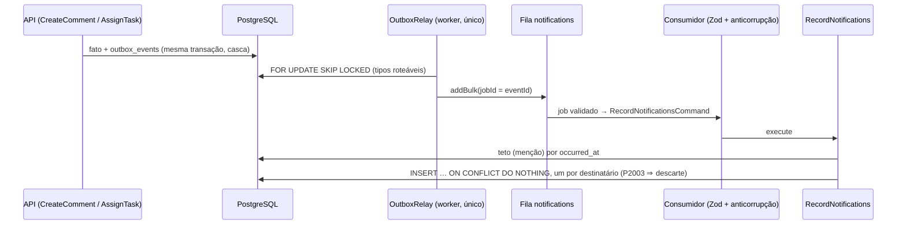

# 008 — Notificações · Design técnico

- **Status**: Aprovado (revisão 2 — achados de arquitetura e segurança incorporados; decisões 8 a 10 do usuário)
- **Requisitos**: [requirements.md](requirements.md)
- **Revisão de arquitetura**: feita (2026-10-15) — aprovado com ajustes; B1–B4 e I1–I8 incorporados
- **Revisão de segurança**: feita (2026-10-15) — sem Críticos/Altos; M1–M4 e B1–B9 incorporados
- **ADR**: [0017 — Outbox para eventos de integração entre contextos](../../docs/architecture/adr/0017-outbox-for-cross-context-integration-events.md) (Aceito; amplia o escopo do 0011)

## Solução proposta

Nasce o contexto **`notifications`**, dono de `notifications` e `notification_preferences`. Ele **reage a eventos** dos produtores (Outbox) e **consulta por portas**, em lote, o que precisa saber para mostrar ou enviar. Nenhum produtor conhece `notifications`.

1. **Produção** (ADR 0017): `collaboration` e `tasks` gravam **eventos de integração** em `outbox_events` dentro do `transactions.run` da casca (`runCommentMutation`, `runTaskMutation`), depois do núcleo e antes do commit, por uma função pura que traduz os eventos internos. Os núcleos não mudam; a repetição em `P2034` regera os eventos.
   - `collaboration.mentions_added` — `{ organizationId, projectId, taskId, commentId, actorUserId, userIds }` (menções **novas** do comentário criado ou editado; cumpre a obrigação 1 da 010 com um evento dedicado, em vez de consumir `comment_created`/`comment_edited`);
   - `tasks.assignee_changed` — `{ organizationId, projectId, taskId, actorUserId, assigneeUserId }` (sempre que o responsável passa a ser alguém, na criação ou na atribuição; **o produtor emite o fato**, `notifications` decide — quem atribui a si mesmo não é notificado).
   - Payloads só com ids, tipados na `application` do produtor (`CollaborationIntegrationEventType`, `MentionsAddedPayload`; `TasksIntegrationEventType`, `AssigneeChangedPayload`). Nomes sem sufixo de versão (convenção existente), distintos dos eventos de log.
2. **Roteamento**: um **único** `OutboxRelay` no worker (montado em `main.ts`), com o `BullMqEventPublisher` roteando tipo → fila: os de e-mail para `emails`, os dois novos para `notifications` (`jobId = eventId`).
3. **Registro (worker)**: o consumidor de `notifications` valida o envelope (`z.discriminatedUnion('type')`, `strictObject`, uuids, `userIds` 1–20 sem repetição; schemas `satisfies z.ZodType<Payload do produtor>`), traduz para `RecordNotificationsCommand` (camada anticorrupção no composition root — `notifications/application` nunca importa tipos dos produtores) e chama `RecordNotifications`, que:
   - descarta destinatário = ator;
   - **menções**: aplica o teto por (organização, ator, destinatário) — 20 por hora contadas por `occurred_at`; o excedente é descartado com log só de ids;
   - grava **por destinatário** (`INSERT … ON CONFLICT DO NOTHING` sobre `UNIQUE (organization_id, recipient_user_id, dedupe_key)`); violação de FK (`P2003`: destinatário saiu da organização ou tarefa excluída antes do processamento) é **descarte**, não erro — um destinatário inválido não afeta os outros.
   - **Não** confere acesso ao registrar: a validade é decidida na leitura (D3) — quem não lê a tarefa naquele momento não vê a notificação, e passa a vê-la se o acesso voltar.
   - Evento inválido ⇒ `UnrecoverableError` (sem retry).
4. **Leitura (API)**: rotas tenant-scoped **pessoais**. Lista e contador filtram pela porta `NotificationTargets`, em lote e **falhando fechado** (erro ⇒ 5xx; ausência no mapa ⇒ não mostrar): tarefa visível ao leitor agora (com chave e título) e, para menções, menção ainda existente em comentário não removido **daquela tarefa**.
5. **Resumo (worker)**: um job agendado de hora em hora faz só o **fan-out** — pessoas com notificações candidatas (não lidas, não enviadas, das últimas **24 h**) e preferência ligada — e enfileira um job por pessoa com `jobId = digest-{userId}-{AAAAMMDDHH}` (sem `:`, que o BullMQ reserva) (no máximo um por pessoa por hora, retry isolado). O job da pessoa, **sem lock**: lê até 50 candidatas, filtra a visibilidade por organização (papel atual pela porta de pessoas), envia o e-mail se sobrar algo e só então grava `emailed_at` (`… WHERE id IN (…) AND emailed_at IS NULL`, transação curta) em **todas** as candidatas lidas, visíveis ou não. Queda entre envio e gravação ⇒ reenvio (aceito, "pelo menos uma vez").
6. **Retenção**: a limpeza diária (`maintenance`) apaga, em lotes de 1 000, notificações com `occurred_at` acima de 90 dias.

## Componentes envolvidos

| Projeto Nx                                         | Camada         | Mudança                                                                                                                                                                                                                                                                       |
| -------------------------------------------------- | -------------- | ----------------------------------------------------------------------------------------------------------------------------------------------------------------------------------------------------------------------------------------------------------------------------- |
| `libs/backend/notifications/domain` (novo)         | domain         | `NotificationKind`, chaves de deduplicação, limites, contratos de repositório (todas as assinaturas com `organizationId` **e** `recipientUserId`; nenhum método "por id" solto)                                                                                               |
| `libs/backend/notifications/application` (novo)    | application    | `RecordNotifications`, `ListNotifications`, `CountUnread`, `MarkRead`, `MarkAllRead`, `Get/UpdatePreference`, `PlanDigests` (fan-out), `SendDigest` (por pessoa), `PurgeOldNotifications`; portas `NotificationTargets`, `NotificationPeople`, `DigestMailer`; limites; fakes |
| `libs/backend/notifications/infrastructure` (novo) | infrastructure | Repositórios Prisma, template pt-BR do resumo                                                                                                                                                                                                                                 |
| `libs/backend/notifications/http` (novo)           | presentation   | Router tenant-scoped, rotas de preferência em `/me`, erros, OpenAPI (tag Notifications)                                                                                                                                                                                       |
| `libs/backend/collaboration/application`           | application    | Casca grava `collaboration.mentions_added` (`outbox` nas dependências); `ListActiveMentions(org, { taskId, commentId, userId }[])` em lote, conferindo `comments.task_id`                                                                                                     |
| `libs/backend/tasks/application`                   | application    | Casca grava `tasks.assignee_changed`; `ResolveVisibleTasks(org, viewer, taskIds)` → `{ key, title }` em lote (tarefas por ids + porta de projetos)                                                                                                                            |
| `libs/backend/projects/application`                | application    | `ResolveReadableProjects(org, viewer, projectIds)` → `Map<projectId, { key }>` em lote, sem workflow; exposto em `contribution` e na porta `ProjectAccess` de `tasks` (método novo)                                                                                           |
| `libs/contracts`                                   | contracts      | `notifications/notifications.contract.ts` (só HTTP)                                                                                                                                                                                                                           |
| `apps/api`                                         | composition    | Módulo `notifications` (montado por último), adaptadores, `OutboxWriter` em `tasks` e `collaboration`, harness e baterias                                                                                                                                                     |
| `apps/worker`                                      | composition    | Relay único com rotas `emails` + `notifications`; `queues/notification-jobs.ts` (schemas e anticorrupção); `modules/notifications.module.ts` (adaptadores **só de leitura** de `organizations`, `projects`, `tasks`, `collaboration`, `identity`); jobs do resumo; retenção   |
| `apps/web`                                         | frontend       | Sino com contador (polling), `/o/:slug/notifications`, preferência em "Conta"                                                                                                                                                                                                 |
| `prisma/models/notifications.prisma` (novo)        | persistência   | Tabelas, back-relations inertes em `Membership` e `Task`; migration com índices parciais manuais                                                                                                                                                                              |
| `eslint.config.mjs`                                | lint           | `notificationsMustNotReachOtherContexts`; `tasksMustNotReachOtherContexts` e a regra de `organizations` barrando `notifications`                                                                                                                                              |

**Ordem de montagem**: na API, `notifications` é o **último** módulo (depois de `collaboration`); no worker, `notifications.module.ts` compõe os adaptadores de leitura como `organizations-emails.module.ts` já faz (duplicação pequena, coberta por teste de composição nos dois apps). Grafo de consulta sem ciclo: `NOT → COL → TSK → PRJ → ORG → IAM`, mais `NOT → ORG` e `NOT → IAM`.

## Fluxo de dados



## Modelo de domínio

- **`NotificationKind`**: `mention` | `assignment`.
- **Chaves de deduplicação** (por destinatário): `mention:{commentId}` — tirar e repor a menção não notifica de novo **enquanto a notificação existir** (até 90 dias ou até a cascata apagá-la); `assignment:{sourceEventId}`.
- **Limites**: teto **20** menções por (organização, ator, destinatário) por hora de `occurred_at` (decisão 9: atribuições sem teto — já têm `task:assign`, BR-003 e `tasks.write.user.hour`); resumo com no máximo **50** itens, só das últimas **24 h** (decisão 10); retenção **90** dias; contador analisa no máximo as **200** não lidas mais recentes e satura em **99**.
- **Preferência**: `emailDigest` (padrão ligado quando não há linha); `PUT` idempotente, última escrita vence (sem `version`: um booleano, sem conflito a resolver).

## Modelagem de dados

```text
notifications
  id uuid PK (v7) · organization_id · recipient_user_id · kind (enum) · actor_user_id
  project_id · task_id · comment_id NULL · dedupe_key text · source_event_id uuid
  occurred_at (do evento) · created_at · read_at NULL · emailed_at NULL
  UNIQUE (organization_id, recipient_user_id, dedupe_key)
  FK (organization_id, recipient_user_id) → memberships (organization_id, user_id) ON DELETE CASCADE ON UPDATE RESTRICT
  FK (organization_id, project_id, task_id) → tasks (organization_id, project_id, id) ON DELETE CASCADE ON UPDATE RESTRICT
  INDEX (organization_id, recipient_user_id, occurred_at DESC, id DESC)                      -- lista; prefixo cobre a FK de membership
  INDEX (organization_id, recipient_user_id, occurred_at DESC) INCLUDE (task_id, comment_id, kind) WHERE read_at IS NULL  -- contador (manual)
  INDEX (recipient_user_id, occurred_at) WHERE read_at IS NULL AND emailed_at IS NULL          -- resumo (manual)
  INDEX (organization_id, project_id, task_id)                                                -- cascata da tarefa
  INDEX (occurred_at)                                                                          -- retenção

notification_preferences
  user_id uuid PK · email_digest boolean · updated_at
```

- FKs entre contextos pelo ADR 0015 (linhas na tabela de exceções): **membership** — critério (b), quem sai da organização perde as notificações dela (privacidade: voltar não as recupera); **tarefa** — critério (a), como `comments`. A FK da tarefa também garante que `organizationId`/`projectId` do evento batem com a tarefa.
- Sem FK para `comments` (exclusão lógica; validade pela porta) nem para `identity` (`actor_user_id`, `notification_preferences.user_id`). **Obrigação futura**: quando houver exclusão de conta, `identity` precisa avisar `notifications` para apagar a preferência.
- Back-relations `Membership.notifications` e `Task.notifications` inertes, barradas por lint.

## Contratos

### Endpoints

| Método | URI                                                                        | Auth          | Request           | Response                                | Erros                                  |
| ------ | -------------------------------------------------------------------------- | ------------- | ----------------- | --------------------------------------- | -------------------------------------- |
| GET    | `/organizations/{organizationId}/notifications?cursor&limit` (25, máx. 50) | membro        | —                 | `{ items: Notification[], nextCursor }` | 400 `INVALID_CURSOR`; 429              |
| GET    | `/organizations/{organizationId}/notifications/unread-count`               | membro        | —                 | `{ count, capped }`                     | 429                                    |
| POST   | `/organizations/{organizationId}/notifications/{notificationId}/read`      | membro        | `{}`              | 204                                     | 404 `NOTIFICATION_NOT_FOUND`           |
| POST   | `/organizations/{organizationId}/notifications/read-all`                   | membro        | `{ upToId? }`     | 204                                     | 404 (se `upToId` não for próprio); 429 |
| GET    | `/me/notification-preferences`                                             | sessão        | —                 | `{ emailDigest }`                       | —                                      |
| PUT    | `/me/notification-preferences`                                             | sessão + CSRF | `{ emailDigest }` | `{ emailDigest }`                       | 400                                    |

- `Notification` = `{ id, kind, actor: { userId, name | null }, task: { id, key, title }, commentId | null, occurredAt, readAt }`; `name: null` = "Ex-membro". Só as visíveis agora.
- **Lista**: busca `limit` linhas por keyset `(occurred_at DESC, id DESC)`, filtra e devolve o que sobrar com `nextCursor` — **páginas curtas ou vazias são válidas** (documentado no contrato; o frontend continua com "carregar mais"). Cursor validado (formato, data ISO, uuid ⇒ senão 400); fora isso é só posição no keyset filtrado pelo próprio destinatário (no harness: `noLeak`).
- **Contador**: sem não lidas ⇒ nenhuma porta chamada (caso comum do polling); senão analisa as 200 mais recentes, filtra, `count = min(visíveis, 99)`, `capped = visíveis > 99` (a interface mostra "99+"). No máximo 4 consultas.
- **`read`**: alheia, inexistente, de outra organização ou invisível ⇒ o mesmo 404. **`read-all`**: marca as não lidas do próprio usuário na organização até `upToId` (inclusive; ausente = todas), inclusive as invisíveis no momento.
- Comandos `strictObject`. Preferências são rotas globais (`/me`), na allowlist com a justificativa "identidade: preferência da própria conta"; `PUT` passa por `authenticate → csrf`.
- **Limites de leitura por usuário**: `notifications.count.user.minute` 120, `notifications.list.user.minute` 60, `notifications.write.user.minute` 60 (`read` e `read-all`).

### Eventos (integração, Outbox — ADR 0017)

| Evento                         | Payload                                                                | Consumidor                     |
| ------------------------------ | ---------------------------------------------------------------------- | ------------------------------ |
| `collaboration.mentions_added` | `organizationId, projectId, taskId, commentId, actorUserId, userIds[]` | worker → `RecordNotifications` |
| `tasks.assignee_changed`       | `organizationId, projectId, taskId, actorUserId, assigneeUserId`       | worker → `RecordNotifications` |

## Portas

- **`NotificationTargets`** (só leitura; falha fechado):
  - `visibleTasks(org, viewer: { userId, organizationRole }, taskIds)` → `Map<taskId, { key, title }>` (adaptador: `tasks.ResolveVisibleTasks` → `projects.ResolveReadableProjects`);
  - `activeMentions(org, { taskId, commentId, userId }[])` → conjunto das que ainda existem em comentário não removido **da tarefa indicada** (adaptador: `collaboration.ListActiveMentions`).
- **`NotificationPeople`**: nomes de membros atuais em lote (API e worker); no resumo, papel atual por organização (`organizations.rolesOf`), slug das organizações e conta (`identity`: e-mail, só se verificado).
- **`DigestMailer`**: envia o resumo montado (template pt-BR em `infrastructure`, `SmtpEmailSender` compartilhado).

## Segurança

- **Notificações são pessoais**: só o destinatário lê, conta ou marca; nenhum papel (nem owner/admin) vê as de outro — 404 idêntico ao de inexistente. Repositório sempre com `(organizationId, recipientUserId)`. Sem permissão nova na matriz (recurso próprio; negação por padrão para o resto).
- **Isolamento**: harness com as 4 rotas tenant-scoped (notificação de B ⇒ 404; cursor de B ⇒ `noLeak`); **bateria própria** com owner, admin, member e viewer da **mesma** organização: `read` alheio ⇒ 404 igual a inexistente e a própria invisível; lista e contador sem alheias; `read-all` não toca terceiros (conferido no banco); notificação própria de outra organização pelo caminho de A ⇒ 404.
- **Visibilidade (RNF-01)**: título só se a tarefa é visível ao leitor agora; menção só se existe em comentário não removido da mesma tarefa (B2 da segurança); portas falham fechado (teste com fake que lança).
- **E-mail (M1 da segurança, decisão 8)**: **sem nome de ator, sem título, sem texto, sem nome de organização**. Assunto fixo ("Você tem novidades no TaskFlow"); corpo com frases fixas por organização identificada pelo **slug** (formato restrito): "Em acme: 2 menções e 1 atribuição — WEB-12, WEB-15", com links montados de `appUrl` (configuração, nunca do `Host`) e slug/chave codificados, mais o link para `${appUrl}/account/notifications` (página "Notificações da conta"). Só para e-mail verificado. Teste do template com valores hostis.
- **Worker**: envelope validado; logs só com `eventId`, tipo e contagens; tipos listados um a um no roteamento.
- **Abuso**: teto de menções; resumo 1/h por pessoa e só 24 h; limites de leitura e escrita por usuário.
- **Informativo**: o prefixo da chave da tarefa (ex.: `DEMISSOES-3`) fica na caixa de e-mail — aceito pela decisão 7.

## Concorrência e consistência

- **Produção**: evento e fato na mesma transação (BR-010); rollback ⇒ sem evento (teste nas duas cascas).
- **Registro**: idempotente pela chave única; um insert por destinatário; `P2003` ⇒ descarte com log. Teto por `occurred_at` (worker parado não corta notificações antigas legítimas); corrida entre jobs pode passar do teto por poucos itens (aceito).
- **Resumo**: sem lock; `jobId` por pessoa e hora garante um por janela e isola falhas; `emailed_at` gravado depois do envio com `AND emailed_at IS NULL`. Remover membro ou excluir tarefa nunca espera o SMTP.
- **Marcar como lida**: `updateMany` filtrado por destinatário; idempotente.
- **Retenção** em lotes curtos (não compete com a cascata de membership).

## Frontend

- **Sino** na barra da organização: botão com nome acessível "Notificações, N não lidas" (ou "Notificações"), badge visual; consulta a cada 60 s e no `visibilitychange`, pausada com a aba oculta; anúncio discreto (`aria-live="polite"`) quando o número aumenta.
- **Página** `/o/:slug/notifications`: ator (ou "Ex-membro"), frase ("mencionou você em", "atribuiu a você"), chave e título, data relativa; não lida destacada; abrir marca como lida e navega para a tarefa; "Marcar todas como lidas" (com `upToId` do item mais recente exibido); "carregar mais" (aceita páginas curtas); estados de carregamento, vazio e erro.
- **Conta**: página "Notificações da conta" (`/account/notifications`, no menu da conta e no link do e-mail) com a seção "Notificações por e-mail" e o interruptor do resumo.
- Textos em `notifications.messages.ts`.

## Observabilidade

Logs do consumidor (gravadas, deduplicadas, descartadas por teto ou FK) e do resumo (planejados, enviados, vazios) só com ids e contagens.

## Decisões arquiteturais

| Decisão                       | Alternativas                                              | Escolha e motivo                                                                                                         | ADR      |
| ----------------------------- | --------------------------------------------------------- | ------------------------------------------------------------------------------------------------------------------------ | -------- |
| D1 — Contexto próprio         | `notifications`; dentro de `collaboration`                | Próprio: vários produtores, preferências e entrega; previsto no mapa                                                     | 0003     |
| D2 — Transporte               | Outbox + fila; despacho in-process                        | Outbox com convenções comuns (nome, payload, validação, relay único)                                                     | **0017** |
| D3 — Validade                 | filtrar na leitura; apagar por eventos de perda de acesso | Filtrar: sem acoplar `projects`/`collaboration` a `notifications`; acesso que volta reaparece; custo contido (lote, 200) | —        |
| D4 — Deduplicação             | por destinatário e chave; por evento                      | `mention:{commentId}` enquanto a notificação existir; atribuição por evento                                              | —        |
| D5 — Resumo                   | fan-out + job por pessoa; transação com `FOR UPDATE`      | Fan-out com `jobId` por pessoa e hora: sem lock durante o SMTP, intervalo garantido, retry isolado                       | —        |
| D6 — Preferência              | global por usuário; por organização                       | Global (decisão 3); `PUT` sem versão                                                                                     | —        |
| D7 — Produtores               | emitem o fato; emitem a política                          | Emitem o fato (responsável mudou); a regra (não notificar a si mesmo) fica em `notifications`                            | 0017     |
| D8 — Sem checagem na gravação | conferir leitores ao gravar; só na leitura                | Só na leitura: uma regra, sem assimetria; a FK cobre quem saiu                                                           | —        |
| D9 — Visibilidade em lote     | casos de uso em lote por porta; JOIN entre contextos      | Lote por porta (`projects` → `tasks` → `notifications`): cada contexto lê as suas tabelas                                | —        |

## Riscos

| Risco                                       | Probabilidade | Impacto | Mitigação                                                               |
| ------------------------------------------- | ------------- | ------- | ----------------------------------------------------------------------- |
| Vazar título de tarefa sem acesso           | Baixa         | Alto    | Filtro na leitura falhando fechado; e-mail sem título; testes e bateria |
| Phishing pelo e-mail                        | Baixa         | Alto    | E-mail sem nomes controlados por usuários; frases e assunto fixos       |
| Contador caro com polling                   | Média         | Médio   | Curto-circuito, índice parcial com `INCLUDE`, 200 analisadas, limites   |
| Páginas curtas na lista                     | Média         | Baixo   | Documentado no contrato; "carregar mais"                                |
| Resumo reenviado após queda                 | Baixa         | Baixo   | Aceito ("pelo menos uma vez")                                           |
| Worker compõe adaptadores duplicados da API | Média         | Baixo   | Adaptadores pequenos com teste de composição nos dois apps              |

## Histórico de revisões

| Revisão | Origem                  | Resumo                                                                                                                                                                                                                                                                                                                                                                                                                                                                                                                                                                                                                                                                                                                                                                                                                                                                                                                                                                                                                                                                                                                                                                                                                                                                                                        |
| ------- | ----------------------- | ------------------------------------------------------------------------------------------------------------------------------------------------------------------------------------------------------------------------------------------------------------------------------------------------------------------------------------------------------------------------------------------------------------------------------------------------------------------------------------------------------------------------------------------------------------------------------------------------------------------------------------------------------------------------------------------------------------------------------------------------------------------------------------------------------------------------------------------------------------------------------------------------------------------------------------------------------------------------------------------------------------------------------------------------------------------------------------------------------------------------------------------------------------------------------------------------------------------------------------------------------------------------------------------------------------- |
| 1       | Autor                   | Versão inicial                                                                                                                                                                                                                                                                                                                                                                                                                                                                                                                                                                                                                                                                                                                                                                                                                                                                                                                                                                                                                                                                                                                                                                                                                                                                                                |
| 2       | Arquitetura e segurança | Resumo por fan-out + job por pessoa e hora, sem lock (B1 arq., M2 seg.); visibilidade em lote por `projects`→`tasks` e menções por `collaboration` amarradas à tarefa (B2 arq., B2 seg.); insert por destinatário com `P2003` como descarte (B3 arq., B5 seg.); ADR 0017 (B4 arq.); gravação na casca, nomes sem sufixo e distintos dos de log (I1); payload tipado no produtor e anticorrupção no worker (I2, B3 seg.); `occurred_at`; teto só para menções (I3, decisão 9); lista com páginas curtas e contador analisando 200 com curto-circuito (I4, M3 seg.); índice da cascata, back-relations e lints (I5); sem checagem de leitores na gravação (I6); resumo só das últimas 24 h (I7, B7 seg., decisão 10); mapa e ordem de montagem (I8); relay único (S1); produtor emite o fato (S2); dedupe "enquanto existir" (S3, B6 seg.); preferência sem versão (S4); `read-all` com `upToId` (S6, I5 seg.); e-mail só verificado (S7, I3 seg.); `source_event_id` (S8); e-mail sem nomes, assunto fixo e slug (M1 seg., decisão 8); bateria de isolamento entre usuários da mesma organização (M4 seg.); cursor `noLeak` (B1 seg.); portas falham fechado (B4 seg.); limites de lista e escrita (B9 seg.); retenção em lotes (I6 seg.). Obrigação 1 da 010 cumprida com o evento dedicado `mentions_added`. |
