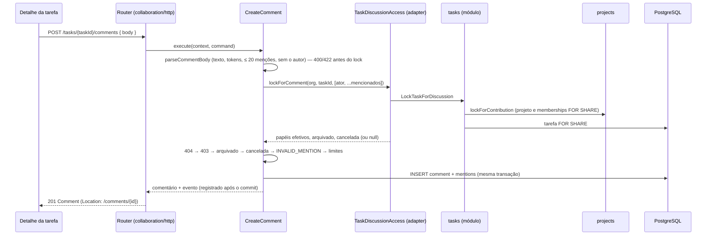

# 010 — Comentários e menções · Design técnico

- **Status**: Rascunho (revisão 2 — achados de arquitetura e segurança incorporados; decisões 9 e 10 do usuário)
- **Requisitos**: [requirements.md](requirements.md)
- **Revisão de arquitetura**: feita (2026-10-14) — aprovado com ajustes; bloqueantes B1/B2 e importantes I1–I7 incorporados
- **Revisão de segurança**: feita (2026-10-14) — sem Críticos/Altos; M1–M4 e B1–B6 incorporados

## Solução proposta

Nasce o contexto **`collaboration`** (previsto no mapa de contextos), dono das tabelas `comments` e `comment_mentions`. Ele não lê tabelas de outros contextos: usa **uma porta**, **`TaskDiscussionAccess`** (na sua `application`, ligada no composition root), que responde se a tarefa existe, quem a lê, em que estado está, trava o necessário na ordem única de locks e busca candidatos a menção. A porta **devolve dados** (papéis, `archived`, `canceled` ou `null`); quem decide 404/403/estado é `collaboration`. O adaptador compõe as APIs públicas de `tasks` (tarefa e lock da linha, que pede a `projects` o projeto e os papéis), de `projects` (ids de quem lê o projeto) e de `identity` (nomes e busca entre ids). O grafo de dependências ganha `COL → TSK`, `COL → PRJ` e `COL → IAM` — um DAG sem ciclo (`tasks` e `projects` nunca chamam `collaboration`).

**Comentário** é texto simples. Menções são **tokens no texto** (`<@uuid>`), extraídos e reescritos na forma canônica no servidor, gravados em `comment_mentions` e exibidos com o nome atual de quem **ainda é membro** da organização (decisão 10: quem saiu aparece como "Ex-membro"). Editar troca o texto e o conjunto de menções, conferindo só as **menções novas**; excluir é **lógico** e permitido também em tarefa cancelada e projeto arquivado (decisão 9).

Escritas: ator relido sob lock na ordem **projeto `FOR SHARE` → memberships `FOR SHARE` → linha da tarefa `FOR SHARE` → linha do comentário `FOR NO KEY UPDATE`**. Comentários **nunca escrevem em `tasks`** (o `FOR SHARE` não pode ser promovido). Eventos `collaboration.comment_*` são registrados **após o commit** (ADR 0008, como `tasks.*`); entrega e Outbox ficam com a 008 (obrigações no fim).

## Componentes envolvidos

| Projeto Nx                                         | Camada         | Mudança                                                                                                                                                                                                                                                       |
| -------------------------------------------------- | -------------- | ------------------------------------------------------------------------------------------------------------------------------------------------------------------------------------------------------------------------------------------------------------- |
| `libs/backend/collaboration/domain` (novo)         | domain         | `Comment` (criar, editar com menções mantidas/novas, excluir idempotente, versão), `parseCommentBody` (normalização, limites, tokens), erros, contrato do repositório                                                                                         |
| `libs/backend/collaboration/application` (novo)    | application    | `GetComment`, `ListComments`, `CreateComment`, `EditComment`, `DeleteComment`, `ListMentionCandidates`; portas `TaskDiscussionAccess` e `CollaborationUserDirectory`; erros próprios com os mesmos códigos/status dos reaproveitados; limites; eventos; fakes |
| `libs/backend/collaboration/infrastructure` (novo) | infrastructure | `PrismaCommentRepository` (keyset, lock da linha, menções, contagem)                                                                                                                                                                                          |
| `libs/backend/collaboration/http` (novo)           | presentation   | Router, mapeamento de erros, OpenAPI (tag Comments)                                                                                                                                                                                                           |
| `libs/backend/tasks/application`                   | application    | **Módulo** (não a fundação, que é montada antes de `projects`): `LockTaskForDiscussion` (`findById` → `lockForContribution` → `lockForShare`, sem decidir permissão) e `ResolveTaskForDiscussion`, expostos em `createTasksModule(...).discussion`            |
| `libs/backend/tasks/infrastructure`                | infrastructure | `lockForShare` (SQL parametrizado, `FOR SHARE`, filtro de organização e projeto)                                                                                                                                                                              |
| `libs/backend/projects/application`                | application    | `ListProjectReaderIds(org, projectId)`: todos os ids que leem o projeto (participantes — teto 500 — e owner/admin da organização), sem paginar                                                                                                                |
| `libs/backend/identity/application` + infra        | application    | `SearchUsersAmong(ids, query, page)`: `id = ANY($ids)` e `ILIKE` escapado sobre nome e e-mail, keyset `(name, id)` (só nome e e-mail; a pertinência à organização vem de `organizations`)                                                                     |
| `libs/backend/organizations/application`           | application    | `CurrentMembers(org, userIds)`: quais ids ainda são membros (para "Ex-membro")                                                                                                                                                                                |
| `libs/contracts`                                   | contracts      | `collaboration/comments.contract.ts`; gramática do token compartilhada (`MENTION_TOKEN`) e marca de schema `embeddedReferences`                                                                                                                               |
| `apps/api`                                         | composition    | `adapters/task-discussion-access.adapter.ts`, `adapters/collaboration-user-directory.adapter.ts`, `collaboration.module.ts`; `ApiModules.collaboration`; harness e baterias                                                                                   |
| `apps/web`                                         | frontend       | `features/tasks/comments/` no detalhe da tarefa                                                                                                                                                                                                               |
| `prisma/models/collaboration.prisma` (novo)        | persistência   | `comments`, `comment_mentions`; back-relation inerte `comments` em `Task`; migration manual (CHECKs)                                                                                                                                                          |
| `eslint.config.mjs`                                | lint           | Tags `domain:collaboration`; `tasksMustNotReachOtherContexts` passa a barrar `comments`; `collaborationMustNotReachOtherContexts` barra `.task`, `.project`, `.membership`, `.user` na infra de `collaboration` (exceto `*.integration.spec.ts`)              |

**Ordem de montagem** (`apps/api/src/main.ts`): `tasksFoundation` → `projectsFoundation` → `organizations` → `projects` → `tasks` (expõe `discussion`) → **`collaboration`** (recebe `tasks.discussion`, `projects.readerIds`, `organizations.currentMembers`, `identity.searchUsersAmong`/nomes). Nenhum módulo anterior depende de `collaboration`.

## Fluxo de dados



## Modelo de domínio

- **`Comment`** (agregado): `id`, `organizationId`, `projectId`, `taskId`, `authorUserId`, `body` (`string | null`), `mentionedUserIds` (conjunto), `createdAt`, `editedAt`, `deletedAt`, `deletedByUserId`, `version`.
  - `create(...)`: versão 1.
  - `edit(parsed, now)`: removido ⇒ `COMMENT_DELETED` (409). Calcula, contra o conjunto **relido sob lock**, as menções **mantidas** (não são conferidas de novo — B2 da arquitetura) e **novas** (conferidas pela porta). Texto igual ao atual: nada muda (sem versão, sem evento). Senão versão + 1, `editedAt = now`.
  - `delete(actor, now)`: `body = null`, menções vazias, `deletedAt`, `deletedByUserId`, versão + 1. Já removido: nada muda.
- **`parseCommentBody(raw, authorUserId)`** (BR-031/032), validação de entrada **antes do lock**:
  - `raw.isWellFormed()` (surrogates sem par ⇒ 400); `\r\n`/`\r` → `\n`; apara; 1–**5 000** code points depois de aparar, contando os tokens.
  - Recusa (`INVALID_COMMENT_BODY`, 400): controle C0/C1 exceto `\n` e `\t`; **formatação bidi** U+202A–U+202E e U+2066–U+2069 (spoofing de link e de autoria — M2); mais de 3 marcas combinantes consecutivas.
  - Tokens `<@uuid>` (gramática `MENTION_TOKEN` de `libs/contracts`, UUID sem diferenciar maiúsculas): cada token é **reescrito em minúsculas** no texto guardado; token malformado é texto literal. Menção ao próprio autor é mantida no texto mas **não** vira menção (não gravada, sem evento). Até **20** pessoas distintas (`TOO_MANY_MENTIONS`, 422).
- **Erros**: `COMMENT_NOT_FOUND` (404), `INVALID_COMMENT_BODY` (400), `TOO_MANY_MENTIONS` (422), `INVALID_MENTION` (422, corpo único), `COMMENT_DELETED` (409), `COMMENT_LIMIT_REACHED` (422). Classes próprias de `collaboration` com o **mesmo código e status** de `TASK_NOT_FOUND`, `INSUFFICIENT_ROLE`, `PROJECT_ARCHIVED`, `TASK_CANCELED`, `VERSION_CONFLICT`, `INVALID_CURSOR` (exigência de `mergeDomainErrors`).

## Modelagem de dados

`prisma/models/collaboration.prisma` (aditiva; `Task` ganha só a back-relation inerte `comments`, barrada por lint — ADR 0015, item 3).

```text
comments
  id uuid PK (v7) · organization_id · project_id · task_id
  author_user_id uuid            -- sem FK (como tasks.created_by_user_id)
  body text NULL                 -- NULL ⇔ removido
  created_at · edited_at NULL · deleted_at NULL · deleted_by_user_id NULL · version int
  UNIQUE (organization_id, id)
  FK (organization_id, project_id, task_id) → tasks (organization_id, project_id, id) ON DELETE CASCADE ON UPDATE RESTRICT
  INDEX (organization_id, task_id, created_at DESC, id DESC)
  CHECK ((body IS NULL) = (deleted_at IS NOT NULL))
  CHECK (body IS NULL OR char_length(body) BETWEEN 1 AND 5000)

comment_mentions
  organization_id · comment_id · user_id
  PK (organization_id, comment_id, user_id)
  FK (organization_id, comment_id) → comments (organization_id, id) ON DELETE CASCADE ON UPDATE RESTRICT
  INDEX (organization_id, user_id)          -- para a 008 ("onde fui mencionado")
```

- FK composta (ADR 0015, critério a): comentário só em tarefa do mesmo projeto e organização; apaga a conversa com a tarefa, as subtarefas e a organização. `project_id` é exigido por ela; com `ON UPDATE RESTRICT`, uma futura "mover tarefa entre projetos" terá de levar os comentários.
- Mencionados **sem FK** para `memberships`: a menção é fato passado; uma FK com cascata deixaria o token órfão no texto. A 008 confere o acesso na entrega.
- Migration manual (CHECKs); teste de catálogo para FKs, CHECKs e índices.

## Contratos

Sob `/api/v1/organizations/{organizationId}`. Escritas com CSRF do escopo do tenant.

### Endpoints

| Método | URI                                                                         | Permissão                                | Request             | Response                                                         | Erros                                                                                                                            |
| ------ | --------------------------------------------------------------------------- | ---------------------------------------- | ------------------- | ---------------------------------------------------------------- | -------------------------------------------------------------------------------------------------------------------------------- |
| GET    | `/tasks/{taskId}/comments?cursor&limit` (padrão 25, máx. 100)               | `project:read`                           | —                   | `{ items: Comment[], nextCursor, count?, actions: { comment } }` | 400 `INVALID_CURSOR`; 404 `TASK_NOT_FOUND`                                                                                       |
| GET    | `/comments/{commentId}`                                                     | `project:read`                           | —                   | `Comment`                                                        | 404 `COMMENT_NOT_FOUND`                                                                                                          |
| POST   | `/tasks/{taskId}/comments`                                                  | `comment:create`                         | `{ body }`          | 201 `Comment` (`Location: …/comments/{id}`)                      | 400; 403; 404; 409 `PROJECT_ARCHIVED`, `TASK_CANCELED`; 422 `INVALID_MENTION`, `TOO_MANY_MENTIONS`, `COMMENT_LIMIT_REACHED`; 429 |
| PATCH  | `/comments/{commentId}`                                                     | `comment:update` (só o autor)            | `{ body, version }` | `Comment`                                                        | 400; 403; 404; 409 arquivado, cancelada, `COMMENT_DELETED`, `VERSION_CONFLICT`; 422; 429                                         |
| DELETE | `/comments/{commentId}?version`                                             | `comment:delete` (autor; manager modera) | —                   | 204                                                              | 400; 403; 404; 409 `VERSION_CONFLICT` (não se já removido); 429                                                                  |
| GET    | `/tasks/{taskId}/mentionable-users?query&cursor&limit` (padrão 20, máx. 50) | `comment:create`                         | —                   | `{ items: [{ userId, name, email }], nextCursor }`               | 400; 403; 404; 429                                                                                                               |

- `Comment` = `{ id, taskId, author: { userId, name: string | null }, body: string | null, mentions: [{ userId, name: string | null }], createdAt, editedAt, deletedAt, version, actions: { edit, delete } }`. `name: null` = **Ex-membro** (não é membro atual da organização). `body` traz tokens `<@id>`; o cliente troca pelo nome de `mentions`; token sem item correspondente é texto.
- `count` (comentários não removidos, RF-13) só na primeira página (sem `cursor`).
- Ordem `(created_at DESC, id DESC)`; cursor opaco `{ c, i }` validado e **amarrado à tarefa**.
- Candidatos: `query` 1–50 caracteres; ids vêm de `projects` (`ListProjectReaderIds`), menos o próprio ator; nomes/e-mails filtrados e paginados em `identity` (`SearchUsersAmong`, keyset `(name, id)`; cursor opaco amarrado à tarefa e à `query`); acima de 1 000 ids, 422 `TOO_MANY_READERS` (não esperado: participantes ≤ 500). Limite de leitura `collaboration.mentions.read.user.minute` **120**. Exige `comment:create`: viewer não comenta, logo não busca. E-mail mantido (decisão da 002: membros veem e-mails) para desambiguar homônimos.
- Comandos `strictObject`; nenhum aceita `organizationId`, `authorUserId` nem lista de menções (só do texto). `body` declarado com `.meta({ embeddedReferences: 'mentions' })`.
- **Ordem de decisão**:
  - **Validação de entrada** (antes de qualquer lock): 400 do schema e de `parseCommentBody`; 422 `TOO_MANY_MENTIONS`.
  - Rotas por **tarefa**: 404 `TASK_NOT_FOUND` (inexistente, outra organização, sem leitura) → 403 → `PROJECT_ARCHIVED` → `TASK_CANCELED` → `INVALID_MENTION` → limites.
  - Rotas por **comentário**: o **único** 404 é `COMMENT_NOT_FOUND` — comentário inexistente, de outra organização, de projeto sem leitura, ou tarefa/comentário apagado no meio (o caso de uso traduz o "não encontrado" da porta; M1 da segurança) → 403 → (editar: `PROJECT_ARCHIVED` → `TASK_CANCELED` → `COMMENT_DELETED` → `VERSION_CONFLICT` → `INVALID_MENTION` das novas → limites) / (excluir: **sem** checagem de arquivado/cancelada — decisão 9; já removido ⇒ 204 sem mudança, **depois** do 403; senão `VERSION_CONFLICT`).

### Eventos

Despacho in-process após o commit (ADR 0008), como `tasks.*`. Payload só com ids (RNF-06).

| Evento                          | Tipo    | Payload                                                                       | Consumidores            |
| ------------------------------- | ------- | ----------------------------------------------------------------------------- | ----------------------- |
| `collaboration.comment_created` | domínio | `organizationId, projectId, taskId, commentId, actorUserId, mentionedUserIds` | log; 008 (planejado)    |
| `collaboration.comment_edited`  | domínio | idem + `addedMentionUserIds` (só as novas em relação ao conjunto anterior)    | log; 008 (planejado)    |
| `collaboration.comment_deleted` | domínio | `organizationId, projectId, taskId, commentId, actorUserId, moderated`        | log; auditoria (Fase 3) |

## Segurança

- **Autenticação e autorização**: rotas só em `createTenantScope`; contexto por `tenantRequestContextFrom`. Papel efetivo do ator **relido sob lock** pela porta; decisão no caso de uso com `canOnProject(role, 'comment:*', { ownsResource: autor === ator })` (006: `update` = `own` para manager e member; `delete` = `allow` manager, `own` member; viewer `deny`). Autor rebaixado a viewer perde editar/excluir; owner/admin são manager efetivos e moderam. A posse é `author_user_id`, que fica na linha removida.
- **Tenant isolation**: toda consulta filtra `organization_id`; comentário achado por `(organization_id, id)`; `project_id` vem da tarefa sob lock, nunca do cliente; FK composta impede comentário em tarefa de outro projeto. **Menções novas** travadas com o ator (memberships `FOR SHARE`) e válidas só com papel efetivo (lê o projeto); senão `INVALID_MENTION` com corpo único — inexistente, outra organização e sem acesso seguem o mesmo caminho.
- **Harness**: as 6 rotas em `isolation-cases.ts`. `inputReferences` passa a reconhecer campos marcados com `embeddedReferences` e exige a variante `body.mentions` (`refused` 422 `INVALID_MENTION` com usuário de B e com membro de A sem acesso) — **falha fechado** pelo schema, não por flag do caso (B1 da segurança, S7 da arquitetura). As baterias comparam o **corpo inteiro** dos 404 (inexistente × projeto sem acesso × outro projeto, inclusive para o owner).
- **XSS e spoofing** (RNF-02): backend guarda texto; frontend **nunca** usa `innerHTML`, `bypassSecurityTrust*` nem `contenteditable`. Segmentação por função pura (`text`, `mention`, `link`, `newline`) com interpolação; cada comentário com `dir="auto"` e `unicode-bidi: isolate`, menções e links em `<bdi>`. Link: só `https?://` com host; termina antes de espaço, `<` e qualquer caractere de formatação (`Cf`); texto exibido derivado de `new URL(...).href` (IDN em punycode); `target="_blank" rel="noopener noreferrer nofollow"`. Testes com `<script>`, ``, `javascript:`, `data:`, RLO e tokens dentro de URL. Paridade: todo id em `mentions` aparece como segmento `mention` (B2 da segurança).
- **Ex-membros** (decisão 10): nomes resolvidos em lote cruzando `CurrentMembers` (organizations) com `identity`; quem não é membro atual sai com `name: null`. Nenhum dado de quem saiu é publicado.
- **Abuso**: `collaboration.comments.write.user.hour` **300** (criar, editar, excluir; toda tentativa conta); teto **suave** de **2 000** comentários não removidos por tarefa (contagem sob o `FOR SHARE`); 20 menções; 5 000 caracteres; UI contém o comentário (altura máxima com "mostrar mais"). Spam de notificação é tratado na 008 (obrigações).
- **Logs**: nunca o texto; eventos só com ids; a query string de candidatos não é registrada.
- **Retenção** (informativo): o texto removido some da linha mas persiste em tuplas mortas até o VACUUM e em backups — registrar no documento de privacidade quando existir. Autor que saiu não apaga os próprios comentários; só a moderação.

## Concorrência e consistência

- **Comentar × cancelar/excluir/editar/mover a tarefa**: comentário trava a tarefa `FOR SHARE`; essas escritas travam `FOR NO KEY UPDATE`/`DELETE`. O comentário entra antes (e é apagado em cascata na exclusão) ou espera e relê o estado (cancelada ⇒ 409; excluída ⇒ 404). Custo aceito: comentários também esperam `MoveCard`, atribuições e edições de campos da mesma tarefa (curtas); excluir tarefa com muitos comentários pode estourar o `lock_timeout` de quem comenta (409 `CONCURRENT_UPDATE`). `FOR KEY SHARE` não serviria (não conflita com cancelar).
- **Comentar × perda de acesso**: memberships do ator e das menções novas travadas `FOR SHARE` (mudança de papel trava a membership `FOR NO KEY UPDATE`; invariante da 004).
- **Editar/excluir**: depois do lock da tarefa, a linha do comentário `FOR NO KEY UPDATE`, relida (mesma tarefa); versão conferida (BR-008).
- **Ordem única de locks** (extensão): projeto `FOR SHARE` → memberships `FOR SHARE` → [`task_project_locks` — nunca usado por comentários] → **uma** linha de `tasks` (`FOR SHARE` em comentários) → **uma** linha de `comments`. **Invariante novo**: nenhuma transação trava `tasks` depois de travar `comments`; comentários nunca escrevem em `tasks`. A 008 e o histórico de atividades devem respeitar.
- `lock_timeout` de 2 s; repetição única em `P2034`; persistindo, 409 `CONCURRENT_UPDATE`.
- Comentário e menções na mesma transação (BR-010); eventos após o commit.

## Frontend

- `features/tasks/comments/`: `CommentsStore` (primeira página com `count`, "carregar anteriores", criar/editar/excluir, recarga em `VERSION_CONFLICT`/`COMMENT_NOT_FOUND`/`COMMENT_DELETED`); `comment-body.ts` (segmentação pura); `comment-item`; `comment-composer`.
- **Composer** (I7 da arquitetura), funções puras testadas:
  - o `textarea` mostra `@Nome`; o componente guarda intervalos `{ start, end, userId }`, ajustados a cada `input` pela diferença de texto; editar **dentro** de um intervalo o invalida (vira texto comum);
  - ao digitar `@` + letras abre combobox acessível (`role="combobox"`, `aria-expanded`, `aria-activedescendant`, setas/Enter/Esc), debounce 250 ms, `GET mentionable-users?query`;
  - ao enviar, `serialize` troca cada intervalo por `<@id>`; na edição, `deserialize` usa `mentions` (Ex-membro vira "@Ex-membro" preservando o token);
  - o contador mostra o tamanho **serializado** (limite 5 000); colar texto com `<@…>` literal é texto.
- Seção "Comentários (N)"; ordem cronológica (mais recente embaixo); "editado" com `title` da data; "Comentário removido" em itálico; menções destacadas; "Ex-membro" para quem saiu; links seguros; altura máxima com "mostrar mais".
- Estados: skeleton, vazio ("Nenhum comentário ainda"), erro com "Tentar de novo", somente leitura (arquivado/cancelada: lista e excluir, sem composer nem editar) com aviso. `aria-live` para enviado/atualizado/removido; foco volta ao item após editar e ao composer após excluir. Textos em `comments.messages.ts`.

## Observabilidade

Eventos `collaboration.comment_*` no log estruturado (ids, `moderated`); métricas com OpenTelemetry (Fase 4).

## Decisões arquiteturais

| Decisão                            | Alternativas                                                     | Escolha e motivo                                                                                                                                 | ADR                 |
| ---------------------------------- | ---------------------------------------------------------------- | ------------------------------------------------------------------------------------------------------------------------------------------------ | ------------------- |
| D1 — Onde vivem os comentários     | (a) contexto `collaboration`; (b) dentro de `tasks`              | (a): previsto no mapa; permissões, invariantes e consumidor (008) próprios; `tasks` não incha                                                    | 0003 (sem ADR novo) |
| D2 — Integridade com a tarefa      | FK composta com cascata; sem FK + limpeza por evento             | FK `CASCADE` (ADR 0015, critério a), com lint da back-relation; limpeza por evento exigiria Outbox agora e deixaria órfãos                       | 0015 (nova linha)   |
| D3 — Representação das menções     | tokens `<@id>` + tabela; lista de ids separada; nomes no texto   | Tokens canônicos + tabela: renomear não quebra; posição preservada; tabela serve à 008                                                           | —                   |
| D4 — Exclusão                      | lógica; física                                                   | Lógica (decisão 4); texto e menções apagados de fato; CHECK de coerência                                                                         | —                   |
| D5 — Lock para comentar            | tarefa `FOR SHARE`; `FOR KEY SHARE`; `FOR NO KEY UPDATE`         | `FOR SHARE`: serializa com cancelar/excluir sem serializar comentários entre si; custo com movimentos aceito                                     | —                   |
| D6 — Eventos de menção             | pós-commit agora e Outbox na 008; Outbox agora                   | Pós-commit: sem consumidor ainda; `comment_mentions` é o registro durável (ADR 0008/0011)                                                        | 0008                |
| D7 — Contagem                      | na conversa; campo no detalhe da tarefa                          | Na conversa: campo na tarefa criaria `tasks → collaboration`                                                                                     | —                   |
| D8 — Uma porta                     | uma porta (`TaskDiscussionAccess`); uma por contexto fornecedor  | Uma: um consumidor e um alvo (precedente `ProjectAccess`); o adaptador compõe `tasks`, `projects`, `organizations`, `identity`                   | —                   |
| D9 — Candidatos a menção           | ids em `projects` + busca em `identity`; JOIN; filtro em memória | Ids em `projects` (sem paginar, ≤ 500 + owner/admin) e busca/paginação em `identity`: cada contexto lê só as suas tabelas; JOIN violaria a posse | —                   |
| D10 — Edição de menções            | conferir só as novas; conferir todas                             | Só as novas (contra o conjunto relido sob lock): conferir todas impediria editar um comentário que menciona quem saiu                            | —                   |
| D11 — Excluir em estado só leitura | permitir; bloquear                                               | Permitir (decisão 9): remover dado sensível sem reabrir tarefa ou restaurar projeto; criar e editar seguem bloqueados                            | —                   |
| D12 — Quem saiu da organização     | "Ex-membro"; nome da época; nome atual                           | "Ex-membro" (decisão 10): minimização de dados e sem falsificação por troca de nome                                                              | —                   |

### Obrigações para a spec 008

1. Consumir `comment_created`/`comment_edited` **pela Outbox** — adotá-la nos casos de uso de `collaboration` na mesma transação, com `IntegrationEvent`/`createIntegrationEvent` (`eventId`) e payload tipado na `application` de `collaboration` (ADR 0011, item 8); consumidores idempotentes por `eventId`.
2. Na **entrega**, conferir por uma porta de `notifications` para `collaboration` (`MentionStillActive(org, commentId, userId)`, seta `NOT → COL` de consulta) que a menção ainda existe e o comentário não foi removido, e que o mencionado ainda lê o projeto (a menção não concede acesso).
3. Deduplicar por `(commentId, userId)` para sempre (tirar e repor a menção não notifica de novo), limitar por `(ator, destinatário)` por janela e agregar e-mails (digest).
4. Não incluir o texto do comentário no e-mail (link por id); payload da Outbox só com ids.
5. Menções gravadas antes da 008 **não** são notificadas (sem backfill). Menção ao próprio autor já não é gravada.

## Riscos

| Risco                                                    | Probabilidade | Impacto | Mitigação                                                                                               |
| -------------------------------------------------------- | ------------- | ------- | ------------------------------------------------------------------------------------------------------- |
| XSS ou spoofing por texto, link ou bidi                  | Média         | Alto    | Sem `innerHTML`; bidi de formatação recusado; isolamento na UI; segmentação testada com cargas; revisão |
| Oráculo de existência nas rotas por comentário           | Média         | Médio   | Um único 404 `COMMENT_NOT_FOUND`; baterias comparam o corpo inteiro                                     |
| Harness não ver referência dentro do texto               | Média         | Alto    | Marca `embeddedReferences` no schema e exigência derivada dele no `route-coverage.spec`                 |
| Composer com tokens dessincronizado                      | Média         | Médio   | (De)serialização por funções puras testadas; contador serializado                                       |
| Teto por tarefa ultrapassado por concorrência            | Baixa         | Baixo   | Teto suave documentado; limite por usuário/hora                                                         |
| Comentário em tarefa cancelada/excluída por corrida      | Baixa         | Médio   | Tarefa `FOR SHARE`; testes de integração concorrentes                                                   |
| Comentários esperando movimentos/edições da mesma tarefa | Média         | Baixo   | Escritas curtas; `lock_timeout` 2 s com 409 recuperável                                                 |
| Combobox de menção inacessível                           | Média         | Médio   | Padrão ARIA combobox; testes de teclado; revisão de UX                                                  |

## Histórico de revisões

| Revisão | Origem                  | Resumo                                                                                                                                                                                                                                                                                                                                                                                                                                                                                                                                                                                                                                                                                                                                                   |
| ------- | ----------------------- | -------------------------------------------------------------------------------------------------------------------------------------------------------------------------------------------------------------------------------------------------------------------------------------------------------------------------------------------------------------------------------------------------------------------------------------------------------------------------------------------------------------------------------------------------------------------------------------------------------------------------------------------------------------------------------------------------------------------------------------------------------- |
| 1       | Autor                   | Versão inicial                                                                                                                                                                                                                                                                                                                                                                                                                                                                                                                                                                                                                                                                                                                                           |
| 2       | Arquitetura e segurança | Candidatos: ids em `projects` + busca em `identity` (B1); edição confere só menções novas (B2); casos de uso no módulo de `tasks` e ordem de montagem (I1); DAG `COL → TSK/PRJ/IAM` e extensão da ordem de locks (I3); lints da back-relation e de `collaboration` (I4); `GET /comments/{id}` (I5); obrigações da 008 completas (I6, M3, I5 seg.); composer especificado (I7); 404 único por comentário (M1); bidi, `isWellFormed`, marcas combinantes, links isolados (M2, B6); "Ex-membro" (M4, decisão 10); marca `embeddedReferences` (B1 seg.); token canônico e paridade (B2 seg.); excluir em só leitura (decisão 9); candidatos exigem `comment:create` e têm limite (B4); validação antes do lock (B5); porta única `TaskDiscussionAccess` (S1) |
