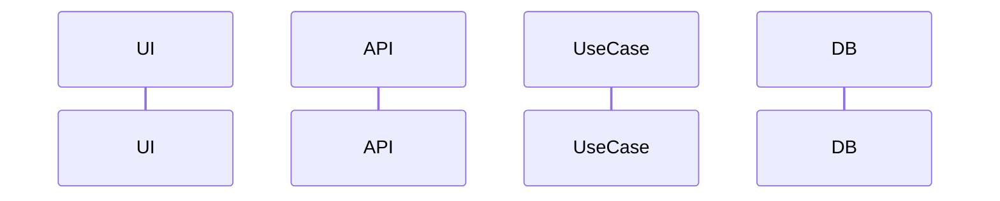

# NNN — Nome da funcionalidade · Design técnico

- **Status**: Rascunho
- **Requisitos**: [requirements.md](requirements.md)
- **Revisão de arquitetura**: pendente
- **Revisão de segurança**: pendente

## Solução proposta

Resumo da abordagem em poucos parágrafos.

## Componentes envolvidos

| Projeto Nx                  | Camada | Mudança |
| --------------------------- | ------ | ------- |
| `libs/backend/<ctx>/domain` | domain |         |

## Fluxo de dados

## Modelo de domínio

Entidades, value objects, invariantes e eventos de domínio.

## Modelagem de dados

Mudanças em `prisma/models/<contexto>.prisma` (tabelas, colunas, índices, constraints), classificação aditiva/destrutiva e plano de migração.

## Contratos

### Endpoints

| Método | URI | Auth | Permissão | Request | Response | Erros |
| ------ | --- | ---- | --------- | ------- | -------- | ----- |

### Eventos

| Evento | Tipo (domínio/integração) | Payload | Consumidores |
| ------ | ------------------------- | ------- | ------------ |

## Segurança

- Autenticação e autorização (papel + recurso):
- Tenant isolation (como `organizationId` é garantido):
- Validação de entrada, exposição de dados, rate limit:
- Ameaças consideradas e mitigação:

## Concorrência e consistência

Versionamento, transações (fronteira), idempotência, ordem de efeitos pós-commit.

## Frontend

Rotas, componentes, estado, estados de UI, acessibilidade.

## Observabilidade

Logs, métricas e eventos de auditoria relevantes.

## Decisões arquiteturais

| Decisão | Alternativas | Escolha e motivo | ADR |
| ------- | ------------ | ---------------- | --- |

## Riscos

| Risco | Probabilidade | Impacto | Mitigação |
| ----- | ------------- | ------- | --------- |
